import SectionHeader from '@components/blog/SectionHeader.astro'
import Text from '@components/base/text.astro'
import TagList from '@components/base/TagList.astro'
import SectionTitle from '@components/blog/SectionTitle.astro'
import HighLight from '@components/base/Highlight.astro'
import Note from '@components/base/Note.astro'
import { Icon } from 'astro-icon/components'
import Title from '@components/base/Title.astro'
import Link from '@components/base/Link.astro'
import Table from '@components/base/Table.astro'
import MaturityBadge from '@components/articles/MaturityBadge.astro'
import DecisionCard from '@components/articles/DecisionCard.astro'
import MechanismCatalog from '@components/articles/MechanismCatalog.astro'
import AxisGrid from '@components/articles/AxisGrid.astro'
import CodeTabs from '@components/base/CodeTabs.astro'
import orchestratorMain from '@/examples/orchestrator-worker/main.py?raw'
import orchestratorSchemas from '@/examples/orchestrator-worker/schemas.py?raw'
import orchestratorPrompts from '@/examples/orchestrator-worker/prompts.py?raw'
import orchestratorLlm from '@/examples/orchestrator-worker/llm.py?raw'
import chainMain from '@/examples/sequential-chain/main.py?raw'
import chainSchemas from '@/examples/sequential-chain/schemas.py?raw'
import chainPrompts from '@/examples/sequential-chain/prompts.py?raw'
import chainLlm from '@/examples/sequential-chain/llm.py?raw'
import routerMain from '@/examples/router/main.py?raw'
import routerSchemas from '@/examples/router/schemas.py?raw'
import routerPrompts from '@/examples/router/prompts.py?raw'
import routerLlm from '@/examples/router/llm.py?raw'
import parallelMain from '@/examples/parallel-branching/main.py?raw'
import parallelSchemas from '@/examples/parallel-branching/schemas.py?raw'
import parallelPrompts from '@/examples/parallel-branching/prompts.py?raw'
import parallelLlm from '@/examples/parallel-branching/llm.py?raw'
import treeMain from '@/examples/hierarchical-tree/main.py?raw'
import treeSchemas from '@/examples/hierarchical-tree/schemas.py?raw'
import treePrompts from '@/examples/hierarchical-tree/prompts.py?raw'
import treeLlm from '@/examples/hierarchical-tree/llm.py?raw'
import allocationMain from '@/examples/dynamic-task-allocation/main.py?raw'
import allocationSchemas from '@/examples/dynamic-task-allocation/schemas.py?raw'
import allocationPrompts from '@/examples/dynamic-task-allocation/prompts.py?raw'
import allocationLlm from '@/examples/dynamic-task-allocation/llm.py?raw'
import peerMain from '@/examples/peer-to-peer/main.py?raw'
import peerSchemas from '@/examples/peer-to-peer/schemas.py?raw'
import peerPrompts from '@/examples/peer-to-peer/prompts.py?raw'
import peerLlm from '@/examples/peer-to-peer/llm.py?raw'
import blackboardMain from '@/examples/blackboard/main.py?raw'
import blackboardSchemas from '@/examples/blackboard/schemas.py?raw'
import blackboardPrompts from '@/examples/blackboard/prompts.py?raw'
import blackboardLlm from '@/examples/blackboard/llm.py?raw'
import busMain from '@/examples/message-bus/main.py?raw'
import busBus from '@/examples/message-bus/bus.py?raw'
import busSchemas from '@/examples/message-bus/schemas.py?raw'
import busPrompts from '@/examples/message-bus/prompts.py?raw'
import busLlm from '@/examples/message-bus/llm.py?raw'


<Note title="Article en cours de rédaction" variant="warning" class="mt-6">
  <HighLight accent="yellow" bold>Note importante :</HighLight> Cet article pose les bases théoriques, les axes de conception et le catalogue des patterns multi-agents. La structure générale est en place, mais l'ensemble est actuellement en cours d'enrichissement. 
  
  En parallèle des tests pratiques réalisés sur chaque brique, <HighLight accent="cyan" bold>le ton et la rédaction de l'article seront prochainement retravaillés</HighLight> pour s'éloigner du premier jet brut et s'adapter à une voix plus personnelle et terrain. Les retours d'expérience, les frictions rencontrées et les benchmarks détaillés enrichiront le contenu au fil de mes expérimentations. Cet article est donc consultable à titre informatif en attendant sa version définitive.
</Note>

<SectionHeader sectionId="intro" label="intro" />

<Text>Quand j'ai commencé à m'intéresser aux systèmes multi-agents, j'ai fait une erreur de lecture qui me semble assez répandue : imaginer un catalogue de patterns parmi lesquels il faudrait <HighLight accent="yellow" bold>choisir</HighLight>. Comme si l'on devait opter pour « le » pattern adapté à son problème, à la manière d'un design pattern classique.</Text>

<Text>En creusant, j'ai compris les choses autrement. Les mécanismes que nous allons parcourir ne sont pas vingt architectures mutuellement exclusives : ce sont des <HighLight accent="cyan" bold>briques composables</HighLight>. D'après les retours publiés (Anthropic, Microsoft, LangGraph…), un même système réel en combine souvent trois ou quatre, à des niveaux différents. Un routeur, un orchestrateur et une boucle de vérification peuvent parfaitement cohabiter — cela ne fait pas « trois architectures », mais <HighLight accent="cyan" bold>une</HighLight> architecture assemblée à partir de trois mécanismes.</Text>

<Text>Cet article rassemble la grille de lecture que je me suis construite pour comprendre comment on <HighLight accent="green" bold>conçoit</HighLight>, <HighLight accent="green" bold>évalue</HighLight> et <HighLight accent="green" bold>exploite</HighLight> un système LLM multi-agents. Et, tout aussi important, comment savoir <HighLight accent="red" bold>quand ne pas en construire</HighLight>.</Text>

<Text>Précision importante : <strong class="text-text-secondary">je n'ai pas mis de système multi-agents en production</strong>. Ce qui suit est une synthèse de mes lectures (articles d'Anthropic, de Microsoft, de LangGraph, papiers de recherche — voir les références en fin d'article) et de petites expérimentations menées pour cet article. Prenez-le comme les notes structurées de quelqu'un qui apprend le sujet, pas comme un retour d'expert.</Text>

<TagList tags={[
  { label: 'Agents IA' },
  { label: 'Multi-Agents', variant: 'green' },
  { label: 'Architecture', variant: 'purple' },
  { label: 'Orchestration', variant: 'red' },
]} />

<Note title="La règle d'or" variant="info">
  Le conseil qui revient dans quasiment toutes les sources que j'ai lues : <HighLight accent="green" bold>commencer simple.</HighLight> Un seul LLM bien prompté — éventuellement avec de la recherche documentaire — résoudrait la majorité des cas. On n'ajoute des agents, de la coordination ou des boucles que si un <HighLight accent="yellow" bold>besoin mesurable</HighLight> le justifie. Tout système multi-agents échange de la latence, du coût et de la complexité opérationnelle contre un gain de performance qu'il faut <HighLight accent="yellow" bold>démontrer</HighLight>.
</Note>

<SectionHeader sectionId="vocabulaire" label="01" />

<SectionTitle>Vocabulaire : <HighLight accent="purple">de quoi parle-t-on vraiment ?</HighLight></SectionTitle>

<Text>Le mot « agent » recouvre des choses très différentes selon qui l'emploie. Avant de parler d'architectures, j'ai trouvé utile de fixer un vocabulaire. Les conventions ci-dessous sont celles que je retiens pour cet article : elles ne sont pas universelles, mais elles m'ont aidé à y voir plus clair.</Text>

<Table
  headers={[{ label: 'Terme' }, { label: 'Définition retenue' }]}
  rows={[
    ['Appel LLM', 'Une inférence unique : un prompt entre, une sortie sort. Aucun état, aucune boucle.'],
    ['Rôle', 'Les responsabilités et consignes attribuées à un composant (persona, instructions, contraintes). Un rôle est une technique de prompt, pas une unité d\'exécution autonome.'],
    ['Agent', 'Une unité d\'exécution capable de poursuivre un objectif au moyen d\'un modèle, d\'outils et d\'une boucle de contrôle. Il peut disposer d\'un état, d\'une mémoire, de permissions et décider de ses prochaines actions.'],
    ['Workflow', 'Le mécanisme qui définit comment les étapes s\'enchaînent (souvent en code déterministe).'],
    ['Système multi-agents', 'Un système où plusieurs unités agentiques collaborent ou se coordonnent.'],
  ]}
/>

<SectionHeader sectionId="agent-appel" label="01.1" />

<Title size={3}>Agent vs appel LLM</Title>

<Text>Un <HighLight accent="cyan" bold>agent</HighLight> n'est pas un appel à un modèle avec un prompt différent. Ce qui le distingue :</Text>

<ul class="space-y-2 my-4 ml-6">
  <li class="flex items-start gap-3 text-text-muted text-[15px] leading-[1.8]">
    <span class="mt-[10px] shrink-0 size-2 rounded-full bg-accent-cyan"></span>
    un <strong class="text-text-secondary">état</strong> qui persiste entre les étapes ;
  </li>
  <li class="flex items-start gap-3 text-text-muted text-[15px] leading-[1.8]">
    <span class="mt-[10px] shrink-0 size-2 rounded-full bg-accent-cyan"></span>
    une <strong class="text-text-secondary">boucle d'exécution</strong> (observer → décider → agir) ;
  </li>
  <li class="flex items-start gap-3 text-text-muted text-[15px] leading-[1.8]">
    <span class="mt-[10px] shrink-0 size-2 rounded-full bg-accent-cyan"></span>
    des <strong class="text-text-secondary">outils</strong> et des <strong class="text-text-secondary">permissions</strong> ;
  </li>
  <li class="flex items-start gap-3 text-text-muted text-[15px] leading-[1.8]">
    <span class="mt-[10px] shrink-0 size-2 rounded-full bg-accent-cyan"></span>
    une <strong class="text-text-secondary">mémoire</strong> éventuelle ;
  </li>
  <li class="flex items-start gap-3 text-text-muted text-[15px] leading-[1.8]">
    <span class="mt-[10px] shrink-0 size-2 rounded-full bg-accent-cyan"></span>
    la capacité de <strong class="text-text-secondary">décider de ses prochaines actions</strong>.
  </li>
</ul>

<Note title="Conséquence directe">
  Appeler quatre fois le même modèle avec quatre prompts différents ne crée pas nécessairement quatre agents autonomes au sens architectural. Plusieurs mécanismes de cet article (vote, débat, personas, évaluateur) sont souvent présentés comme « multi-agents » alors qu'ils reposent sur de simples appels LLM différenciés. Cette distinction me semble importante : elle a des conséquences sur la robustesse, le coût et la testabilité du système.
</Note>

<SectionHeader sectionId="continuum" label="01.2" />

<Title size={3}>Workflows et agents : un continuum</Title>

<Text>La distinction popularisée par <Link href="https://www.anthropic.com/engineering/building-effective-agents">Anthropic</Link> est un bon point de départ :</Text>

<div class="grid grid-cols-1 sm:grid-cols-2 gap-4 my-6">
  <div class="rounded-card border border-border bg-surface-card p-4">
    <div class="flex items-center gap-2 mb-2">
      <Icon name="lucide:workflow" class="size-[18px] text-accent-cyan" />
      <span class="text-[15px] font-semibold text-text-primary">Workflows</span>
    </div>
    <p class="text-[13px] text-text-muted leading-[1.6]">Le LLM est orchestré par des chemins de code prédéfinis (enchaînement, routage, parallélisation). <strong class="text-accent-green">Prévisibles</strong>, <strong class="text-accent-green">économiques</strong>, adaptés aux tâches bien définies.</p>
  </div>
  <div class="rounded-card border border-border bg-surface-card p-4">
    <div class="flex items-center gap-2 mb-2">
      <Icon name="lucide:bot" class="size-[18px] text-accent-purple" />
      <span class="text-[15px] font-semibold text-text-primary">Agents</span>
    </div>
    <p class="text-[13px] text-text-muted leading-[1.6]">Le LLM décide lui-même de ses étapes et de l'usage de ses outils. <strong class="text-accent-yellow">Flexibles</strong>, mais <strong class="text-accent-red">coûteux</strong> en tokens et en latence.</p>
  </div>
</div>

<Text>Mais on la lit souvent comme un choix binaire, alors que les deux se mélangent facilement :</Text>

<ul class="space-y-2 my-4 ml-6">
  <li class="flex items-start gap-3 text-text-muted text-[15px] leading-[1.8]">
    <span class="mt-[10px] shrink-0 size-2 rounded-full bg-accent-purple"></span>
    on peut avoir un <strong class="text-text-secondary">workflow déterministe dont certaines étapes</strong> font appel à un agent autonome ;
  </li>
  <li class="flex items-start gap-3 text-text-muted text-[15px] leading-[1.8]">
    <span class="mt-[10px] shrink-0 size-2 rounded-full bg-accent-purple"></span>
    on peut laisser un <strong class="text-text-secondary">superviseur choisir dynamiquement</strong> parmi des branches préconstruites, sans lui permettre de modifier librement tout le système ;
  </li>
  <li class="flex items-start gap-3 text-text-muted text-[15px] leading-[1.8]">
    <span class="mt-[10px] shrink-0 size-2 rounded-full bg-accent-purple"></span>
    la même application peut être « workflow » pour 90 % du trafic et « agent » pour les 10 % de cas complexes.
  </li>
</ul>

<Note title="La question qui m'a le plus aidé" variant="info">
  Plutôt que « workflow <em>ou</em> agent ? », je trouve plus utile de se demander : <HighLight accent="green" bold>quelles décisions confions-nous au modèle, et lesquelles gardons-nous dans du code déterministe ?</HighLight> C'est le fil rouge de cet article.
</Note>

<SectionHeader sectionId="regle-or" label="01.3" />

<Title size={3}>La règle d'or</Title>

<Text>Les sources que j'ai consultées convergent : un seul LLM bien prompté (+ retrieval) couvrirait la majorité des besoins. L'idée est de n'ajouter de la coordination que si un besoin mesurable le justifie — et de comparer à une <HighLight accent="cyan" bold>baseline mono-agent</HighLight> qui répond aux mêmes exigences fonctionnelles, de sécurité et de service.</Text>

<SectionHeader sectionId="axes" label="02" />

<SectionTitle>Les <HighLight accent="cyan">axes de conception</HighLight></SectionTitle>

<Text>Plutôt que de choisir « un pattern », je trouve plus parlant de décrire un système en positionnant chaque mécanisme sur des axes <HighLight accent="cyan" bold>distincts mais interdépendants</HighLight>. Un système se décrit par un <HighLight accent="cyan" bold>vecteur</HighLight> sur ces axes, pas par un nom unique.</Text>

<AxisGrid />

<Note title="Pourquoi « interdépendants » ?" variant="warning">
  Les axes restent utiles pour structurer la conception, mais ils ne sont pas orthogonaux : un routeur peut mettre en œuvre une cascade de modèles (ressources), un orchestrateur peut décider de paralléliser (décomposition), une restriction d'accès peut être déclenchée par le routage (capacités/sécurité). C'est une <strong class="text-text-secondary">grille de lecture</strong>, pas un espace mathématique.
</Note>

<Text>Trois mécanismes agissent souvent au même niveau et il faut éviter de les confondre : <HighLight accent="yellow">qui décide</HighLight> (le contrôle), <HighLight accent="green">comment on découpe</HighLight> (la décomposition), et <HighLight accent="pink">comment les composants se parlent et partagent un état</HighLight> (la communication). Un orchestrateur qui délègue en parallèle mobilise les trois à la fois.</Text>

<SectionHeader sectionId="catalogue" label="03" />

<SectionTitle>Le catalogue des <HighLight accent="purple">20 entrées</HighLight></SectionTitle>

<Text>Voici les vingt entrées du catalogue, regroupées par fonction. Attention : il s'agit d'un <HighLight accent="yellow" bold>point d'entrée</HighLight> vers le reste de l'article, <HighLight accent="red" bold>pas d'une règle de décision</HighLight>. Le n°19 regroupe en réalité deux techniques distinctes (speculative decoding et draft-and-verify), comme nous le verrons.</Text>

<MechanismCatalog />

<Note title="Comment lire les statuts de maturité" variant="warning">
  La colonne de maturité est une <strong class="text-text-secondary">appréciation personnelle et volontairement grossière</strong>, construite à partir de mes lectures, pas d'une expérience de terrain. Elle mélange quatre dimensions qu'il faudrait idéalement évaluer séparément : maturité technique, adoption, niveau de preuve et généralisation. Et gardons en tête que <HighLight accent="red" bold>l'adoption n'est pas la qualité</HighLight>. Qu'un mécanisme ou un framework soit massivement utilisé démontre qu'il est utilisé, pas qu'il améliore la qualité ou le coût.
</Note>

<SectionHeader sectionId="contrat" label="03.1" />

<Title size={3}>Le contrat d'une tâche déléguée</Title>

<Text>Pour qu'un worker soit testable et remplaçable, il me paraît utile d'encadrer chaque tâche déléguée par un <HighLight accent="green" bold>contrat explicite</HighLight>. Voici les éléments que je retiens :</Text>

<Table
  headers={[{ label: "Élément du contrat" }, { label: "Question à laquelle il répond" }]}
  rows={[
    ['Objectif', 'Que doit accomplir le worker ?'],
    ['Entrées autorisées', 'Quelles données ou quels états peut-il consommer ?'],
    ['Format de sortie', 'Quel schéma de sortie est attendu (JSON, fichier, rapport) ?'],
    ['Preuves requises', 'Quelles références ou vérifications doit-il fournir avec le résultat ?'],
    ['Budget', "Combien d'appels, de tokens et d'étapes au maximum ?"],
    ["Conditions d'échec", "Quand s'arrête-t-il en échec, proprement, plutôt que de bricoler ?"],
    ["Critères d'acceptation", 'Comment la sortie sera-t-elle validée par le composant appelant ?'],
  ]}
/>

<Text>Sans ce contrat, un worker risque de n'être qu'un « prompt décrit dans un paragraphe » : difficile à tester isolément, à remplacer, à auditer. Le contrat est le pendant concret des <HighLight accent="green">tests déterministes</HighLight> de la section Evaluator-Optimizer.</Text>

<SectionHeader sectionId="code-modele" label="03.2" />

<Title size={3}>Code déterministe vs décision du modèle</Title>

<Text>La question « quelles décisions pour le modèle, lesquelles pour le code ? » gagne, à mon sens, à devenir un <HighLight accent="cyan" bold>réflexe systématique</HighLight>, posé à chaque étape. Voici la répartition qui ressort de mes lectures :</Text>

<Table
  headers={[{ label: 'Décision' }, { label: 'Imposée par le code' }, { label: 'Confiée au modèle' }]}
  rows={[
    ['Routage de base', 'règles, embeddings, seuils calibrés', 'cas ambigus, hors périmètre'],
    ["Contrôle d'accès", 'permissions, ACL, sandbox', 'jamais'],
    ['Validation de schéma', 'parseurs, schémas, compilateurs', "cas où l'interprétation sémantique est requise"],
    ['Budgets, timeouts, retries', 'infrastructure', 'jamais'],
    ['Interprétation / adaptation', '—', 'résumé, réécriture, analyse, planification'],
  ]}
/>

<Note title="Le principe que je retiens" variant="info">
  <strong class="text-text-secondary">Ce qui est déterminable, vérifiable et répétable va dans le code ; ce qui demande interprétation, nuance ou adaptation va au modèle.</strong> D'après les recommandations de sécurité que j'ai lues, c'est aussi une défense importante : un agent ne devrait <HighLight accent="red" bold>jamais</HighLight> être le juge de ses propres permissions.
</Note>

<SectionHeader sectionId="controle" label="04" />

<SectionTitle>Contrôle & <HighLight accent="cyan">coordination</HighLight></SectionTitle>

<Text>Ces mécanismes répondent à : <HighLight accent="cyan" bold>qui pilote qui, et comment les agents se parlent</HighLight>.</Text>

<SectionHeader sectionId="orchestrator" label="04.1" />

<div class="mb-4 flex flex-wrap items-center gap-2.5 sm:gap-3 [&>div]:mb-0">
  <MaturityBadge level="Éprouvé" />
  <Title size={3}>Orchestrator-Worker</Title>
</div>

<Text>Un agent central — l'<HighLight accent="cyan" bold>orchestrateur</HighLight> — reçoit la tâche globale, la découpe en sous-tâches, les <HighLight accent="cyan" bold>délègue à des workers spécialisés</HighLight>, puis collecte, filtre et agrège leurs résultats. Contrairement à la parallélisation simple, les sous-tâches ne sont <strong class="text-text-secondary">pas prédéfinies</strong> : l'orchestrateur décide dynamiquement quoi déléguer.</Text>

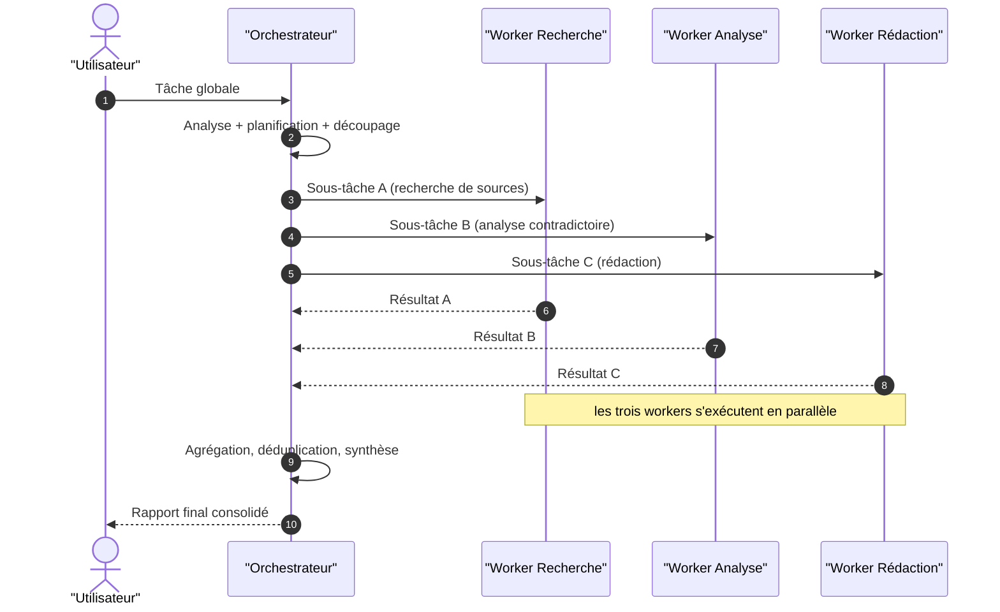

<Text><strong class="text-text-primary">Exemple concret.</strong> Génération d'un rapport de veille : « comparez le positionnement de deux constructeurs aéronautiques ». L'orchestrateur lance en parallèle un worker de recherche, un worker d'analyse financière et un worker de revue de presse, puis produit une synthèse sourcée.</Text>

<Note variant="warning">
  L'agrégation est le point de fragilité : il faut des règles de <strong class="text-text-secondary">provenance</strong> (d'où vient l'information ?) et une gestion explicite des <strong class="text-text-secondary">contradictions</strong>. Un bon découpage isole aussi les tâches pour limiter la contamination contextuelle.
</Note>

<Text><strong class="text-text-primary">En code.</strong> Triage d'un backlog d'issues produit, mélangées et parfois en double. L'orchestrateur lit le backlog et décide seul du plan : <HighLight accent="cyan">quel worker</HighLight> traite quoi (bug, feature ou refacto), <HighLight accent="cyan">comment regrouper</HighLight> les doublons et <HighLight accent="cyan">combien</HighLight> de workers lancer. Chaque worker a son propre prompt, son propre modèle, son propre effort et son propre format de sortie. Implémentation réécrite à partir du <Link href="https://github.com/anthropics/claude-cookbooks/blob/main/patterns/agents/orchestrator_workers.ipynb">cookbook Anthropic</Link>.</Text>

<CodeTabs title="Exemple" files={[
  { name: 'main.py', lang: 'python', code: orchestratorMain, description: "Config des agents, backlog mocké et orchestration : un appel à l'orchestrateur, puis les workers en parallèle." },
  { name: 'schemas.py', lang: 'python', code: orchestratorSchemas, description: 'Les contrats de données : le plan produit par l\'orchestrateur et les sorties typées de chaque worker.' },
  { name: 'prompts.py', lang: 'python', code: orchestratorPrompts, description: "Les prompts système de l'orchestrateur et des workers." },
  { name: 'llm.py', lang: 'python', code: orchestratorLlm, description: 'L\'appel LLM unique via le SDK Anthropic : modèle, effort et schéma de sortie propres à chaque agent.' },
]} />

<Note title="À retenir" variant="info">
  <strong class="text-text-secondary">Le modèle décide, le code exécute</strong> : l'orchestrateur choisit un type de worker dans un Enum fermé, c'est le code qui l'associe à une config. <strong class="text-text-secondary">Isolation de contexte</strong> : un worker ne voit que ses issues et la consigne de l'orchestrateur, ce champ <code>instructions</code> est donc le seul canal entre les deux. Ici, pas d'agrégation : l'exemple s'arrête à la délégation pour ne montrer que le pattern.
</Note>

<DecisionCard accent="cyan" items={[
  { label: 'Problème résolu', value: 'Tâche complexe et imprévisible, décomposable, nécessitant plusieurs expertises.' },
  { label: "Quand l'employer", value: "La structure du travail n'est pas connue à l'avance. Des sous-tâches indépendantes permettent le parallélisme ; des sous-tâches dépendantes restent possibles via une exécution en plusieurs vagues." },
  { label: 'Alternatives plus simples', value: 'Un appel unique bien prompté ; une chaîne fixe si les étapes sont connues.' },
  { label: 'Coûts', value: "Latence de planification et d'agrégation, attente du worker le plus lent, multiplication des tokens (chaque worker re-prompt le contexte)." },
  { label: 'Modes de défaillance', value: 'Mauvais découpage ; agrégation qui propage ou masque une erreur ; goulot si l\'orchestrateur devient un point unique.' },
  { label: 'Garanties', value: 'Aucune garantie de justesse globale ; traçabilité des sous-résultats possible.' },
  { label: "Comment l'évaluer", value: 'Comparer à une baseline mono-agent sur le même jeu ; mesurer le gain par sous-tâche, pas seulement sur la sortie finale.' },
]} />

<SectionHeader sectionId="chain" label="04.2" />

<div class="mb-4 flex flex-wrap items-center gap-2.5 sm:gap-3 [&>div]:mb-0">
  <MaturityBadge level="Éprouvé" />
  <Title size={3}>Sequential Chain</Title>
</div>

<Text>Les étapes interviennent <strong class="text-text-secondary">les unes après les autres</strong> : la sortie de l'étape N devient l'entrée de l'étape N+1. C'est le mécanisme le plus simple : <HighLight accent="green">linéaire, déterministe, prévisible</HighLight>. On y ajoute souvent des <HighLight accent="green">gates</HighLight> de qualité entre les étapes.</Text>

<Note title="Au sens du glossaire" variant="info">
  C'est un <strong class="text-text-secondary">workflow multi-appels</strong> : chaque maillon peut être un simple appel LLM sans boucle de contrôle. On ne parle d'agents que si une étape dispose d'un état, d'outils autonomes ou d'une décision dynamique.
</Note>

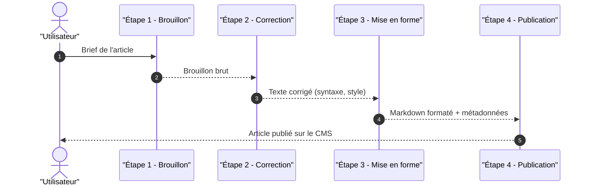

<Text><strong class="text-text-primary">En code.</strong> Transformer les commits d'une release en annonce pour les utilisateurs. La chaîne passe progressivement du technique au grand public : un <HighLight accent="green">tri</HighLight> classe chaque commit (feature, fix ou interne), une étape de <HighLight accent="green">release notes</HighLight> rédige les nouveautés et corrections en ignorant l'interne, puis une étape d'<HighLight accent="green">annonce</HighLight> en tire un message court. Chaque étape a son propre prompt, son propre modèle, son propre effort et son propre format de sortie.</Text>

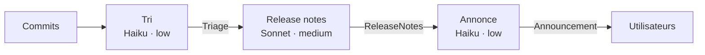

<CodeTabs title="Exemple" files={[
  { name: 'main.py', lang: 'python', code: chainMain, description: "Config des trois étapes, commits mockés et la chaîne : chaque appel reçoit la sortie du précédent." },
  { name: 'schemas.py', lang: 'python', code: chainSchemas, description: 'Les contrats entre les maillons : la sortie typée de chaque étape est l\'entrée de la suivante.' },
  { name: 'prompts.py', lang: 'python', code: chainPrompts, description: 'Les prompts système des trois étapes.' },
  { name: 'llm.py', lang: 'python', code: chainLlm, description: 'Le même appel LLM unique que pour l\'Orchestrator-Worker : un maillon de chaîne est une config comme une autre.' },
]} />

<Note title="À retenir" variant="info">
  <strong class="text-text-secondary">Le schéma est le contrat entre deux maillons</strong> : l'étape N+1 reçoit la sortie JSON de l'étape N, telle quelle. <strong class="text-text-secondary">Chaque maillon ne voit que son prédécesseur</strong> : les release notes ne voient jamais les commits bruts, l'annonce ne voit jamais le tri. L'exemple est volontairement placé dans le meilleur des mondes : pas de gate de qualité ni de gestion d'erreur. En production, un commit mal classé au tri se propagerait jusqu'à l'annonce sans qu'aucune étape ne s'en aperçoive.
</Note>

<DecisionCard accent="cyan" items={[
  { label: 'Problème résolu', value: 'Transformation séquentielle en étapes clairement identifiables.' },
  { label: "Quand l'employer", value: "Le flux est stable, connu à l'avance, et chaque étape a un contrat de sortie vérifiable." },
  { label: 'Alternatives plus simples', value: 'Un seul appel avec des étapes explicites dans le prompt ; du code déterministe pur.' },
  { label: 'Coûts', value: 'Séquence sans parallélisme ; contexte cumulé si chaque étape reçoit tout l\'historique.' },
  { label: 'Modes de défaillance', value: "Propagation d'erreur en cascade (hallucination amplifiée) ; blocage si une étape échoue sans retry." },
  { label: 'Garanties', value: 'Déterminisme du flux (pas de la sortie) ; coûts et difficultés estimables.' },
  { label: "Comment l'évaluer", value: "Mesurer la qualité par étape et l'impact d'une erreur amont sur la sortie finale." },
]} />

<SectionHeader sectionId="router" label="04.3" />

<div class="mb-4 flex flex-wrap items-center gap-2.5 sm:gap-3 [&>div]:mb-0">
  <MaturityBadge level="Éprouvé" />
  <Title size={3}>Router</Title>
</div>

<Text>Une couche de <HighLight accent="cyan" bold>routage</HighLight> classe la requête (intention, thème, difficulté) et la redirige vers <strong class="text-text-secondary">un seul</strong> sous-système expert. Contrairement à l'orchestrateur : ni découpage, ni agrégation. Le routeur est souvent doublé : un <HighLight accent="green">classifieur léger</HighLight> fait le premier tri, et un LLM prend le relais en cas de faible confiance (voir Cascade de modèles).</Text>

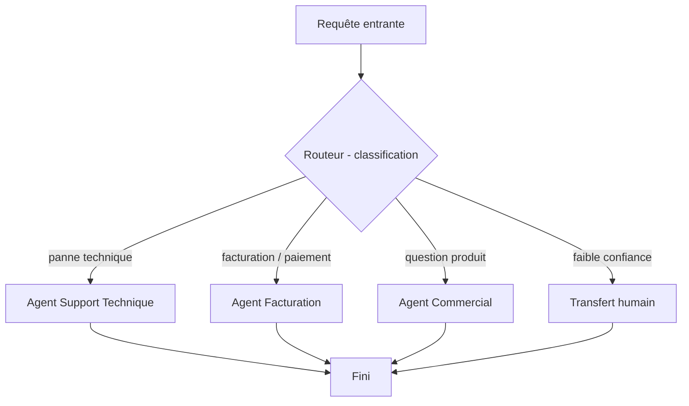

<Note title="Attention au cas ambigus" variant="warning">
  Viser des catégories <em>disjointes et exhaustives</em> en langage naturel semble illusoire : une requête peut relever de deux domaines à la fois (« facturation » <strong class="text-text-secondary">et</strong> « incident technique »). D'où l'intérêt d'une <HighLight accent="yellow">route de repli explicite</HighLight> (clarification, transfert humain) et d'un seuil de confiance calibré sur un jeu de validation.
</Note>

<Text><strong class="text-text-primary">En code.</strong> Aiguiller des questions de développeurs selon leur difficulté. Un <HighLight accent="cyan">classifieur</HighLight> léger pose une étiquette sur chaque question sans y répondre, puis le code l'envoie vers <HighLight accent="cyan">un seul expert</HighLight> dimensionné pour elle : une réponse rapide, un diagnostic de bug ou une proposition d'architecture. Les questions trop vagues prennent la <HighLight accent="yellow">route de repli</HighLight> : aucun LLM, un humain. Chaque expert a son propre prompt, son propre modèle, son propre effort et son propre format de sortie.</Text>

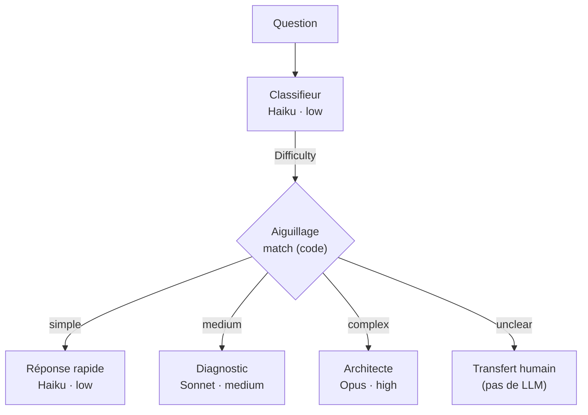

<CodeTabs title="Exemple" files={[
  { name: 'main.py', lang: 'python', code: routerMain, description: "Config du classifieur et des experts, questions mockées et le routage : un appel au classifieur, puis un match vers une seule route." },
  { name: 'schemas.py', lang: 'python', code: routerSchemas, description: "L'étiquette du classifieur (un Enum fermé) et la sortie typée de chaque expert." },
  { name: 'prompts.py', lang: 'python', code: routerPrompts, description: 'Le prompt du classifieur et ceux des trois experts.' },
  { name: 'llm.py', lang: 'python', code: routerLlm, description: 'Le même appel LLM unique que pour les patterns précédents : classifieur et experts sont des configs comme les autres.' },
]} />

<Note title="À retenir" variant="info">
  <strong class="text-text-secondary">Routeur = classifieur + aiguillage</strong> : le LLM rend une étiquette dans un Enum fermé, c'est le <code>match</code> du code qui choisit l'expert. <strong class="text-text-secondary">Le classifieur ne parle jamais à l'expert</strong> : l'expert reçoit la question brute, contrairement aux workers de l'orchestrateur qui reçoivent des consignes rédigées. <strong class="text-text-secondary">Une route n'est pas forcément un agent</strong> : <code>unclear</code> part chez un humain. L'exemple est volontairement placé dans le meilleur des mondes : pas de seuil de confiance calibré ni de gestion d'erreur. En production, une question complexe envoyée à Haiku donnerait une réponse médiocre sans aucune erreur visible.
</Note>

<DecisionCard accent="cyan" items={[
  { label: 'Problème résolu', value: 'Volume élevé de requêtes hétérogènes à trier avant traitement.' },
  { label: "Quand l'employer", value: 'Les catégories sont stables et les routes ont des coûts ou qualités différents.' },
  { label: 'Alternatives plus simples', value: 'Règles, expressions régulières ou un unique modèle généraliste.' },
  { label: 'Coûts', value: 'Coût du classifieur ; maintenance des routes ; coût caché des erreurs de classification.' },
  { label: 'Modes de défaillance', value: 'Route erronée vers une impasse ; dérive de la distribution des requêtes ; route de repli absente.' },
  { label: 'Garanties', value: 'Isolation par domaine (prompt, outils, permissions) ; pas de vision globale multi-expert.' },
  { label: "Comment l'évaluer", value: 'Matrice de confusion du routeur, précision par route, taux de repli, coût moyen par requête.' },
]} />

<SectionHeader sectionId="parallel" label="04.4" />

<div class="mb-4 flex flex-wrap items-center gap-2.5 sm:gap-3 [&>div]:mb-0">
  <MaturityBadge level="Éprouvé" />
  <Title size={3}>Parallel Branching (Fan-Out / Fan-In)</Title>
</div>

<Text>Une tâche est distribuée à plusieurs branches indépendantes (<HighLight accent="cyan">fan-out</HighLight>), puis une étape d'agrégation combine les sorties (<HighLight accent="cyan">fan-in</HighLight>). Deux variantes canoniques : le <strong class="text-text-secondary">sectioning</strong> (chaque branche traite une portion distincte) et le <strong class="text-text-secondary">voting</strong> (plusieurs branches produisent la même sortie — voir Consensus).</Text>

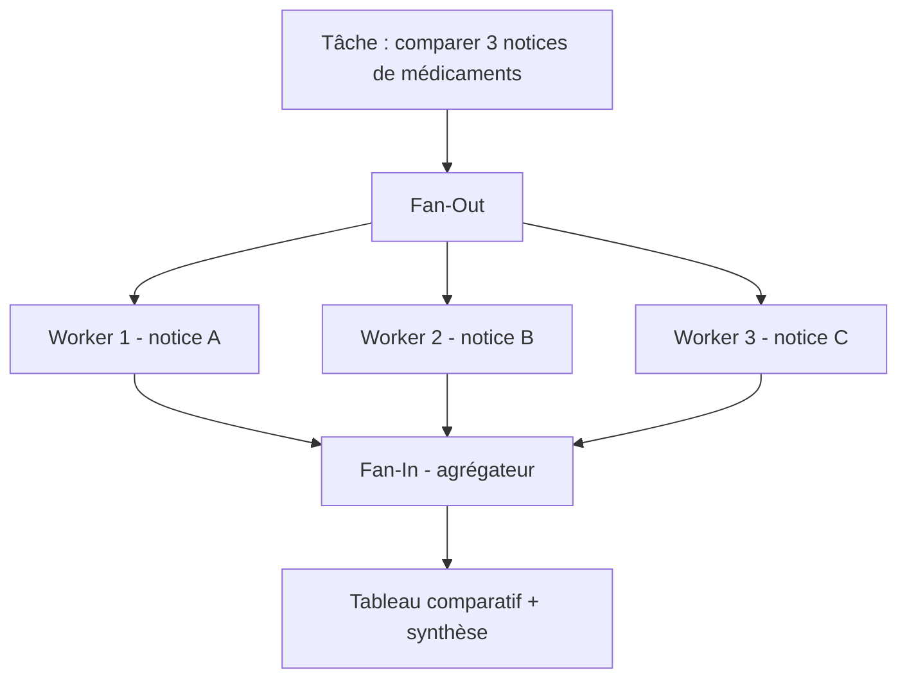

<Text><strong class="text-text-primary">Exemple concret.</strong> Un avocat dépose 40 contrats fournisseurs ; le système les traite par lots en parallèle, chaque worker extrait les clauses de responsabilité, délais et pénalités, puis une synthèse produit un tableau comparatif et signale les clauses atypiques.</Text>

<Text><strong class="text-text-primary">En code.</strong> Traduire les textes d'interface d'une application e-commerce du français vers trois langues, variante <em>sectioning</em>. Le <HighLight accent="cyan">fan-out</HighLight> est écrit en dur : toujours les mêmes trois langues, et <strong class="text-text-secondary">la même</strong> config de traducteur lancée trois fois en parallèle, seule la langue cible change. Le <HighLight accent="cyan">fan-in</HighLight> n'est pas un agent : une ligne de code regroupe les sorties, puis un check déterministe vérifie que les placeholders comme <code>{'{count}'}</code> ont survécu à la traduction.</Text>

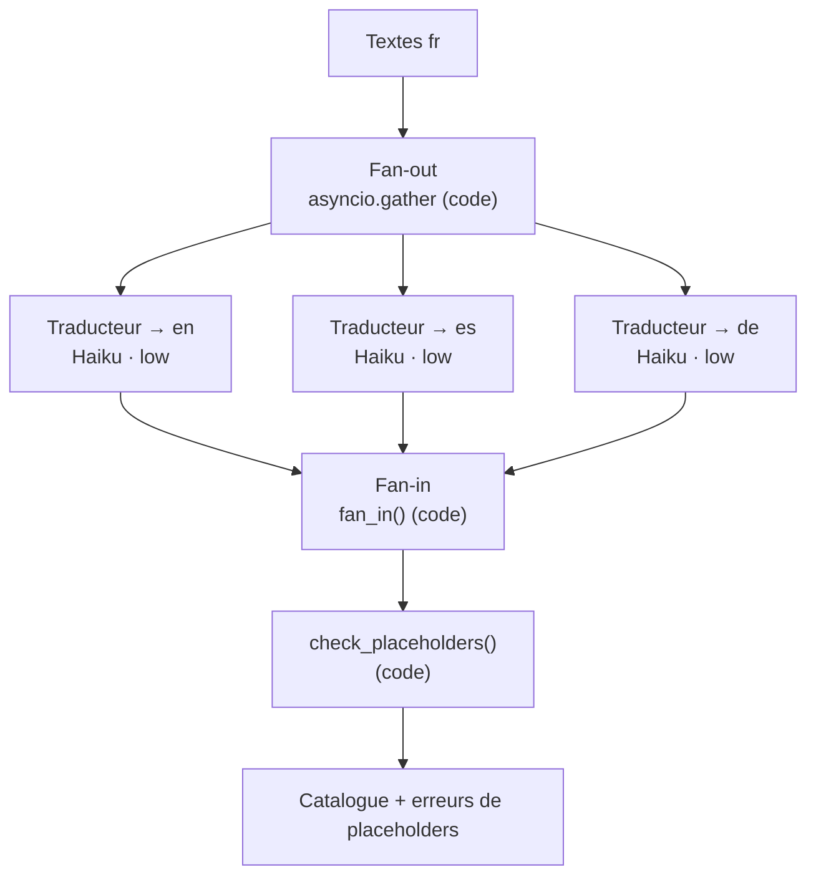

<CodeTabs title="Exemple" files={[
  { name: 'main.py', lang: 'python', code: parallelMain, description: "Config du traducteur, textes mockés, fan-out sur une liste fixe de langues, puis fan-in et check des placeholders en code." },
  { name: 'schemas.py', lang: 'python', code: parallelSchemas, description: "Les langues, la sortie d'une branche et le format d'une erreur de placeholder." },
  { name: 'prompts.py', lang: 'python', code: parallelPrompts, description: 'Un seul prompt, commun aux trois branches.' },
  { name: 'llm.py', lang: 'python', code: parallelLlm, description: 'Le même appel LLM unique que pour les patterns précédents : une branche est une config comme une autre.' },
]} />

<Note title="À retenir" variant="info">
  <strong class="text-text-secondary">Personne ne planifie</strong> : contrairement à l'orchestrateur, aucun LLM ne décide du découpage, le nombre de branches est fixé dans le code. <strong class="text-text-secondary">Les branches sont indépendantes</strong> : chaque traducteur ne voit que la source et sa langue cible, jamais le travail des autres. <strong class="text-text-secondary">Le fan-in peut être du code</strong> : déterministe et gratuit, un LLM n'est utile que s'il faut juger ou fusionner. L'exemple est volontairement placé dans le meilleur des mondes : pas de gestion des échecs partiels ni des rate limits. En production, avec <code>asyncio.gather</code>, une seule branche qui plante fait échouer les trois langues.
</Note>

<DecisionCard accent="cyan" items={[
  { label: 'Problème résolu', value: 'Traiter plusieurs éléments indépendants à la fois, ou produire plusieurs variantes.' },
  { label: "Quand l'employer", value: 'Décomposition naturelle en lots/sections sans dépendance croisée.' },
  { label: 'Alternatives plus simples', value: 'Traitement séquentiel ou boucle simple si le volume est faible.' },
  { label: 'Coûts', value: 'Chaque branche repaye le contexte partagé ; pics d\'API à gérer (rate limits).' },
  { label: 'Modes de défaillance', value: 'Incohérences entre branches ; agrégation qui écrase une information ; surcharge d\'API.' },
  { label: 'Garanties', value: 'Résultats partiels possibles si une branche échoue ; chaque sous-résultat est attribuable.' },
  { label: "Comment l'évaluer", value: "Qualité de l'agrégation, taux de contradictions détectées, gain de latence vs séquentiel." },
]} />

<SectionHeader sectionId="hierarchie" label="04.5" />

<div class="mb-4 flex flex-wrap items-center gap-2.5 sm:gap-3 [&>div]:mb-0">
  <MaturityBadge level="Émergent" />
  <Title size={3}>Hierarchical Tree</Title>
</div>

<Text>Structure à <strong class="text-text-secondary">plusieurs niveaux</strong> : un manager général délègue à des managers intermédiaires, qui pilotent chacun leur équipe. C'est l'extension d'Orchestrator-Worker quand le nombre d'agents devient trop grand pour qu'un seul superviseur garde une vision claire : chaque niveau <HighLight accent="green">réduit la portée de contrôle</HighLight> et compartimente le contexte.</Text>

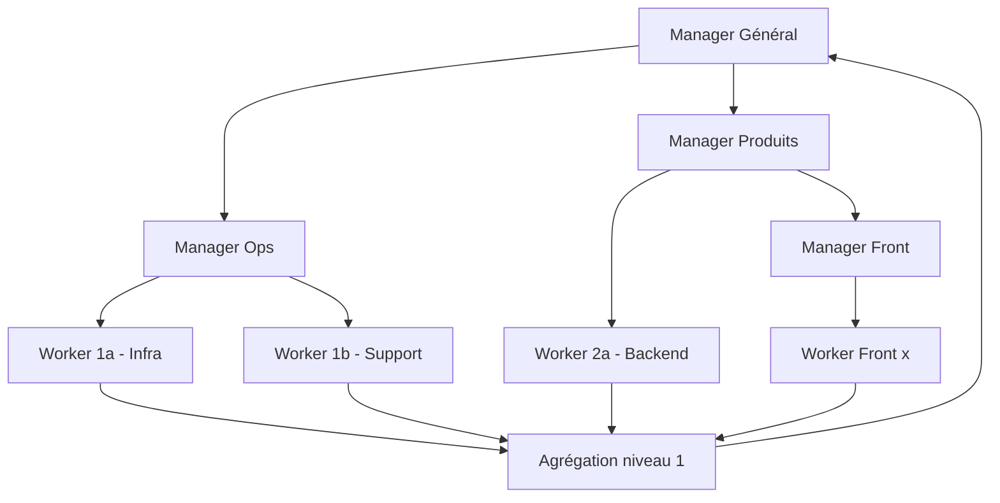

<Note variant="warning">
  Risque de <strong class="text-text-secondary">dérive d'information</strong> : chaque compression entre niveaux peut perdre du détail. Les contrats inter-niveaux (rapports, formats) doivent être stables.
</Note>

<Text><strong class="text-text-primary">En code.</strong> Décider du go / no-go du lancement d'une feature. L'organigramme est <HighLight accent="green">fixé dans le code</HighLight> : un Head of Product, deux managers (Tech, Marketing) et quatre workers. À la <HighLight accent="green">descente</HighLight>, chaque manager rédige une consigne par subordonné ; seuls les workers connaissent les faits du terrain. À la <HighLight accent="green">remontée</HighLight>, chaque manager résume les rapports de son équipe, jusqu'à une décision au sommet. Le modèle baisse en descendant : une décision lourde en haut, des feuilles nombreuses et simples en bas.</Text>

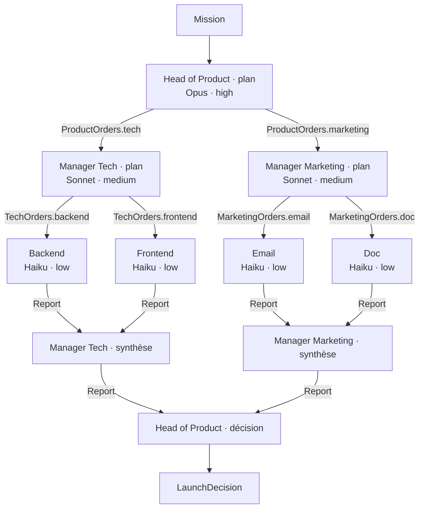

<CodeTabs title="Exemple" files={[
  { name: 'main.py', lang: 'python', code: treeMain, description: "L'organigramme, la mission et les connaissances mockées, et une seule fonction récursive qui parcourt tout l'arbre." },
  { name: 'schemas.py', lang: 'python', code: treeSchemas, description: "Les ordres de chaque manager (un champ par subordonné), le rapport commun à tous les niveaux et la décision finale." },
  { name: 'prompts.py', lang: 'python', code: treePrompts, description: 'Les prompts des trois niveaux : plan et synthèse pour chaque manager, un prompt par worker.' },
  { name: 'llm.py', lang: 'python', code: treeLlm, description: 'Le même appel LLM unique que pour les patterns précédents : managers et workers sont des configs comme les autres.' },
]} />

<Note title="À retenir" variant="info">
  <strong class="text-text-secondary">Le code garde la structure, le LLM écrit le contenu</strong> : un champ par subordonné dans le schéma d'ordres garantit que chacun reçoit exactement une consigne, sans oubli ni subordonné inventé. <strong class="text-text-secondary">Un manager est un worker pour son chef</strong> : il reçoit une mission et rend un <code>Report</code>, d'où une seule fonction <code>run</code> récursive. <strong class="text-text-secondary">La remontée compresse</strong> : dans les logs, on peut suivre ce qu'il reste du « 80 000 factures, pas de pagination » du Backend une fois arrivé au Head of Product. L'exemple est volontairement placé dans le meilleur des mondes : pas de gestion des branches en panne ni de mesure de la perte d'information. En production, un risque bloquant d'une feuille pourrait disparaître dans un résumé sans que personne ne s'en aperçoive.
</Note>

<DecisionCard accent="cyan" items={[
  { label: 'Problème résolu', value: "Coordination de dizaines d'agents dépassant la portée d'un superviseur unique." },
  { label: "Quand l'employer", value: 'Le travail se décompose naturellement en sous-domaines avec un responsable par niveau.' },
  { label: 'Alternatives plus simples', value: 'Un seul orchestrateur tant que le périmètre reste maîtrisable.' },
  { label: 'Coûts', value: 'Latence cumulée à la remontée ; multiplication des appels par niveau.' },
  { label: 'Modes de défaillance', value: "Perte d'information à chaque compression ; empilement de managers inutiles ; dérive du périmètre." },
  { label: 'Garanties', value: 'Isolation de contexte par sous-équipe ; résilience partielle (une branche en panne).' },
  { label: "Comment l'évaluer", value: "Comparer au superviseur unique à budget égal ; mesurer la fidélité de l'information remontée." },
]} />

<SectionHeader sectionId="communication" label="04.6" />

<Title size={3}>Communication : allocation, P2P, blackboard & bus</Title>

<Text>Les mécanismes de communication apportent des garanties qui ne découlent <strong class="text-text-secondary">pas automatiquement</strong> de leur topologie. Il faut distinguer la topologie des agents des garanties du système distribué sous-jacent.</Text>

<div class="mb-4 flex flex-wrap items-center gap-2.5 sm:gap-3 [&>div]:mb-0">
  <MaturityBadge level="Exploratoire" />
  <Title size={3}>Dynamic Task Allocation</Title>
</div>

<Text>Les tâches sont déposées dans un pool central ; chaque agent évalue ses capacités et se porte candidat par une « enchère ». Des travaux récents (<HighLight accent="cyan">AgentLance</HighLight>, <HighLight accent="cyan">Agora</HighLight>) étudient réellement ce mécanisme — mais passer de « des recherches explorent ce mécanisme » à « c'est prêt pour la production » est un <HighLight accent="red" bold>saut non démontré</HighLight>. Une enchère n'a de sens que si les agents ont des compétences ou des coûts réellement différents, si l'on dispose de mesures de performance fiables, et si le coût de l'enchère est inférieur au bénéfice de l'allocation. <strong class="text-text-secondary">Mon intuition à ce stade : une simple file de tâches avec des workers spécialisés devrait suffire dans la grande majorité des cas.</strong></Text>

<Text><strong class="text-text-primary">En code.</strong> Répartir un pool de quatre issues entre trois développeurs de niveaux différents : un junior, un senior et un expert, chacun avec son modèle, son taux horaire et sa <HighLight accent="cyan">capacité</HighLight> (le nombre d'issues qu'il peut prendre). Chaque agent voit tout le pool et rend une <HighLight accent="cyan">offre par issue</HighLight> : les heures qu'il lui faudrait à son niveau, multipliées par son taux. L'<HighLight accent="cyan">attribution</HighLight> n'est pas un agent : le code trie les offres de la moins chère à la plus chère et attribue chaque issue tant que le gagnant a de la capacité. Le même agent intervient deux fois, avec deux prompts : il enchérit, puis traite les issues qu'il a remportées.</Text>

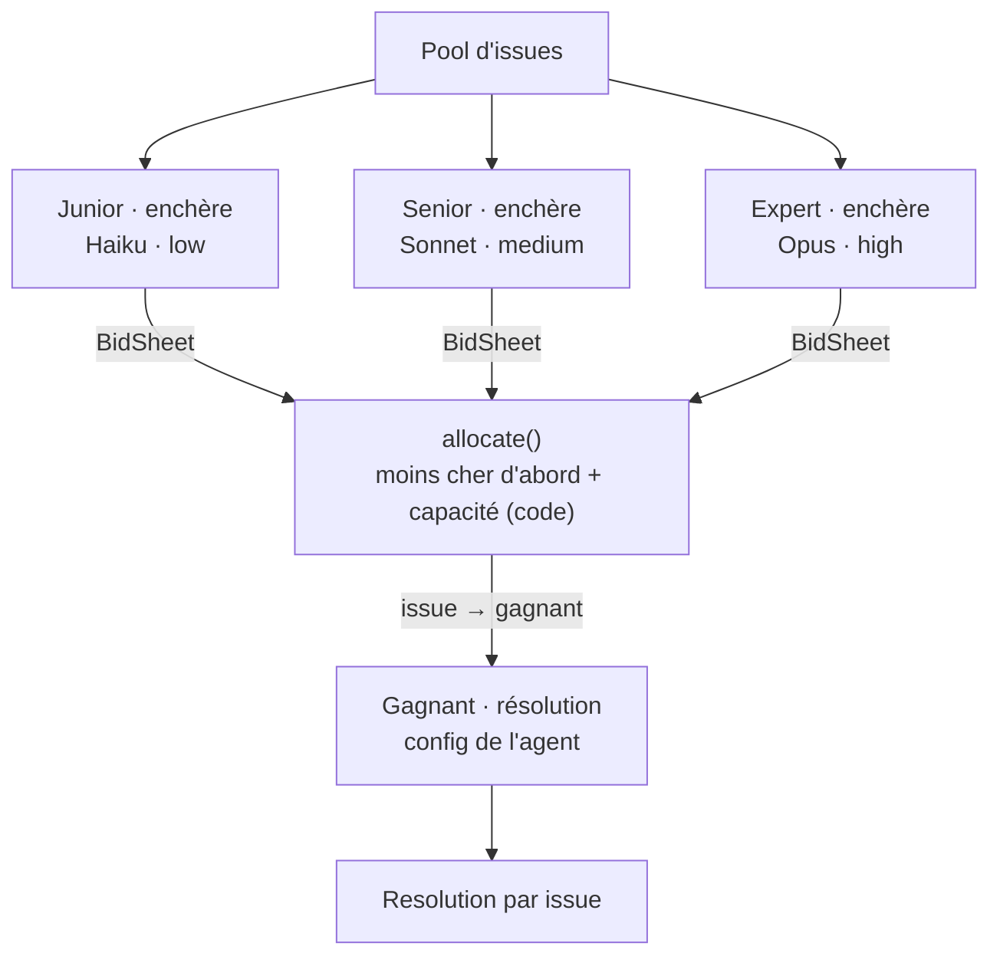

<CodeTabs title="Exemple" files={[
  { name: 'main.py', lang: 'python', code: allocationMain, description: "Les agents (modèle, taux, capacité), le pool d'issues mocké, l'enchère en parallèle, l'attribution en code puis la résolution par les gagnants." },
  { name: 'schemas.py', lang: 'python', code: allocationSchemas, description: "Une issue, une offre (prix et justification), la feuille d'offres d'un agent et la résolution livrée." },
  { name: 'prompts.py', lang: 'python', code: allocationPrompts, description: "Le prompt d'enchère et celui de résolution, paramétrés par le niveau de l'agent." },
  { name: 'llm.py', lang: 'python', code: allocationLlm, description: "Le même appel LLM unique que pour les patterns précédents : enchérisseurs et solveurs sont des configs comme les autres." },
]} />

<Note title="À retenir" variant="info">
  <strong class="text-text-secondary">Le LLM chiffre, le code attribue</strong> : aucun agent ne décide qui prend quoi, il ne fait qu'annoncer un prix. <strong class="text-text-secondary">La capacité force la répartition</strong> : sans elle, le moins cher remporterait tout le pool, quelle que soit la difficulté des issues. <strong class="text-text-secondary">Le prix est auto-déclaré</strong> : rien ne vérifie qu'un junior estime honnêtement le temps qu'il lui faut sur un refacto de 1200 lignes. L'exemple est volontairement placé dans le meilleur des mondes : pas de gestion des issues sans preneur ni de comparaison entre le prix annoncé et la qualité livrée. En production, un agent qui sous-estime systématiquement remporterait les enchères sans que personne ne mesure ce qu'il livre.
</Note>

<div class="mb-4 flex flex-wrap items-center gap-2.5 sm:gap-3 [&>div]:mb-0">
  <MaturityBadge level="Exploratoire" />
  <Title size={3}>Peer-to-Peer</Title>
</div>

<Text>Aucun orchestrateur : les agents communiquent directement et décident à qui transférer le contexte. La coordination est <HighLight accent="purple">émergente</HighLight>. Usage type : négociation acheteur/vendeur. Bénéfice annoncé : pas de point unique de défaillance <em>côté agents</em>. Nuance : supprimer le superviseur ne supprime pas les points uniques de l'<strong class="text-text-secondary">infrastructure</strong>. <strong class="text-accent-red">Aucune garantie de convergence.</strong></Text>

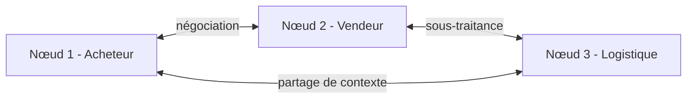

<Text><strong class="text-text-primary">En code.</strong> Un client négocie le développement d'un export CSV de factures avec un freelance. Chaque pair a un <HighLight accent="purple">état privé</HighLight> injecté dans son prompt : le budget et le délai du client, le prix plancher et la disponibilité du freelance. Personne ne distribue la parole : chaque message désigne lui-même son <HighLight accent="purple">destinataire</HighLight> (<code>to</code>), et le code se contente de le livrer. Le freelance peut consulter en coulisses un développeur senior que le client ne voit pas ; ses contacts possibles sont fixés par son schéma. La négociation s'arrête quand un négociateur passe <code>status</code> à <code>accepted</code> ou <code>rejected</code>, ou au bout de <code>MAX_TURNS</code>.</Text>

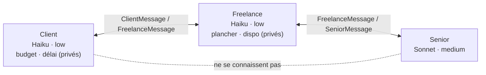

<CodeTabs title="Exemple" files={[
  { name: 'main.py', lang: 'python', code: peerMain, description: "Les pairs et leurs états privés, la livraison d'un message dans l'historique des deux pairs concernés et la boucle bornée par MAX_TURNS." },
  { name: 'schemas.py', lang: 'python', code: peerSchemas, description: "Les pairs, les contacts autorisés de chacun (un enum par pair), le statut de la négociation et les messages." },
  { name: 'prompts.py', lang: 'python', code: peerPrompts, description: "Un bloc commun pour lire l'historique et clore la négociation, puis le prompt de chaque pair." },
  { name: 'llm.py', lang: 'python', code: peerLlm, description: 'Le même appel LLM unique que pour les patterns précédents : chaque pair est une config comme les autres.' },
]} />

<Note title="À retenir" variant="info">
  <strong class="text-text-secondary">Le LLM choisit à qui parler, le schéma borne qui il peut joindre</strong> : le client ne peut écrire qu'au freelance, le senior ne connaît que le freelance. Le routage est émergent, mais l'annuaire est en code. <strong class="text-text-secondary">Chaque pair n'a que son historique</strong> : le client ne voit jamais l'échange avec le senior. <strong class="text-text-secondary">La convergence n'est pas garantie</strong> : sans la consigne « pas de demain » dans les prompts, un premier run est resté bloqué sur un accord « de principe » jamais conclu, alors que les zones d'accord se recoupaient. <code>MAX_TURNS</code> est le seul garde-fou. L'exemple est volontairement placé dans le meilleur des mondes : pas de vérification que les pairs respectent leurs contraintes privées, ni de détection d'une négociation qui tourne en rond.
</Note>

<div class="mb-4 flex flex-wrap items-center gap-2.5 sm:gap-3 [&>div]:mb-0">
  <MaturityBadge level="Exploratoire" />
  <Title size={3}>Blackboard</Title>
</div>

<Text>Tous les agents lisent et écrivent dans un espace d'état central partagé ; un contrôleur sélectionne l'agent compétent pour traiter les données « mûres ». C'est une mémoire partagée + contrôle opportuniste : l'ordre des étapes n'est pas connu à l'avance. Nuance décisive : partager un état ne garantit <HighLight accent="red" bold>ni consensus ni convergence</HighLight>. Il faut définir des règles de conflit, des versions et des conditions d'arrêt.</Text>

<Text><strong class="text-text-primary">En code.</strong> Enquêter sur un crash au paiement sur iPhone depuis la v2.3. Le tableau est un dossier d'enquête : le symptôme, des hypothèses (<code>open</code>, <code>confirmed</code>, <code>refuted</code>) signées par leur auteur, puis une conclusion. Le <HighLight accent="purple">contrôleur est du code</HighLight> : à chaque tour, il évalue une condition par agent et prend le premier prêt, dans un ordre de priorité fixe. Les développeurs frontend et backend proposent chacun une hypothèse à partir de ce qu'ils savent de la v2.3, un SRE la confronte aux logs de production mockés, et un lead technique conclut. Les agents qui proposent ne voient pas les preuves, et celui qui a les preuves ne propose pas.</Text>

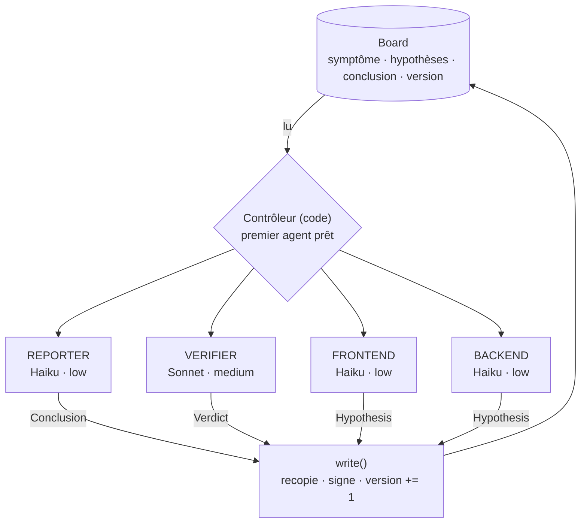

<CodeTabs title="Exemple" files={[
  { name: 'main.py', lang: 'python', code: blackboardMain, description: "Les agents, les connaissances et les logs mockés, une condition de déclenchement par agent, write() et la boucle du contrôleur." },
  { name: 'schemas.py', lang: 'python', code: blackboardSchemas, description: "Le tableau (symptôme, hypothèses signées et versionnées, conclusion) et la sortie de chaque agent." },
  { name: 'prompts.py', lang: 'python', code: blackboardPrompts, description: "Un bloc commun qui décrit le tableau, puis le prompt de chaque agent." },
  { name: 'llm.py', lang: 'python', code: blackboardLlm, description: 'Le même appel LLM unique que pour les patterns précédents : chaque contributeur est une config comme les autres.' },
]} />

<Note title="À retenir" variant="info">
  <strong class="text-text-secondary">Le tableau est le seul canal</strong> : aucun agent ne connaît les autres, il lit le tableau et rend une sortie structurée. <strong class="text-text-secondary">Le contrôleur ne suit pas de plan</strong> : la priorité est fixe, l'ordre d'exécution ne l'est pas. Si la première hypothèse (front) est réfutée, le backend entre en jeu ; sinon, il ne parle jamais. <strong class="text-text-secondary">Un seul écrivain</strong> : c'est <code>write()</code> qui recopie, signe et incrémente <code>version</code> ; comme un seul agent tourne par tour, il n'y a pas de conflit d'écriture. <strong class="text-text-secondary">Trois façons de s'arrêter</strong> : une conclusion, plus aucun agent prêt, ou <code>MAX_STEPS</code>. L'exemple est volontairement placé dans le meilleur des mondes : pas d'écritures concurrentes ni de vérification indépendante du verdict. En production, un faux <code>confirmed</code> clôturerait l'enquête sur une mauvaise cause.
</Note>

<div class="mb-4 flex flex-wrap items-center gap-2.5 sm:gap-3 [&>div]:mb-0">
  <MaturityBadge level="Éprouvé" />
  <Title size={3}>Message Bus</Title>
</div>

<Text>La communication est asynchrone, par publication/abonnement d'événements sur un bus (Kafka, RabbitMQ, NATS). Producteurs et consommateurs ne se connaissent pas. C'est une <HighLight accent="green">brique d'infrastructure mature</HighLight>, mais elle n'apporte pas automatiquement une coordination correcte : livraison, doublons, idempotence, ordre et reprise dépendent de la configuration. <strong class="text-text-secondary">Le couplage n'est pas supprimé, il est déplacé vers les contrats</strong> (schémas d'événements, sémantique des topics, garanties de livraison).</Text>

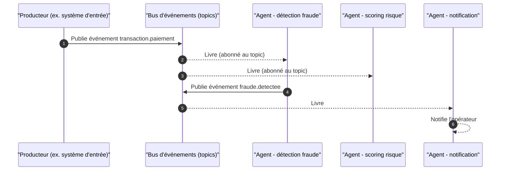

<Text><strong class="text-text-primary">En code.</strong> Traiter un flux de quatre alertes de production, publiées une toutes les 0,5 s juste après le déploiement de la v2.3. Le bus est un simple objet en mémoire : une <HighLight accent="green">file par abonné</HighLight>, et chaque <HighLight accent="green">topic</HighLight> a son contrat, vérifié à la publication. Un conseiller propose une première vérification pour chaque alerte ; un détecteur décide si les alertes reçues confirment un incident et ne publie <code>incident.opened</code> que dans ce cas ; un rédacteur écrit alors le message de la page de statut. Un logger en code écoute tous les topics, sans que personne ne le sache.</Text>

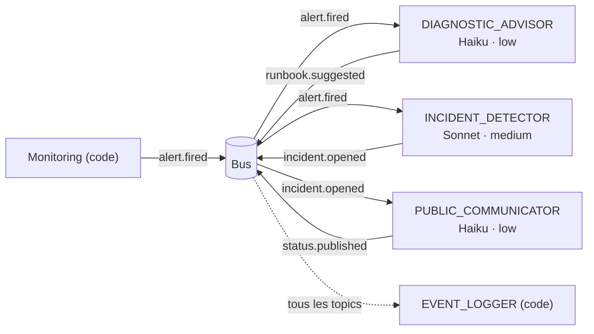

<CodeTabs title="Exemple" files={[
  { name: 'main.py', lang: 'python', code: busMain, description: "Les agents, les alertes mockées, le producteur, une coroutine par abonné et main(), qui attend que le flux soit traité." },
  { name: 'bus.py', lang: 'python', code: busBus, description: "Le bus en mémoire : abonnement, publication contrôlée par contrat, drain() et l'itérateur listen()." },
  { name: 'schemas.py', lang: 'python', code: busSchemas, description: "Les topics et leurs contrats d'événements, séparés des sorties des agents." },
  { name: 'prompts.py', lang: 'python', code: busPrompts, description: "Un bloc commun qui décrit la situation d'un abonné, puis le prompt de chaque agent." },
  { name: 'llm.py', lang: 'python', code: busLlm, description: 'Le même appel LLM unique que pour les patterns précédents : chaque abonné est une config comme les autres.' },
]} />

<Note title="À retenir" variant="info">
  <strong class="text-text-secondary">Personne ne se connaît</strong> : un abonné ne connaît que des topics, et <code>bus.py</code> ne connaît aucun agent. <strong class="text-text-secondary">Le couplage est déplacé vers les contrats</strong> : <code>CONTRACTS</code> associe un schéma à chaque topic, et renommer un champ d'<code>AlertFired</code> casse les abonnés, alors qu'aucun ne connaît le monitoring. <strong class="text-text-secondary">Un ordre par abonné, pas d'ordre global</strong> : chaque abonné lit sa file dans l'ordre, ce qui permet au détecteur de garder sa mémoire en variables locales, mais l'ordre de la trace change d'un run à l'autre. L'exemple est volontairement placé dans le meilleur des mondes : livraison au plus une fois, sans rétention, sans reprise ni dédoublonnage. En production, une alerte rejouée par un broker <em>at-least-once</em> ouvrirait un second incident si le détecteur n'ignorait pas les <code>message_identifier</code> déjà vus.
</Note>

<DecisionCard accent="pink" title="Fiche — Message Bus" items={[
  { label: 'Problème résolu', value: 'Traitement continu de flux d\'événements avec découplage temporel et opérationnel des producteurs et consommateurs.' },
  { label: "Quand l'employer", value: 'Les flux sont en temps réel, les consommateurs évoluent indépendamment, la charge est variable.' },
  { label: 'Alternatives plus simples', value: 'Appels directs ou file de tâches si le volume et l\'asynchronisme ne le justifient pas.' },
  { label: 'Coûts', value: 'Infra à exploiter (partitionnement, ordre) ; latence de sérialisation ; débogage asynchrone difficile.' },
  { label: 'Modes de défaillance', value: "Doublons, désordre, perte d'événements, retraitement non idempotent." },
  { label: 'Garanties', value: 'À spécifier explicitement : livraison, ordre, idempotence, reprise. Non acquises par défaut.' },
  { label: "Comment l'évaluer", value: 'Taux de doublons traités, comportement en panne/reprise, latence bout-en-bout, cohérence de l\'état.' },
]} />

<SectionHeader sectionId="qualite" label="05" />

<SectionTitle>Qualité & <HighLight accent="green">vérification</HighLight></SectionTitle>

<Text>Ces mécanismes répondent à : <HighLight accent="green" bold>comment fiabiliser une sortie et la gouverner</HighLight>. Point transversal : <HighLight accent="yellow" bold>la redondance des agents ne doit pas être confondue avec l'indépendance des preuves</HighLight>.</Text>

<SectionHeader sectionId="evaluator" label="05.1" />

<div class="mb-4 flex flex-wrap items-center gap-2.5 sm:gap-3 [&>div]:mb-0">
  <MaturityBadge level="Éprouvé" />
  <Title size={3}>Evaluator-Optimizer</Title>
</div>

<Text>Une étape <strong class="text-text-secondary">générateur</strong> produit un résultat ; une étape <strong class="text-text-secondary">évaluateur</strong> le juge selon une grille explicite. En cas d'échec, le générateur reçoit un feedback structuré et révise, jusqu'à validation ou épuisement d'un budget de révisions.</Text>

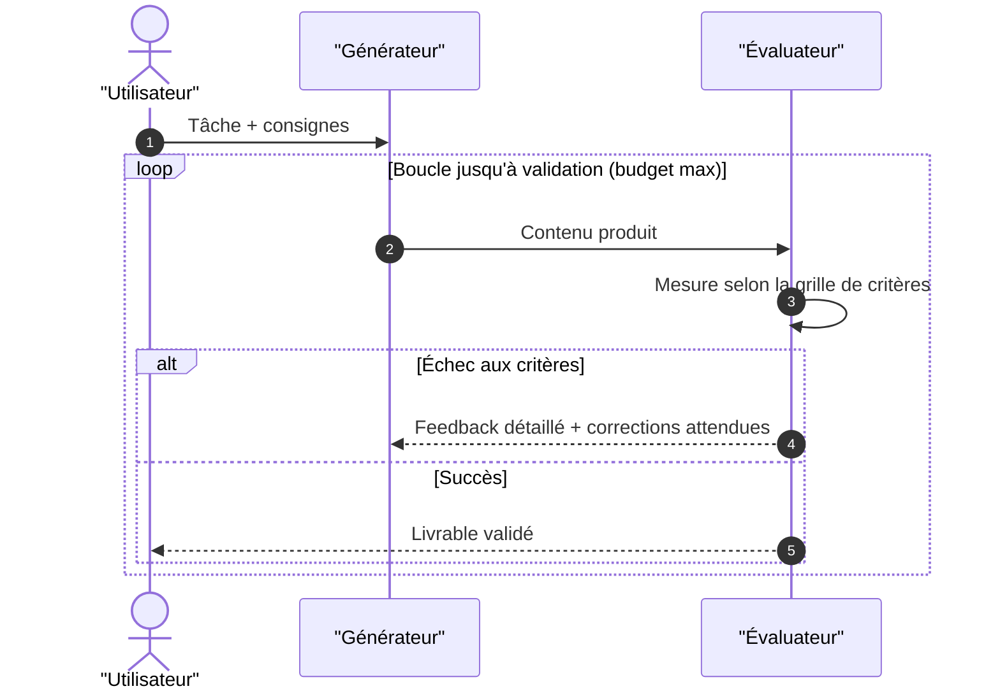

<Note title="Limite fondamentale" variant="danger">
  Un évaluateur LLM qui relit une sortie <HighLight accent="red" bold>n'est pas une preuve de correction</HighLight>. Il peut manquer un défaut, valider sa propre erreur, ou pousser le générateur à satisfaire la grille au détriment de l'objectif réel. Le pattern semble surtout efficace <strong class="text-text-secondary">quand des critères vérifiables existent</strong> ; il paraît fragile quand l'évaluation repose sur le seul jugement du modèle.
</Note>

<DecisionCard accent="green" items={[
  { label: 'Problème résolu', value: 'Améliorer itérativement une sortie selon des critères explicitables.' },
  { label: "Quand l'employer", value: 'Les critères de qualité sont vérifiables et il y a un gain réel à l\'itération.' },
  { label: 'Alternatives plus simples', value: 'Tests déterministes seuls ; une seule passe avec un prompt soigné.' },
  { label: 'Coûts', value: 'Au moins 2 appels par itération ; risque de sur-optimisation de la grille.' },
  { label: 'Modes de défaillance', value: 'Évaluateur qui rate un défaut ou valide sa propre erreur ; dérive vers la grille ; boucle coûteuse sans gain.' },
  { label: 'Garanties', value: 'Aucune garantie de correction ; au mieux un gain mesurable si les critères sont objectifs.' },
  { label: "Comment l'évaluer", value: 'Delta de qualité avant/après, nombre d\'itérations moyen, taux de faux positifs de l\'évaluateur, coût par livrable validé.' },
]} />

<SectionHeader sectionId="vote" label="05.2" />

<div class="mb-4 flex flex-wrap items-center gap-2.5 sm:gap-3 [&>div]:mb-0">
  <MaturityBadge level="Émergent" />
  <Title size={3}>Consensus / Majority Voting</Title>
</div>

<Text>Plusieurs exécutions indépendantes de la même tâche ; un algorithme (vote majoritaire, pondéré, clustering sémantique) ou un agent juge retient la réponse la plus convergente. C'est l'héritier de la <em>self-consistency</em>. <strong class="text-accent-red">Limite à expliciter :</strong> trois agents peuvent reproduire la même erreur parce qu'ils partagent le même modèle ou le même biais. <HighLight accent="yellow" bold>Quatre avis ne constituent pas quatre preuves indépendantes.</HighLight></Text>

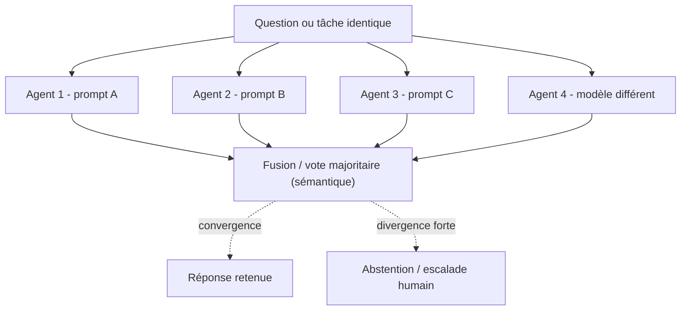

<Note variant="warning">
  Pour établir un <strong class="text-text-secondary">fait</strong>, confronter les réponses à des sources, des tests ou des outils indépendants est souvent plus pertinent que compter les voix. Le vote semble surtout utile quand il n'existe pas de vérificateur externe <strong class="text-text-secondary">et</strong> que les erreurs ne sont pas corrélées.
</Note>

<DecisionCard accent="green" items={[
  { label: 'Problème résolu', value: 'Réduire les hallucinations non corrélées quand aucun vérificateur externe n\'est disponible.' },
  { label: "Quand l'employer", value: 'Les agents peuvent être réellement diversifiés et l\'erreur est stochastique, pas systématique.' },
  { label: 'Alternatives plus simples', value: 'Vérification externe (source, test, outil) — souvent plus fiable pour les faits.' },
  { label: 'Coûts', value: 'N fois le coût d\'une réponse ; latence d\'attente de tous les votes.' },
  { label: 'Modes de défaillance', value: 'Erreurs corrélées (biais partagés) → fausse confiance ; consensus artificiel ; vote qui élimine la bonne réponse minoritaire.' },
  { label: 'Garanties', value: "Réduction d'erreur sous hypothèse d'indépendance. Aucune garantie en cas de biais partagé." },
  { label: "Comment l'évaluer", value: "Taux d'erreur restant vs agent unique ; corrélation des erreurs entre agents ; conditions de gain." },
]} />

<SectionHeader sectionId="debat" label="05.3" />

<div class="mb-4 flex flex-wrap items-center gap-2.5 sm:gap-3 [&>div]:mb-0">
  <MaturityBadge level="Exploratoire" />
  <Title size={3}>Multi-Agent Debate</Title>
</div>

<Text>Deux ou plusieurs agents aux perspectives opposées débattent en plusieurs tours ; un modérateur tranche. L'hypothèse : l'échange contradictoire corrige les biais. <strong class="text-accent-red">Ce que montrent les travaux que j'ai pu lire :</strong> le débat n'est <HighLight accent="red" bold>pas toujours supérieur</HighLight> au simple vote ni à l'auto-correction isolée. Effets parasites identifiés : <HighLight accent="yellow">conformisme sycophante</HighLight>, <HighLight accent="yellow">fragilité contextuelle</HighLight> et <HighLight accent="yellow">effondrement du consensus</HighLight>.</Text>

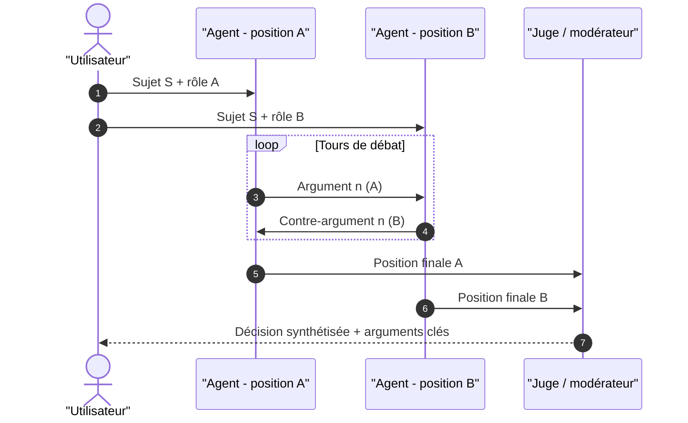

<Text>Le débat n'a de valeur que si l'on peut le <HighLight accent="cyan" bold>comparer</HighLight> à des alternatives plus simples, sur les mêmes tâches et à budget égal : baseline agent unique, vote indépendant, vérification externe. Sans cette comparaison, difficile d'en conclure quoi que ce soit.</Text>

<DecisionCard accent="green" items={[
  { label: 'Problème résolu', value: 'Explorer des perspectives opposées, exposer des angles morts.' },
  { label: "Quand l'employer", value: "Les agents peuvent être réellement divers et l'on dispose d'un protocole de comparaison." },
  { label: 'Alternatives plus simples', value: 'Agent unique ; vote ; auto-correction isolée (souvent aussi efficace et moins cher).' },
  { label: 'Coûts', value: 'N tours × N agents × contexte croissant.' },
  { label: 'Modes de défaillance', value: 'Consensus artificiel ; perturbation de raisonnements corrects ; juge sensible au style plutôt qu\'à la vérité.' },
  { label: 'Garanties', value: 'Aucune supériorité garantie ; dépend fortement des prompts et des rôles.' },
  { label: "Comment l'évaluer", value: 'Comparer à agent unique / vote / vérification externe, à budget égal et sur le même jeu.' },
]} />

<SectionHeader sectionId="redteam" label="05.4" />

<div class="mb-4 flex flex-wrap items-center gap-2.5 sm:gap-3 [&>div]:mb-0">
  <MaturityBadge level="Émergent" />
  <Title size={3}>Red Teaming</Title>
</div>

<Text>Un agent <strong class="text-text-secondary">attaquant</strong> tente de faire échouer ou détourner le système cible : hallucination forcée, injection d'instructions, contournement de garde-fous. Un <strong class="text-text-secondary">juge</strong> mesure le succès de chaque tentative et alimente l'adaptation des attaques.</Text>

<ul class="grid grid-cols-1 sm:grid-cols-2 gap-3 my-6">
  <li class="flex items-start gap-3 p-3 rounded-block transition-colors hover:bg-surface-hover">
    <Icon name="lucide:target" class="mt-1 shrink-0 size-[18px] text-accent-green" />
    <div class="flex flex-col gap-0.5">
      <span class="text-text-secondary text-[15px] font-semibold leading-[1.4]">Métrique de succès objective</span>
      <p class="text-text-subtle text-[13px] leading-[1.5]">Action dangereuse déclenchée, secret divulgué, taux de refus…</p>
    </div>
  </li>
  <li class="flex items-start gap-3 p-3 rounded-block transition-colors hover:bg-surface-hover">
    <Icon name="lucide:bug" class="mt-1 shrink-0 size-[18px] text-accent-purple" />
    <div class="flex flex-col gap-0.5">
      <span class="text-text-secondary text-[15px] font-semibold leading-[1.4]">Canaux d'attaque variés</span>
      <p class="text-text-subtle text-[13px] leading-[1.5]">Prompt direct, contamination RAG, contenu de mails/fichiers, outils compromis</p>
    </div>
  </li>
</ul>

<Note title="À retenir" variant="danger">
  <HighLight accent="red" bold>Aucune garantie d'exhaustivité</HighLight> : l'absence de faille trouvée n'est pas une preuve d'absence de faille. Les sources recommandent aussi de cloisonner les attaquants automatisés en sandbox : ils génèrent du contenu réellement dangereux.
</Note>

<DecisionCard accent="green" items={[
  { label: 'Problème résolu', value: 'Découvrir des vulnérabilités avant les attaquants réels.' },
  { label: "Quand l'employer", value: 'Avant tout déploiement à impact, et en continu pour les systèmes exposés.' },
  { label: 'Alternatives plus simples', value: 'Tests manuels ciblés sur les scénarios critiques.' },
  { label: 'Coûts', value: 'Boucle attaque/évaluation coûteuse ; confinement nécessaire des attaquants.' },
  { label: 'Modes de défaillance', value: "Couverture incomplète ; définir « l'attaque a réussi » reste souvent subjectif." },
  { label: 'Garanties', value: 'Aucune garantie d\'exhaustivité.' },
  { label: "Comment l'évaluer", value: 'Taux de vulnérabilités découvertes, taux de faux positifs, reproductibilité des attaques.' },
]} />

<SectionHeader sectionId="hitl" label="05.5" />

<div class="mb-4 flex flex-wrap items-center gap-2.5 sm:gap-3 [&>div]:mb-0">
  <MaturityBadge level="Éprouvé" />
  <Title size={3}>Human-in-the-Loop</Title>
</div>

<Text>Un <strong class="text-text-secondary">point d'arrêt</strong> où le système sollicite un humain avant d'exécuter une action critique ou irréversible. Trois couches à ne pas confondre :</Text>

<ol class="space-y-3 my-4 ml-6">
  <li class="flex items-start gap-3 text-text-muted text-[15px] leading-[1.8]">
    <span class="mt-[10px] shrink-0 size-2 rounded-full bg-accent-green"></span>
    <span><strong class="text-text-secondary">Autorisation déterministe</strong> — permissions, règles métier, plafonds, allowlists. C'est le seul maillon qui <em>autorise</em> réellement.</span>
  </li>
  <li class="flex items-start gap-3 text-text-muted text-[15px] leading-[1.8]">
    <span class="mt-[10px] shrink-0 size-2 rounded-full bg-accent-yellow"></span>
    <span><strong class="text-text-secondary">Estimation du risque</strong> — le modèle ou un classifieur aide à déterminer si une revue humaine est nécessaire. Il ne décide <em>jamais seul</em> qu'une action est sûre.</span>
  </li>
  <li class="flex items-start gap-3 text-text-muted text-[15px] leading-[1.8]">
    <span class="mt-[10px] shrink-0 size-2 rounded-full bg-accent-cyan"></span>
    <span><strong class="text-text-secondary">Approbation humaine</strong> — intervient quand la <em>politique</em> l'exige, pas simplement parce qu'un score a franchi un seuil.</span>
  </li>
</ol>

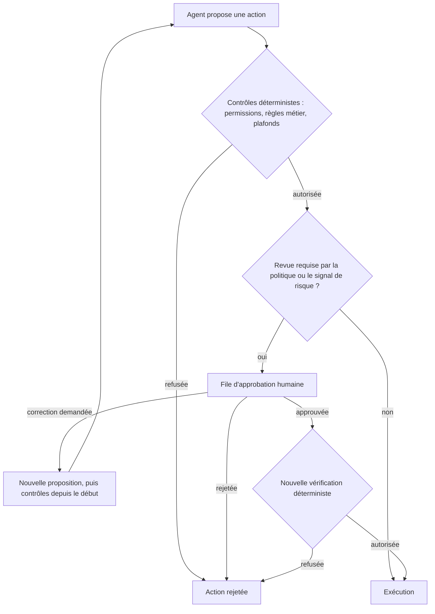

<Note title="Le seuil de risque peut ajouter une revue, jamais en retirer une" variant="warning">
  Une approbation humaine ne contourne ni les permissions ni les règles métier : l'autorisation déterministe est vérifiée avant l'approbation et de nouveau avant l'exécution. Et attention à la <HighLight accent="red" bold>fatigue d'approbation</HighLight> : trop d'escalades → les réviseurs cliquent machinalement et le risque peut augmenter.
</Note>

<DecisionCard accent="green" items={[
  { label: 'Problème résolu', value: 'Contrôler les actions à impact ou irréversibles ; satisfaire une obligation de conformité.' },
  { label: "Quand l'employer", value: "Action à effet de bord important, ou exigence réglementaire d'audit." },
  { label: 'Alternatives plus simples', value: "Guardrails déterministes ; confirmation au niveau de l'outil." },
  { label: 'Coûts', value: "Latence d'approbation ; coût humain ; non scalable sans staff." },
  { label: 'Modes de défaillance', value: 'Fatigue d\'approbation ; goulot de production ; seuil mal calibré.' },
  { label: 'Garanties', value: 'Validation humaine traçable et auditable ; pas de garantie sur les cas non escaladés.' },
  { label: "Comment l'évaluer", value: 'Taux d\'escalade, temps d\'approbation, taux d\'approbation « à l\'aveugle », incidents évités.' },
]} />

<SectionHeader sectionId="capacites" label="06" />

<SectionTitle>Capacités & <HighLight accent="purple">gestion du contexte</HighLight></SectionTitle>

<Text>Ces mécanismes répondent à : <HighLight accent="purple" bold>comment restreindre les accès, organiser et mémoriser</HighLight>.</Text>

<SectionHeader sectionId="roles" label="06.1" />

<div class="mb-4 flex flex-wrap items-center gap-2.5 sm:gap-3 [&>div]:mb-0">
  <MaturityBadge level="Éprouvé" />
  <Title size={3}>Role-based Task Decomposition</Title>
</div>

<Text>Le problème est découpé en attribuant à chaque composant un <strong class="text-text-secondary">rôle métier distinct et contraint</strong> (nom, objectif, contraintes, ton). C'est le fondement de frameworks comme MetaGPT, ChatDev ou CAMEL.</Text>

<Note title="Point critique" variant="warning">
  Un persona est une <HighLight accent="yellow" bold>technique de prompt</HighLight>, pas une preuve de spécialisation. Donner à un modèle les rôles de Product Manager, Architecte, Développeur et QA ne crée pas automatiquement quatre compétences indépendantes. Au sens du glossaire, c'est un <strong class="text-text-secondary">workflow multi-appels structuré par rôles</strong>, pas quatre agents autonomes. Le bénéfice vient de la focalisation du contexte et des objectifs.
</Note>

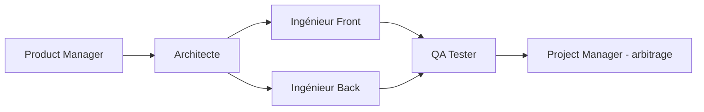

<Text>Le critère que je retiens : un découpage en rôles me paraît défendable si chaque rôle apporte <strong class="text-text-secondary">au moins un</strong> de ces éléments : un contexte spécialisé, des outils distincts, des permissions différentes, un modèle adapté, des critères d'évaluation spécifiques ou une capacité de travail indépendante (parallélisable). Sinon, <HighLight accent="cyan" bold>un seul agent avec un workflow structuré suffit</HighLight>.</Text>

<DecisionCard accent="purple" items={[
  { label: 'Problème résolu', value: 'Focaliser le contexte et les objectifs par responsabilité.' },
  { label: "Quand l'employer", value: 'Les rôles apportent contexte, outils, permissions ou modèles distincts.' },
  { label: 'Alternatives plus simples', value: 'Un agent unique avec un workflow structuré et des prompts par étape.' },
  { label: 'Coûts', value: "Beaucoup d'appels et d'artefacts intermédiaires ; coordination lourde." },
  { label: 'Modes de défaillance', value: 'Rôles redondants ou qui « improvisent » hors périmètre ; bavardage infini.' },
  { label: 'Garanties', value: 'Ségrégation des responsabilités (traçabilité), pas de compétence garantie.' },
  { label: "Comment l'évaluer", value: 'Comparer à un agent unique : mesurer si chaque rôle apporte un gain réel.' },
]} />

<SectionHeader sectionId="tools" label="06.2" />

<div class="mb-4 flex flex-wrap items-center gap-2.5 sm:gap-3 [&>div]:mb-0">
  <MaturityBadge level="Éprouvé" />
  <Title size={3}>Tool-scoped Agents</Title>
</div>

<Text>Chaque agent a l'accès exclusif à un outil lourd ou sensible : un agent SQL, un agent web scraping, un agent exécution Python. C'est un principe utile d'isolation et de séparation des capacités. <strong class="text-accent-red">Mais attention à une formulation trompeuse :</strong> isoler un outil dans un agent <HighLight accent="red" bold>ne constitue pas, à lui seul, une frontière de sécurité suffisante</HighLight>. La sécurité doit être imposée par le système qui exécute les actions, pas par le prompt.</Text>

<Note title="Ce qui fait réellement la sécurité">
  permissions minimales au niveau des outils et des identités techniques ; séparation lecture/écriture ; sandbox pour le code exécuté ; validation des arguments côté serveur ; limites de ressources et délais ; gestion des secrets hors du contexte du modèle ; confirmation explicite pour les opérations destructrices ; protection contre les injections d'instructions provenant de documents ou de résultats d'outils.
</Note>

<Text><strong class="text-text-primary">Exemple.</strong> Une plateforme de data analytics self-service route vers un agent analyste, qui délègue à l'agent SQL (seul détenteur des credentials), puis à l'agent Python (seul dans le sandbox). <HighLight accent="green">La sécurité vient des ACL de la base, du sandbox et de la séparation lecture/écriture — pas du rôle attribué au modèle.</HighLight></Text>

<DecisionCard accent="purple" items={[
  { label: 'Problème résolu', value: "Séparer les capacités et éviter l'erreur de sélection d'outil par un modèle généraliste." },
  { label: "Quand l'employer", value: 'Outils sensibles ou lourds, besoin de cloisonner credentials et responsabilités.' },
  { label: 'Alternatives plus simples', value: 'Permissions au niveau des outils dans un seul agent ; routage simple.' },
  { label: 'Coûts', value: "Sous-utilisation d'outils ; overhead de routage ; multiplication d'agents." },
  { label: 'Modes de défaillance', value: 'Goulot sur l\'agent spécialisé ; faux sentiment de sécurité si les contrôles système manquent.' },
  { label: 'Garanties', value: 'Cloisonnement des accès si les contrôles sont appliqués côté système (permissions, sandbox).' },
  { label: "Comment l'évaluer", value: "Tests d'accès (actions non autorisées), taux d'erreurs d'outil, isolation effective." },
]} />

<SectionHeader sectionId="memoire" label="06.3" />

<div class="mb-4 flex flex-wrap items-center gap-2.5 sm:gap-3 [&>div]:mb-0">
  <MaturityBadge level="Émergent" />
  <Title size={3}>Context & State Management</Title>
</div>

<Text>La gestion du contexte peut reposer sur un agent <strong class="text-text-secondary">dédié</strong> qui maintient, nettoie, condense et indexe l'état partagé (idée inspirée de MemGPT). <strong class="text-accent-green">Mais un agent mémoire n'est pas une nécessité pour avoir une mémoire.</strong> Une couche applicative classique — historique, base SQL, résumé incrémental, RAG, checkpoints — semble souvent plus fiable, moins coûteuse et plus facile à tester.</Text>

<Text>Il me semble utile de séparer quatre problèmes distincts, souvent confondus sous le mot « mémoire » :</Text>

<Table
  headers={[{ label: 'Problème' }, { label: 'Mécanisme typique' }]}
  rows={[
    ['Mémoire (contexte de session)', 'Historique, résumés progressifs'],
    ["Persistance d'état", 'Base de données, checkpoints'],
    ['Récupération de connaissances', 'RAG, index vectoriel'],
    ['Compression du contexte', 'Résumés, distillation'],
  ]}
/>

<DecisionCard accent="purple" items={[
  { label: 'Problème résolu', value: 'Maintenir un contexte fiable sur des sessions longues ou multi-utilisateurs.' },
  { label: "Quand l'employer", value: 'Les politiques de conservation, récupération et consolidation sont complexes et évolutives.' },
  { label: 'Alternatives plus simples', value: 'Historique applicatif, base SQL, résumé incrémental, RAG — à essayer d\'abord.' },
  { label: 'Coûts', value: "Perte d'information à la condensation ; latence lecture/écriture ; cohérence concurrente." },
  { label: 'Modes de défaillance', value: 'Résumé qui écrase un détail vital ; conflits d\'écriture ; le composant devient critique.' },
  { label: 'Garanties', value: 'Persistance et cohérence à définir (verrous, versions, politiques d\'éviction).' },
  { label: "Comment l'évaluer", value: 'Fidélité des faits conservés, taux de rappel des informations pertinentes, coût du contexte.' },
]} />

<SectionHeader sectionId="ressources" label="07" />

<SectionTitle>Gestion des <HighLight accent="yellow">ressources</HighLight></SectionTitle>

<Text>Ces mécanismes répondent à : <HighLight accent="yellow" bold>comment économiser du calcul et de l'argent</HighLight>.</Text>

<SectionHeader sectionId="reduction" label="07.1" />

<div class="mb-4 flex flex-wrap items-center gap-2.5 sm:gap-3 [&>div]:mb-0">
  <MaturityBadge level="Émergent" />
  <Title size={3}>Context Reduction & Evidence Retrieval</Title>
</div>

<Text>Un système peu coûteux (petit modèle, ou mieux : <HighLight accent="green" bold>outils déterministes</HighLight>) reçoit un gros volume de données brutes et n'en transmet au grand modèle que l'essentiel. <strong class="text-accent-red">Le point critique n'est pas le nombre de tokens économisés, mais le risque que le prétraitement supprime précisément le détail qui permettrait de trouver la cause d'un incident.</strong></Text>

```mermaid
flowchart LR
    VOL["Volumes bruts : logs, docs, tickets"] --> SM["Filtrage déterministe + petit modèle"]
    SM -->|"extrait + liens vers sources"| C["Contexte utile réduit"]
    C --> GM["Grand modèle principal"]
    GM -->|"retrieve si besoin"| SRC["Données sources (références conservées)"]
    SRC --> GM
    GM --> R["Réponse de haute qualité"]
```

<Text>Pour des logs ou des données structurées, l'approche généralement recommandée consiste à commencer par du filtrage temporel, du regroupement d'erreurs, de la déduplication, de l'agrégation de métriques et de la sélection de fenêtres pertinentes. Le LLM intervient <strong class="text-text-secondary">ensuite</strong>.</Text>

<Note title="Références vs complétude" variant="warning">
  Un résumé irréversible est une mauvaise frontière d'information : mieux vaut conserver les références aux sources. Mais conserver des liens ne garantit pas la complétude. Il faut distinguer quatre propriétés : <strong class="text-text-secondary">accessibilité</strong>, <strong class="text-text-secondary">rappel</strong>, <strong class="text-text-secondary">complétude</strong> et <strong class="text-text-secondary">vérifiabilité</strong>.
</Note>

<DecisionCard accent="yellow" items={[
  { label: 'Problème résolu', value: "Réduire le coût/latence lorsque le volume d'entrée dépasse largement la fenêtre utile." },
  { label: "Quand l'employer", value: 'Données volumineuses, filtrables par des critères objectifs et vérifiables.' },
  { label: 'Alternatives plus simples', value: 'Filtrage déterministe seul ; RAG ciblé ; pagination.' },
  { label: 'Coûts', value: 'Coût du petit modèle/pré-traitement ; réglage des critères de sélection.' },
  { label: 'Modes de défaillance', value: 'Suppression du détail déterminant ; chaîne d\'erreurs sans recours aux sources.' },
  { label: 'Garanties', value: 'La conservation des références permet de revenir aux sources, mais ne garantit ni le rappel ni la complétude.' },
  { label: "Comment l'évaluer", value: 'Taux de rappel des informations critiques : le détail utile survit-il à la réduction ?' },
]} />

<SectionHeader sectionId="speculatif" label="07.2" />

<div class="mb-4 flex flex-wrap items-center gap-2.5 sm:gap-3 [&>div]:mb-0">
  <MaturityBadge level="Émergent" />
  <Title size={3}>Exécution spéculative : deux mécanismes distincts</Title>
</div>

<Text>Le n°19 mélange deux sujets aux garanties et objectifs différents. Il reste une seule entrée du catalogue, mais désigne <HighLight accent="yellow" bold>deux techniques distinctes</HighLight>.</Text>

<Text><strong class="text-text-primary">19.1 Speculative decoding.</strong> Technique d'<HighLight accent="cyan" bold>accélération de l'inférence</HighLight> : un modèle auxiliaire propose des tokens, qu'un modèle cible vérifie selon un mécanisme probabiliste spécifique. Dans sa forme standard, elle vise à <strong class="text-text-secondary">préserver la distribution de génération du modèle cible</strong> tout en accélérant le décodage. Ce n'est pas « un petit modèle qui écrit une réponse qu'un grand valide ». Les gains de vitesse (de l'ordre de 2 à 3×) sont <HighLight accent="red">spécifiques à un couple de modèles et à un taux d'acceptation</HighLight>.</Text>

<Text><strong class="text-text-primary">19.2 Draft-and-verify.</strong> <HighLight accent="purple" bold>Workflow applicatif</HighLight> : un agent rapide produit une solution, un agent puissant la révise et corrige. Ce mécanisme <HighLight accent="red" bold>ne garantit ni l'équivalence de la sortie ni un gain de latence</HighLight>. Si le modèle puissant doit examiner, vérifier et corriger le brouillon, il peut même avoir <em>plus</em> de travail. Et le TTFT (Time To First Token) n'est pas le temps d'obtention d'une réponse complète.</Text>

```mermaid
flowchart TD
    subgraph Inf["19.1 Speculative decoding (inférence)"]
        M1["Modèle auxiliaire : propose des tokens"] --> M2{"Modèle cible : vérifie (acceptation)"}
        M2 -->|"accepté"| O1["Token accepté ; poursuivre la vérification"]
        M2 -->|"rejeté"| RC["Échantillonner un token correctif dans la distribution résiduelle"]
        RC --> CTX["Mettre à jour le contexte avec les tokens validés"]
        O1 --> CTX
        CTX --> M1
    end
    subgraph App["19.2 Draft-and-verify (applicatif)"]
        T["Tâche"] --> D["Agent draft rapide"]
        D --> GD["Brouillon complet"]
        GD --> V{"Agent puissant : vérifie / corrige"}
        V -->|"conforme"| O2["Livrable"]
        V -->|"non conforme"| D
    end
```

<DecisionCard accent="yellow" items={[
  { label: 'Problème résolu (19.1)', value: 'Accélérer le décodage à distribution constante.' },
  { label: 'Problème résolu (19.2)', value: "Déléguer la génération à un modèle rapide et faire vérifier par un modèle fort." },
  { label: "Quand employer (19.1)", value: "Au niveau de l'infrastructure, avec un couple de modèles compatible." },
  { label: "Quand employer (19.2)", value: 'Lorsque le coût et la latence de bout en bout (brouillon + vérification + corrections) sont meilleurs qu\'une génération directe, à qualité comparable.' },
  { label: 'Alternatives plus simples', value: 'Modèle unique ; pour 19.2, un seul appel bien prompté.' },
  { label: 'Modes de défaillance', value: "Faible taux d'acceptation ; brouillon raté coûteux ; vérification plus chère que génération." },
  { label: 'Garanties', value: '19.1 : préservation de distribution (sous conditions). 19.2 : aucune garantie d\'équivalence ni de latence.' },
  { label: "Comment l'évaluer", value: "19.1 : taux d'acceptation, vitesse à distribution équivalente. 19.2 : coût total et latence de bout en bout vs génération unique." },
]} />

<SectionHeader sectionId="cascade" label="07.3" />

<div class="mb-4 flex flex-wrap items-center gap-2.5 sm:gap-3 [&>div]:mb-0">
  <MaturityBadge level="Émergent" />
  <Title size={3}>Model Cascade / Escalation</Title>
</div>

<Text>Un modèle économique tente de répondre en premier. Si des signaux indiquent que sa réponse est insuffisante, la tâche peut être <HighLight accent="yellow" bold>escaladée</HighLight> au palier suivant (modèle intermédiaire, puis puissant, puis humain). C'est une application du routage basé sur l'incertitude — souvent plus économique que le vote, parce qu'il <strong class="text-text-secondary">sélectionne au lieu de toujours dépenser</strong>.</Text>

<Note title="Le problème central" variant="warning">
  Décider qu'une réponse est insuffisante est difficile. La confiance déclarée par un LLM n'est pas nécessairement calibrée, et un score de probabilité sur les tokens n'est pas une mesure directe de l'exactitude. Les approches que j'ai vues combinent plusieurs signaux : validité du schéma, succès des appels d'outils, tests externes, score de difficulté calibré, criticité de la tâche.
</Note>

```mermaid
flowchart TD
    R["Requête"] --> M1["Palier 1 - modèle économique (petit)"]
    M1 --> C1{"Signaux d'échec / incertitude"}
    C1 -->|"haute confiance"| OUT["Réponse directe - coût minimal"]
    C1 -->|"faible ou échec"| M2["Palier 2 - modèle intermédiaire"]
    M2 --> C2{"Encore incertain ?"}
    C2 -->|"oui"| M3["Palier 3 - modèle puissant"]
    C2 -->|"non"| OUT
    M3 --> C3{"Ultime incertitude ?"}
    C3 -->|"oui"| H["Humain"]
    C3 -->|"non"| OUT
    H --> OUT
```

<Note title="Attention aux chiffres" variant="danger">
  « Coût divisé par cinq, qualité conservée » est une <HighLight accent="red" bold>hypothèse illustrative</HighLight>, pas un résultat établi. Une cascade peut coûter <strong class="text-text-secondary">plus cher</strong> qu'un modèle unique sur un trafic biaisé. D'où l'importance de comparer à budget égal.
</Note>

<DecisionCard accent="yellow" items={[
  { label: 'Problème résolu', value: 'Traiter un volume hétérogène en réservant le calcul coûteux aux cas difficiles.' },
  { label: "Quand l'employer", value: "La distribution de difficulté est étalée et l'on dispose de signaux d'échec objectifs." },
  { label: 'Alternatives plus simples', value: 'Modèle unique ; routage fixe par règles.' },
  { label: 'Coûts', value: '2-3 appels successifs pour les cas remontés ; monitoring inter-paliers.' },
  { label: 'Modes de défaillance', value: 'Seuils mal calibrés (escalade tout ou rien) ; peut coûter plus cher qu\'un modèle unique sur du trafic biaisé.' },
  { label: 'Garanties', value: "L'escalade alloue davantage de calcul aux cas signalés ; elle ne garantit ni l'amélioration ni un gain économique." },
  { label: "Comment l'évaluer", value: 'Comparer la cascade à un modèle unique sur un même jeu, à budget égal, en mesurant qualité et coût.' },
]} />

<SectionHeader sectionId="production" label="08" />

<SectionTitle>Production & <HighLight accent="red">confiance</HighLight></SectionTitle>

<Text>Les mécanismes précédents décrivent le <strong class="text-text-secondary">chemin nominal</strong>. Je n'ai pas d'expérience de production sur ce type de système : cette partie reprend ce que soulignent les retours d'expérience publiés et les bonnes pratiques classiques des systèmes distribués. D'après eux, en production, les problèmes réels apparaissent souvent ailleurs : timeouts, reprises, sécurité, traçabilité.</Text>

<Title size={3}>Fiabilité opérationnelle</Title>

<Text>Que se passe-t-il quand un worker ne répond jamais, qu'un outil tombe en panne, que deux agents modifient simultanément le même artefact, ou qu'une relance exécute deux fois une opération ? Les mécanismes transverses habituellement cités :</Text>

<Table
  headers={[{ label: 'Mécanisme' }, { label: 'Rôle' }]}
  rows={[
    ["Timeouts et budgets d'exécution", 'Borner le temps et le coût par tâche et par run.'],
    ['Annulation et propagation des erreurs', 'Arrêter proprement les branches en cours.'],
    ['Retries avec limites et backoff', 'Gérer les défaillances transitoires sans boucle infinie.'],
    ['Idempotence des opérations', 'Rendre une opération rejouable sans effet de bord.'],
    ['Checkpoints et reprise', "Repartir d'un état connu après panne."],
    ['Circuit breakers', 'Couper un service défaillant au lieu de le marteler.'],
    ['Traces corrélées entre agents', 'Relier une décision à ses causes.'],
    ['Limites de concurrence et de débit', "Éviter la surcharge d'API et les rate limits."],
  ]}
/>

<Title size={3}>Sécurité des systèmes agentiques</Title>

<Text>Un point qui revient dans toutes les recommandations que j'ai lues : la sécurité ne peut pas être déléguée « à un autre agent qui vérifie ». Un agent n'est pas sûr parce qu'un autre agent joue le rôle de vérificateur.</Text>

<Note title="La frontière de confiance" variant="danger">
  Toute donnée produite par un agent, récupérée sur le Web ou issue d'un document doit être considérée comme <HighLight accent="red" bold>non fiable</HighLight> tant qu'elle n'a pas été validée par le système qui l'utilise. Le risque n'est pas seulement qu'un agent soit manipulé : il peut <strong class="text-text-secondary">recopier une instruction malveillante dans son résultat</strong>, qu'un autre interprétera comme légitime. La sécurité s'applique donc aux <strong class="text-text-secondary">transferts entre composants</strong>, pas seulement à l'entrée utilisateur.
</Note>

<Text>Les sujets qui reviennent dans les guides de sécurité que j'ai consultés : prompt injection indirect, principe du moindre privilège, séparation données non fiables / instructions, gestion des secrets hors du contexte du modèle, effets de bord et opérations irréversibles, limites de sandbox, propagation d'instructions malveillantes entre agents, audit des actions réellement exécutées.</Text>

<Title size={3}>Observabilité & provenance</Title>

<Text>Sans traces, un système multi-agents devient vite très difficile à déboguer. La recommandation qui revient : journaliser <strong class="text-text-secondary">les faits, pas le raisonnement interne</strong> du modèle : traces corrélées (identifiant de run propagé), outils appelés et leurs arguments, résultats observés, décisions prises et les critères objectifs qui les ont déclenchées, coûts et latences par étape, mouvements entre paliers.</Text>

<Text>Maintenir une information fiable à travers les agents est un problème à part entière. Un agent qui reçoit un résumé ne devrait pas être obligé de lui faire aveuglément confiance : il devrait pouvoir retrouver les éléments sources, identifier les informations périmées et distinguer les <strong class="text-text-secondary">faits observés</strong> des <strong class="text-text-secondary">hypothèses générées</strong>.</Text>

<SectionHeader sectionId="evaluation" label="09" />

<SectionTitle>Évaluer &amp; <HighLight accent="green">décider</HighLight></SectionTitle>

<Text>Un tableau « situation → pattern » saute directement du problème à la solution. La démarche qui me paraît la plus saine consiste à répondre d'abord à ces questions, <strong class="text-text-secondary">dans l'ordre</strong> :</Text>

<ol class="space-y-2 my-4 ml-6">
  <li class="flex items-start gap-3 text-text-muted text-[15px] leading-[1.8]">
    <span class="mt-[10px] shrink-0 size-2 rounded-full bg-accent-cyan"></span>
    <span><strong class="text-text-secondary">Quel problème cherche-t-on à résoudre ?</strong> Qualité insuffisante, tâche trop longue, contexte trop volumineux, outils trop nombreux, besoin de parallélisme, manque de contrôle ?</span>
  </li>
  <li class="flex items-start gap-3 text-text-muted text-[15px] leading-[1.8]">
    <span class="mt-[10px] shrink-0 size-2 rounded-full bg-accent-cyan"></span>
    <span><strong class="text-text-secondary">Le problème peut-il être résolu par un workflow simple ?</strong> Une chaîne d'étapes, du code déterministe, des appels d'outils ou une recherche documentaire suffisent-ils ?</span>
  </li>
  <li class="flex items-start gap-3 text-text-muted text-[15px] leading-[1.8]">
    <span class="mt-[10px] shrink-0 size-2 rounded-full bg-accent-cyan"></span>
    <span><strong class="text-text-secondary">Quel mécanisme agentique est réellement nécessaire ?</strong> Délégation dynamique, parallélisme, spécialistes, boucle de vérification, routage ?</span>
  </li>
  <li class="flex items-start gap-3 text-text-muted text-[15px] leading-[1.8]">
    <span class="mt-[10px] shrink-0 size-2 rounded-full bg-accent-cyan"></span>
    <span><strong class="text-text-secondary">Quelles garanties faut-il imposer ?</strong> Permissions, limites de coût, délais, reprise, validation, traçabilité, approbation.</span>
  </li>
  <li class="flex items-start gap-3 text-text-muted text-[15px] leading-[1.8]">
    <span class="mt-[10px] shrink-0 size-2 rounded-full bg-accent-cyan"></span>
    <span><strong class="text-text-secondary">Comment démontrer que l'architecture est meilleure ?</strong> Comparer à une baseline mono-agent sur la qualité, le coût, la latence et les échecs.</span>
  </li>
</ol>

<Note title="La baseline et l'architecture candidate doivent satisfaire le même contrat">
  La baseline n'est pas « un appel LLM nu » : c'est la solution la plus simple qui répond aux <strong class="text-text-secondary">mêmes exigences fonctionnelles, de sécurité et de service</strong>. Sinon, on confond le bénéfice de la coordination avec celui de fonctionnalités supplémentaires. Un mono-agent peut utiliser les mêmes outils et les mêmes contrôles système.
</Note>

<Title size={3}>Métriques à mesurer</Title>

<Table
  headers={[{ label: 'Dimension' }, { label: 'Métriques possibles' }]}
  rows={[
    ['Qualité', 'Taux de réussite, exactitude, conformité aux exigences'],
    ['Coût', "Coût moyen et médian, coût au succès, tokens d'entrée/sortie"],
    ['Performance', "Latence médiane, p95, temps jusqu'au premier token"],
    ["Fiabilité", "Taux d'échec, timeouts, sorties invalides, reprises"],
    ['Efficacité', "Nombre d'appels LLM, d'appels d'outils, de tours"],
    ['Sécurité', 'Actions non autorisées, injections réussies, fuites de données'],
  ]}
/>

<Text>Trois protocoles de comparaison répondent à trois questions différentes : <HighLight accent="cyan">budget comparable</HighLight> (à coût comparable, la qualité s'améliore-t-elle ?), <HighLight accent="green">qualité cible</HighLight> (quel coût minimal pour atteindre une qualité donnée ?) et <HighLight accent="purple">contraintes de service</HighLight> (latence, fiabilité, sécurité respectées ?).</Text>

<Note title="Trois précautions méthodologiques" variant="warning">
  <strong class="text-text-secondary">1. Intervalles d'incertitude.</strong> Rapporter des intervalles de confiance, pas seulement des moyennes. <strong class="text-text-secondary">2. Trois jeux, trois rôles.</strong> Le jeu de test final doit être protégé de l'optimisation répétée, sinon on optimise le benchmark plutôt que le système. <strong class="text-text-secondary">3. Coût au résultat réussi.</strong> Le coût moyen par requête est trompeur : une architecture qui coûte moins cher mais échoue davantage peut coûter plus cher au final.
</Note>

<Title size={3}>Chiffres : ne pas confondre illustration et règle</Title>

<Text>Plusieurs objectifs chiffrés circulent (« 95 % des requêtes dans une route connue », « coût divisé par 100 », « gains de vitesse 2-3× »). Ils peuvent être pertinents dans un contexte précis, mais <HighLight accent="red" bold>sans protocole de mesure ils ressemblent à des règles universelles</HighLight>. Pour chaque chiffre, il faudrait idéalement connaître la source, les modèles et versions comparés, la métrique, le budget de calcul et les limites de généralisation. À défaut, mieux vaut s'en tenir à une formulation qualitative.</Text>

<Title size={3}>Quand simplifier ou retirer un mécanisme</Title>

<Text>Une architecture agentique gagne à rester <HighLight accent="green" bold>réversible</HighLight> : l'idée est de prévoir dès la conception les critères qui conduiront à <strong class="text-text-secondary">retirer</strong> un mécanisme plutôt qu'à l'ajuster. Signaux de simplification : gain de qualité trop faible face à la baseline, coût au succès supérieur, latence excessive pour le contrat de service, branches inutilisées, complexité opérationnelle supérieure au bénéfice. Si deux mécanismes successifs n'apportent pas de gain démontrable l'un par rapport à l'autre, <strong class="text-text-secondary">autant en fusionner ou en supprimer un</strong>. Revenir à un workflow plus simple n'est pas un échec : c'est le coût de contrôle assumé.</Text>

<SectionHeader sectionId="synthese" label="10" />

<SectionTitle>Synthèse : <HighLight accent="green">situation → mécanismes</HighLight></SectionTitle>

<Text>Ce tableau est un <strong class="text-text-secondary">point de départ</strong>, pas une règle de décision. Pour un vrai choix, la méthode de la section précédente reste plus fiable.</Text>

<Table
  headers={[{ label: 'Situation' }, { label: 'Mécanisme(s) à envisager' }]}
  rows={[
    ['Workflow linéaire strict, étapes prédéfinies', 'Sequential Chain'],
    ['Beaucoup de requêtes simples à trier', 'Router (± Model Cascade)'],
    ['Tâche complexe, imprévisible, plusieurs expertises', 'Orchestrator-Worker'],
    ['Analyser plusieurs sources indépendantes à la fois', 'Parallel Branching'],
    ['Hiérarchie naturelle, dizaines d\'agents', 'Hierarchical Tree'],
    ['Critères de qualité vérifiables, itération utile', 'Evaluator-Optimizer'],
    ['Réduire des hallucinations non corrélées', 'Consensus / Voting (± vérification externe)'],
    ['Explorer des perspectives opposées (à mesurer)', 'Multi-Agent Debate'],
    ['Audit de sécurité avant production', 'Red Teaming'],
    ['Actions critiques ou irréversibles', 'Human-in-the-Loop'],
    ['Simuler une équipe ou un métier', 'Role-based Task Decomposition'],
    ['Outils sensibles, restriction des accès', 'Tool-scoped Agents (+ contrôles système)'],
    ['Sessions longues, contexte qui explose', 'Context & State Management (± Context Reduction)'],
    ['Flux asynchrones à découplage temporel', 'Message Bus (brique d\'infrastructure)'],
    ['Gros volumes de données à réduire avant analyse', 'Context Reduction & Evidence Retrieval'],
    ['Volumes hétérogènes, réserver le calcul cher', 'Model Cascade / Escalation'],
  ]}
/>

<Note title="Ce que je retiens" variant="info">
  <strong class="text-text-secondary">1.</strong> Commencer simple. <strong class="text-text-secondary">2.</strong> Garder en tête que les mécanismes se combinent. <strong class="text-text-secondary">3.</strong> Évaluer avant de complexifier, contre une baseline au même contrat. <strong class="text-text-secondary">4.</strong> Surveiller coût et latence : les deux taxes du multi-agents. <strong class="text-text-secondary">5.</strong> Garder des gates et des garde-fous. <strong class="text-text-secondary">6.</strong> Penser à la production dès la conception.
</Note>

<SectionHeader sectionId="conclusion" label="conclusion" />

<SectionTitle>Conclusion : <HighLight accent="green">composer, pas choisir</HighLight></SectionTitle>

<Text>Il n'existe pas de « meilleure » architecture multi-agents — seulement des <HighLight accent="cyan" bold>compromis</HighLight> : autonomie contre contrôle, coût contre qualité, parallélisme contre ordre, centralisation contre résilience.</Text>

<Text>Ce que je retiens surtout de ce travail est peut-être le plus simple : les vingt entrées du catalogue (le n°19 regroupant deux techniques distinctes) ne sont <HighLight accent="red" bold>pas vingt architectures entre lesquelles choisir</HighLight>, mais des <HighLight accent="green" bold>briques composables</HighLight> à positionner sur des axes de conception. Un catalogue permet de <em>nommer</em> des patterns ; une méthode permet de les <em>composer</em> et de <em>prouver</em> qu'ils apportent quelque chose.</Text>

<Text>Comprendre ces mécanismes — leurs topologies, leurs forces, mais aussi leurs <strong class="text-text-secondary">modes de défaillance</strong>, leurs <strong class="text-text-secondary">garanties réelles</strong> et la manière de <strong class="text-text-secondary">démontrer leur intérêt</strong> — me semble être ce qui permet de concevoir, de justifier et d'exploiter une architecture pour un cas d'usage donné.</Text>

<Text>Je compléterai cet article au fil de mes expérimentations. Si vous avez mis ce genre de système en production et que certains points vous semblent faux ou naïfs, vos retours m'intéressent.</Text>

<Note title="Message à emporter">
  Commencer par un LLM bien prompté. Ne complexifier que si un besoin mesurable le justifie, mesurer contre une baseline au même contrat, et garder l'architecture <HighLight accent="green" bold>réversible</HighLight> : savoir retirer un mécanisme semble être une compétence de conception à part entière.
</Note>

<Title size={3}>Références</Title>

<ol class="space-y-3 my-4 ml-6">
  <li class="flex items-start gap-3 text-text-muted text-[15px] leading-[1.8]">
    <span class="mt-[6px] shrink-0 size-2 rounded-full bg-accent-cyan"></span>
    <Link href="https://www.anthropic.com/engineering/building-effective-agents">Anthropic — Building Effective Agents</Link>
  </li>
  <li class="flex items-start gap-3 text-text-muted text-[15px] leading-[1.8]">
    <span class="mt-[6px] shrink-0 size-2 rounded-full bg-accent-cyan"></span>
    <Link href="https://www.anthropic.com/engineering/multi-agent-research-system">Anthropic — How we built our multi-agent research system</Link>
  </li>
  <li class="flex items-start gap-3 text-text-muted text-[15px] leading-[1.8]">
    <span class="mt-[6px] shrink-0 size-2 rounded-full bg-accent-cyan"></span>
    <Link href="https://github.com/microsoft/multi-agent-reference-architecture/blob/main/docs/reference-architecture/Patterns.md">Microsoft — Multi-Agent Reference Architecture</Link>
  </li>
  <li class="flex items-start gap-3 text-text-muted text-[15px] leading-[1.8]">
    <span class="mt-[6px] shrink-0 size-2 rounded-full bg-accent-cyan"></span>
    <Link href="https://langchain-ai.github.io/langgraph/concepts/multi_agent/">LangGraph — Multi-agent concepts</Link>
  </li>
  <li class="flex items-start gap-3 text-text-muted text-[15px] leading-[1.8]">
    <span class="mt-[6px] shrink-0 size-2 rounded-full bg-accent-cyan"></span>
    <Link href="https://arxiv.org/abs/2211.17192">Speculative Decoding (Leviathan et al., 2023)</Link>
  </li>
  <li class="flex items-start gap-3 text-text-muted text-[15px] leading-[1.8]">
    <span class="mt-[6px] shrink-0 size-2 rounded-full bg-accent-cyan"></span>
    <Link href="https://arxiv.org/abs/2406.18665">RouteLLM</Link>
  </li>
  <li class="flex items-start gap-3 text-text-muted text-[15px] leading-[1.8]">
    <span class="mt-[6px] shrink-0 size-2 rounded-full bg-accent-cyan"></span>
    <Link href="https://www.trychroma.com/research/context-rot">Context Rot — Chroma Research</Link>
  </li>
</ol>
