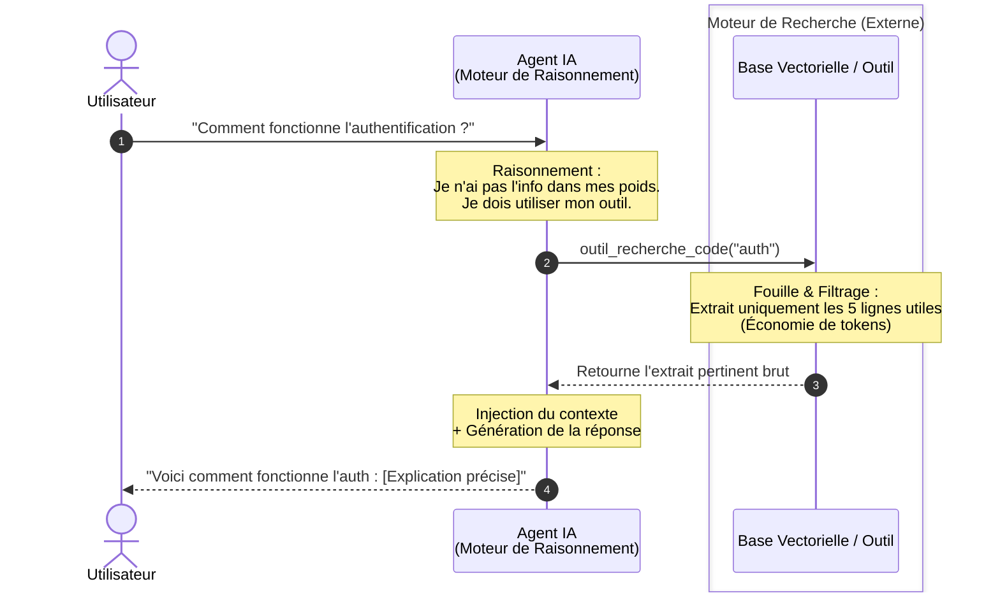
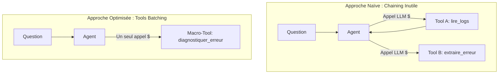
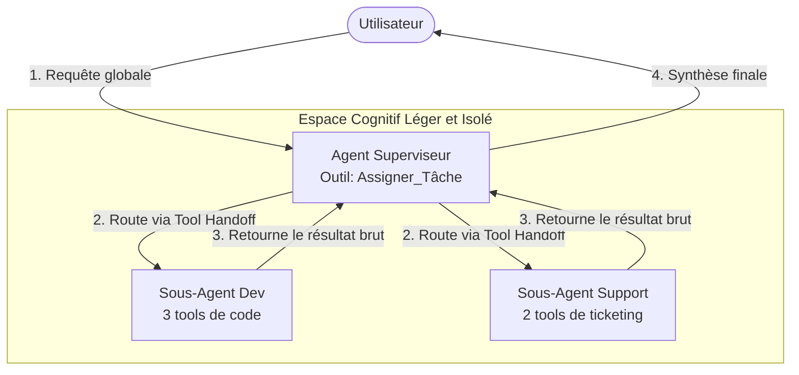
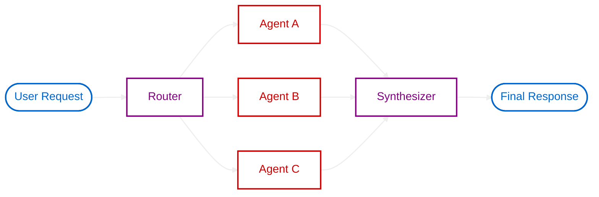

import SectionHeader from '@components/blog/SectionHeader.astro'
import Text from '@components/base/text.astro'
import TagList from '@components/base/TagList.astro'
import SectionTitle from '@components/blog/SectionTitle.astro'
import HighLight from '@components/base/Highlight.astro'
import Note from '@components/base/Note.astro'
import { Icon } from 'astro-icon/components'
import ContextGrid from '@components/articles/ContextGrid.astro'
import CodeBlock from '@components/base/CodeBlock.astro'
import Title from '@components/base/Title.astro'
import Link from '@components/base/Link.astro'

<SectionHeader sectionId="intro" label="intro" />

<Text>Il y a depuis quelques mois de plus en plus d'outils et de techniques pour développer des applications à l'aide d'agents IA. Cet article fait le point sur les différents outils et techniques que j'ai pu croiser, et partage mes retours d'expérience sur le développement applicatif assisté par agents IA.</Text>

<TagList tags={[
  { label: 'Agents IA' },
  { label: 'Contexte', variant: 'green' },
  { label: 'Multi-Agents' },
  { label: 'RAG', variant: 'purple' },
  { label: 'Engineering', variant: 'red' },
]} />

<Note title="Note">
  Le poste suivant s'appuiera sur [**OpenCode**](https://opencode.ai/) pour les exemples pratiques. Cependant, les concepts et la théorie présentés dans cet article restent applicables à la plupart des modèles de langage modernes, tels que Claude, etc...
</Note>

<SectionHeader sectionId="context" label="01" />

<SectionTitle>Le contexte : <HighLight accent='green'>mémoire volatile de l'agent</HighLight></SectionTitle>

<Text>Le contexte peut être vu comme une mémoire volatile (comme la RAM d'un ordinateur), qui est utilisée pour stocker l'identité de l'agent, les outils à sa disposition, les conversations passées, etc. C'est dans ce contexte que l'agent va puiser les informations nécessaires pour répondre aux questions ou accomplir les tâches qui lui sont demandées.</Text>

<Text>Le contexte d'un agent se compose de plusieurs couches qui convergent avant chaque inférence. Les différentes sources (directives, outils, compétences, historique, ...) sont assemblées dans une fenêtre de contexte unique.</Text>

<ContextGrid />

<SectionHeader sectionId="limit" label="02" />

<SectionTitle>Limites et <HighLight accent="red">dégradation du context</HighLight></SectionTitle>

<Text>Il est important de noter que le contexte est limité en taille et que plus celui-ci se remplit, plus l'agent produit des réponses de moins bonne qualité et donc fait apparaitre plusieurs problèmes :</Text>

<ul class="grid grid-cols-1 sm:grid-cols-2 gap-3 my-6">
    <li class="flex items-start gap-3 p-3 rounded-block transition-colors hover:bg-surface-hover">
      <Icon name="lucide:crosshair" class="mt-1 shrink-0 size-[18px] text-accent-red" />
      

        Perte de précision
        
Le modèle répond de façon approximative ou floue sur les détails techniques

      

    </li>
    <li class="flex items-start gap-3 p-3 rounded-block transition-colors hover:bg-surface-hover">
      <Icon name="lucide:message-square" class="mt-1 shrink-0 size-[18px] text-accent-purple" />
      

        Augmentation des hallucinations
        
L'agent invente des informations ou des faits inexistants avec assurance

      

    </li>
    <li class="flex items-start gap-3 p-3 rounded-block transition-colors hover:bg-surface-hover">
      <Icon name="lucide:clipboard" class="mt-1 shrink-0 size-[18px] text-accent-yellow" />
      

        Oublie des instructions système
        
Les directives données en début de session sont progressivement ignorées

      

    </li>
    <li class="flex items-start gap-3 p-3 rounded-block transition-colors hover:bg-surface-hover">
      <Icon name="lucide:trending-down" class="mt-1 shrink-0 size-[18px] text-accent-pink" />
      

        Raisonnement de moins bonne qualité
        
La chaîne de pensée devient moins cohérente et perd en rigueur logique

      

    </li>
    <li class="flex items-start gap-3 p-3 rounded-block transition-colors hover:bg-surface-hover">
      <Icon name="lucide:coins" class="mt-1 shrink-0 size-[18px] text-accent-green" />
      

        Augmentation du coût en token
        
Chaque requête consomme davantage de tokens, ce qui augmente la facture

      

    </li>
    <li class="flex items-start gap-3 p-3 rounded-block transition-colors hover:bg-surface-hover">
      <Icon name="lucide:clock" class="mt-1 shrink-0 size-[18px] text-accent-cyan" />
      

        Augmentation du temps de réponse
        
Le délai entre la requête et la réponse s'allonge significativement

      

    </li>
</ul>

  <Text>Ces problèmes ne surviennent pas uniquement lorsque la fenêtre de contexte est complètement saturée. En pratique, les performances d'un modèle commencent souvent à se dégrader bien avant d'atteindre la limite théorique annoncée.</Text>

  <Text>Certains modèles disposent de fenêtres de contexte de plus de 500 000 tokens, ce qui peut sembler considérable. Pourtant, dans la pratique, de nombreux modèles voient leurs performances diminuer bien avant d'atteindre cette limite, parfois dès 50 à 60 % de la fenêtre de contexte disponible.</Text>

  <Text>Cette dégradation progressive est notamment liée à l'accumulation d'informations peu pertinentes ou obsolètes dans le contexte, un phénomène souvent appelé context rot. Ainsi, augmenter la taille de la fenêtre de contexte ne résout pas le problème : un contexte plus grand n'est pas nécessairement un meilleur contexte.</Text>

  <Text>En pratique, supprimer régulièrement les informations devenues inutiles et ne conserver que le contexte réellement pertinent est souvent l'un des leviers les plus efficaces pour préserver les performances d'un agent.</Text>

<Note title="A retenir" variant="info">
Agrandir la fenêtre de contexte n'améliore pas automatiquement un agent. La qualité du contexte est souvent plus importante que sa taille. Supprimer les informations devenues inutiles ([**context rot**](https://www.trychroma.com/research/context-rot)) est l'une des optimisations les plus efficaces pour maintenir de bonnes performances.
</Note>

<SectionHeader sectionId="bruit" label="03" />

<SectionTitle>Capacités globales & <HighLight accent="yellow">bruit décisionnel</HighLight></SectionTitle>

<Text>Les capacités globales sont les outils, les compétences, les serveurs MCP, etc, qui sont disponibles pour tous les agents. Ils se situent généralement dans les répertoires au niveau de l'utilisateur (~/.opencode/).</Text>

<Text>Dans la pratique, il est souvent préférable de <HighLight accent="yellow">limiter les capacités globales</HighLight> autant que possible, car elles sont partagées entre tous les agents. Même lorsque les capacités globales ne sont jamais utilisées, leurs descriptions et leurs schémas sont souvent injectés dans le contexte. Cela a plusieurs conséquences néfastes :</Text>

<ul class="grid grid-cols-1 sm:grid-cols-2 gap-3 my-6">
  <li class="flex items-start gap-3 p-3 rounded-block transition-colors hover:bg-surface-hover">
    <Icon name="lucide:file-text" class="mt-1 shrink-0 size-[18px] text-accent-red" />
    

      Augmentation inutile de la taille du contexte
      
Avec tout ce que cela implique (cf. chapitre contexte)

    

  </li>
  <li class="flex items-start gap-3 p-3 rounded-block transition-colors hover:bg-surface-hover">
    <Icon name="lucide:git-branch" class="mt-1 shrink-0 size-[18px] text-accent-yellow" />
    

      Augmentation du bruit décisionnel
      
Plus un agent a de capacités, plus il a de choix à faire

    

  </li>
</ul>

<Text>J'utilise ici le terme de <HighLight accent="yellow" bold>bruit décisionnel</HighLight> pour désigner le fait que plus un agent a de capacités à sa disposition, plus il a de choix à faire pour décider quelle capacité utiliser pour accomplir une tâche.</Text>

<Text>Par exemple, imaginons un agent qui possède les compétences suivantes :</Text>

  

    <Icon name="lucide:search" class="shrink-0 size-[16px] text-accent-cyan" />
    search_code
  

  

    <Icon name="lucide:search" class="shrink-0 size-[16px] text-accent-cyan" />
    grep_code
  

  

    <Icon name="lucide:search" class="shrink-0 size-[16px] text-accent-cyan" />
    find_in_files
  

  

    <Icon name="lucide:search" class="shrink-0 size-[16px] text-accent-cyan" />
    semantic_search_code
  

<Text>Toutes ces compétences accomplissent à peu près la même chose : trouver du code dans un projet. Imaginons que l'utilisateur demande :</Text>

<Note title="Exemple" variant="warning">
  Trouve moi la classe UserService dans le projet.
</Note>

<Text>L'agent va devoir faire un choix entre les 4 compétences pour accomplir la tâche. Pour ce faire, il va :</Text>

<ol class="space-y-2 my-4 ml-6">
  <li class="flex items-start gap-3 text-text-muted text-[15px] leading-[1.8]">
    
    Comparer les outils
  </li>
  <li class="flex items-start gap-3 text-text-muted text-[15px] leading-[1.8]">
    
    Comprendre les différences entre les outils
  </li>
  <li class="flex items-start gap-3 text-text-muted text-[15px] leading-[1.8]">
    
    Choisir lequel est le plus adapté à la tâche
  </li>
  <li class="flex items-start gap-3 text-text-muted text-[15px] leading-[1.8]">
    
    Parfois hésiter ou utiliser le mauvais outil
  </li>
</ol>

<Text>Les conséquences de ce bruit décisionnel sont :</Text>

<ul class="grid grid-cols-1 sm:grid-cols-2 gap-3 my-6">
  <li class="flex items-start gap-3 p-3 rounded-block transition-colors hover:bg-surface-hover">
    <Icon name="lucide:clock" class="mt-1 shrink-0 size-[18px] text-accent-cyan" />
    

      Augmentation du temps de réponse
    

  </li>
  <li class="flex items-start gap-3 p-3 rounded-block transition-colors hover:bg-surface-hover">
    <Icon name="lucide:alert-triangle" class="mt-1 shrink-0 size-[18px] text-accent-red" />
    

      Possibilité d'erreur dans le choix de la capacité
    

  </li>
  <li class="flex items-start gap-3 p-3 rounded-block transition-colors hover:bg-surface-hover">
    <Icon name="lucide:coins" class="mt-1 shrink-0 size-[18px] text-accent-green" />
    

      Augmentation du coût en token
    

  </li>
  <li class="flex items-start gap-3 p-3 rounded-block transition-colors hover:bg-surface-hover">
    <Icon name="lucide:trending-down" class="mt-1 shrink-0 size-[18px] text-accent-pink" />
    

      Diminution de la performance globale de l'agent
    

  </li>
  <li class="flex items-start gap-3 p-3 rounded-block transition-colors hover:bg-surface-hover">
    <Icon name="lucide:clipboard" class="mt-1 shrink-0 size-[18px] text-accent-yellow" />
    

      Difficulté à suivre les instructions système
    

  </li>
</ul>

<Text>À noter que le bruit décisionnel ne vient pas uniquement des capacités globales, mais aussi :</Text>

<ul class="space-y-2 my-4 ml-6">
  <li class="flex items-start gap-3 text-text-muted text-[15px] leading-[1.8]">
    
    Des instructions système trop vagues, nombreuses ou contradictoires
  </li>
  <li class="flex items-start gap-3 text-text-muted text-[15px] leading-[1.8]">
    
    De prompts d'entrée trop longs ou trop complexes
  </li>
  <li class="flex items-start gap-3 text-text-muted text-[15px] leading-[1.8]">
    
    D'une architecture de code mal organisée ou trop complexe
  </li>
  <li class="flex items-start gap-3 text-text-muted text-[15px] leading-[1.8]">
    
    D'un RAG qui retourne trop de résultats non pertinents
  </li>
  <li class="flex items-start gap-3 text-text-muted text-[15px] leading-[1.8]">
    
    D'un historique de conversation trop long ou non pertinent
  </li>
</ul>

<Note title="À retenir" variant="info">
  Limiter les capacités globales au strict nécessaire et réduire le bruit décisionnel est l'un des leviers les plus efficaces pour améliorer les performances d'un agent.
</Note>

<SectionHeader sectionId="archi" label="04" />

<SectionTitle>L'Architecture : <HighLight accent="purple">un levier de performance</HighLight></SectionTitle>

<Text>L'architecture logicielle a un impact important sur les performances des agents IA.</Text>

<Text>Plus une architecture est <HighLight accent="green" bold>claire, modulaire et prévisible</HighLight>, plus il devient facile pour un agent de :</Text>

<ul class="space-y-2 my-4 ml-2">
  <li class="flex items-start gap-3 text-text-muted text-[15px] leading-[1.8]">
    
    Comprendre le système dans lequel il évolue
  </li>
  <li class="flex items-start gap-3 text-text-muted text-[15px] leading-[1.8]">
    
    Trouver les informations dont il a besoin pour accomplir une tâche
  </li>
  <li class="flex items-start gap-3 text-text-muted text-[15px] leading-[1.8]">
    
    Retrouver les informations pertinentes
  </li>
  <li class="flex items-start gap-3 text-text-muted text-[15px] leading-[1.8]">
    
    Accomplir des modifications sans charger une quantité d'informations inutile dans le contexte
  </li>
</ul>

<Text>À l'inverse, une architecture mal organisée, non modulaire ou trop complexe va rendre la tâche de l'agent plus difficile, et donc impacter négativement ses performances.</Text>

<Text>Ce point est particulièrement visible avec les architectures logicielles utilisant fortement :</Text>

<ul class="space-y-2 my-4 ml-2">
  <li class="flex items-start gap-3 text-text-muted text-[15px] leading-[1.8]">
    
    Les interfaces
  </li>
  <li class="flex items-start gap-3 text-text-muted text-[15px] leading-[1.8]">
    
    L'inversion de dépendance
  </li>
  <li class="flex items-start gap-3 text-text-muted text-[15px] leading-[1.8]">
    
    Les responsabilités explicites
  </li>
  <li class="flex items-start gap-3 text-text-muted text-[15px] leading-[1.8]">
    
    Les frontières métier claires
  </li>
</ul>

<Text>Pour citer quelques exemples d'architecture qui possèdent ces caractéristiques :</Text>

<ul class="grid grid-cols-1 sm:grid-cols-2 gap-3 my-6">
  <li class="flex items-center gap-3 p-3 rounded-block bg-surface-card border border-border transition-colors hover:bg-surface-hover">
    <Icon name="lucide:hexagon" class="shrink-0 size-[18px] text-accent-cyan" />
    Architecture hexagonale
  </li>
  <li class="flex items-center gap-3 p-3 rounded-block bg-surface-card border border-border transition-colors hover:bg-surface-hover">
    <Icon name="lucide:layers" class="shrink-0 size-[18px] text-accent-purple" />
    Clean architecture
  </li>
  <li class="flex items-center gap-3 p-3 rounded-block bg-surface-card border border-border transition-colors hover:bg-surface-hover">
    <Icon name="lucide:columns" class="shrink-0 size-[18px] text-accent-green" />
    Architecture orientée domaine (DDD)
  </li>
  <li class="flex items-center gap-3 p-3 rounded-block bg-surface-card border border-border transition-colors hover:bg-surface-hover">
    <Icon name="lucide:boxes" class="shrink-0 size-[18px] text-accent-yellow" />
    Architecture orientée microservices
  </li>
</ul>

<Text>etc...</Text>

<Title size={3}>Exemple concret</Title>

<Text>Imaginons une application e-commerce dans laquelle nous souhaitons exposer un nouveau use case permettant à un utilisateur de consulter l'historique de ses commandes.</Text>

<Text>Dans certaines architectures où les responsabilités techniques et métier sont fortement mélangées, l'agent devra souvent charger une grande partie de l'implémentation pour comprendre comment récupérer les commandes :</Text>

<CodeBlock code={`public class OrderRepository {

    private final EntityManager entityManager;
    private final RedisTemplate redisTemplate;
    private final KafkaProducer kafkaProducer;
    private final MetricsRegistry metricsRegistry;
    private final RetryExecutor retryExecutor;
    private final AuditService auditService;

    public List<Order> findOrdersByUserId(String userId) {

        metricsRegistry.increment("orders.search");

        String cacheKey = "orders:user:" + userId;

        List<Order> cachedOrders = redisTemplate.get(cacheKey);

        if (cachedOrders != null) {
            return cachedOrders;
        }

        return retryExecutor.execute(() -> {

            List<OrderEntity> entities = entityManager
                .createQuery("""
                    SELECT o
                    FROM orders o
                    LEFT JOIN order_items oi ON oi.order_id = o.id
                    LEFT JOIN payments p ON p.order_id = o.id
                    WHERE o.user_id = :userId
                    ORDER BY o.created_at DESC
                """)
                .setParameter("userId", userId)
                .getResultList();

            List<Order> orders = entities.stream()
                .map(this::mapEntity)
                .toList();

            kafkaProducer.publish(
                "orders.history.consulted",
                new OrderHistoryConsultedEvent(userId)
            );

            auditService.track(
                "ORDER_HISTORY_CONSULTED",
                Map.of("userId", userId)
            );

            redisTemplate.set(cacheKey, orders);

            return orders;
        });
    }
}`} lang="java" title="OrderRepository.java" />

<Text>Dans cet exemple, l'agent doit charger énormément d'informations qui ne sont pas forcément utiles pour comprendre le comportement métier :</Text>

<ul class="space-y-2 my-4 ml-2">
  <li class="flex items-start gap-3 text-text-muted text-[15px] leading-[1.8]">
    
    Cache Redis
  </li>
  <li class="flex items-start gap-3 text-text-muted text-[15px] leading-[1.8]">
    
    Métriques
  </li>
  <li class="flex items-start gap-3 text-text-muted text-[15px] leading-[1.8]">
    
    Retry
  </li>
  <li class="flex items-start gap-3 text-text-muted text-[15px] leading-[1.8]">
    
    Kafka
  </li>
  <li class="flex items-start gap-3 text-text-muted text-[15px] leading-[1.8]">
    
    Audit
  </li>
</ul>

<Text>À l'inverse, avec une architecture basée sur des interfaces, l'agent peut souvent raisonner uniquement à partir du contrat d'interface, sans avoir à charger l'implémentation complète. L'interface va donc agir comme une <HighLight accent="green" bold>représentation compressée du système</HighLight> :</Text>

<CodeBlock code={`public interface OrderRepository {
    List<Order> findOrdersByUserId(String userId);
}`} lang="java" title="OrderRepository.java" />

<Text>Dans cet exemple, l'agent peut comprendre le comportement métier simplement à partir de la signature de l'interface, sans avoir à charger les détails de l'implémentation.</Text>

<Text>Cela va donc permettre :</Text>

<ul class="grid grid-cols-1 sm:grid-cols-2 gap-3 my-6">
  <li class="flex items-start gap-3 p-3 rounded-block transition-colors hover:bg-surface-hover">
    <Icon name="lucide:minimize-2" class="mt-1 shrink-0 size-[18px] text-accent-cyan" />
    

      Réduire fortement la taille du contexte
    

  </li>
  <li class="flex items-start gap-3 p-3 rounded-block transition-colors hover:bg-surface-hover">
    <Icon name="lucide:git-branch" class="mt-1 shrink-0 size-[18px] text-accent-green" />
    

      Diminuer le bruit décisionnel
    

  </li>
  <li class="flex items-start gap-3 p-3 rounded-block transition-colors hover:bg-surface-hover">
    <Icon name="lucide:eye" class="mt-1 shrink-0 size-[18px] text-accent-purple" />
    

      Améliorer la lisibilité du système pour l'agent
    

  </li>
  <li class="flex items-start gap-3 p-3 rounded-block transition-colors hover:bg-surface-hover">
    <Icon name="lucide:coins" class="mt-1 shrink-0 size-[18px] text-accent-yellow" />
    

      Limiter la consommation de token
    

  </li>
</ul>

<Note title="À retenir" variant="info">
  Une architecture bien conçue — avec des interfaces, des responsabilités explicites et des frontières claires — agit comme un <HighLight accent="green" bold>compresseur de contexte naturel</HighLight> pour l'agent.
</Note>

<SectionHeader sectionId="compaction" label="05" />

<SectionTitle>La compaction : <HighLight accent="green">réduire la taille du contexte</HighLight></SectionTitle>

<Text>La compaction du contexte est une technique qui consiste à réduire la taille du contexte en supprimant les informations inutiles ou redondantes, ou en les résumant de manière à ce qu'elles prennent moins de place.</Text>

<Note title="Attention" variant="warning">
  Il existe plusieurs techniques de compaction, certaines possèdent des pertes d'information et d'autres non. Il est donc important d'avoir une bonne compréhension de ces techniques avant de les utiliser.
</Note>

<Text>Voici quelques techniques de compaction du contexte :</Text>

<SectionHeader sectionId="deletion" label="05.1" />

<Title size={3}>Compaction par suppression</Title>

<Text>Cette technique est la plus simple : elle consiste à supprimer les informations qui ne sont pas nécessaires pour accomplir une tâche. La plupart du temps cela se traduira par la suppression de la session courante de conversation, généralement en faisant un /new dans OpenCode et en supprimant les anciennes sessions.</Text>

<Note title="Attention" variant="warning">
  Un /new dans OpenCode ne supprime pas la mémoire de l'agent, il supprime uniquement la session courante de conversation. Les informations contenues dans la mémoire de l'agent (fichiers de mémoire, notes, etc.) ne sont pas supprimées et peuvent toujours être utilisées. Il est donc important de faire le ménage régulièrement dans ses sessions et les supprimer lorsqu'elles ne sont plus nécessaires, pour éviter d'avoir un contexte trop chargé et préserver les performances de l'agent.
</Note>

<SectionHeader sectionId="resume" label="05.2" />

<Title size={3}>Compaction par résumé</Title>

<Text>Cette technique consiste à résumer les informations du contexte de manière à ce qu'elles prennent moins de place, tout en conservant l'essentiel de l'information. Contrairement à la suppression, l'agent utilise ici sa propre intelligence (ou un autre modèle spécialisé dans le résumé) pour compresser les informations du contexte. La qualité de la compaction dépendra donc directement de la qualité du modèle utilisé.</Text>

<Text>C'est la méthode utilisée quand un utilisateur fait compact session dans OpenCode.</Text>

<Note title="Attention" variant="warning">
  Cette technique entraîne forcément des pertes d'information car le résumé peut omettre des détails qui semblaient inutiles sur le moment. Cette action doit donc être utilisée avec précaution.
</Note>

<Text>Dans la pratique, il est préférable de l'utiliser quand le contexte n'est pas encore trop chargé (~60 % de la fenêtre de contexte maximum) car plus le contexte sera chargé, plus le résumé sera de mauvaise qualité et plus il y aura de pertes d'information. De plus, ne pas attendre la compaction automatique peut permettre de passer des instructions de compaction si l'outillage le permet.</Text>

<Text>Par exemple, dans Claude Code on peut faire :</Text>

  <Icon name="lucide:terminal" class="shrink-0 size-[16px] text-accent-cyan" />
  /compact garde en priorité le schéma de la base de données

<SectionHeader sectionId="selection" label="05.3" />

<Title size={3}>Compaction par sélection</Title>

<Text>Cette technique consiste à remplacer une implémentation complète par une représentation plus compacte du système. On peut autant l'appliquer sur l'input que sur l'output de l'agent.</Text>

<Text>Quelques exemples concrets de compaction par sélection :</Text>

<Title size={3}>Toon (Token Oriented Object Notation)</Title>

  <Text>Toon est un format de sérialisation de données orienté token, conçu pour être utilisé dans les contextes d'agents IA. Il permet de représenter des objets complexes de manière compacte, en utilisant une syntaxe simple et facile à comprendre pour les modèles de langage.</Text>

  <Text>Voici un exemple de données sérialisées en format JSON :</Text>

  <CodeBlock code={`{
    "context": {
      "task": "Our favorite hikes together",
      "location": "Boulder",
        "season": "spring_2025"
      },
      "friends": ["ana", "luis", "sam"],
      "hikes": [
        {
          "id": 1,
          "name": "Blue Lake Trail",
          "distanceKm": 7.5,
          "elevationGain": 320,
          "companion": "ana",
          "wasSunny": true
        },
        {
          "id": 2,
          "name": "Ridge Overlook",
          "distanceKm": 9.2,
          "elevationGain": 540,
          "companion": "luis",
          "wasSunny": false
        },
        {
          "id": 3,
          "name": "Wildflower Loop",
          "distanceKm": 5.1,
          "elevationGain": 180,
          "companion": "sam",
          "wasSunny": true
        }
      ]
    }`} lang="json" title="data.json" />

    <Text>Peut être sérialisé en format Toon de la manière suivante :</Text>

    <CodeBlock code={`context:
      task: Our favorite hikes together
      location: Boulder
      season: spring_2025
    friends[3]: ana,luis,sam
    hikes[3]{id,name,distanceKm,elevationGain,companion,wasSunny}:
      1,Blue Lake Trail,7.5,320,ana,true
      2,Ridge Overlook,9.2,540,luis,false
      3,Wildflower Loop,5.1,180,sam,true`} lang="text" title="Toon" />
  

  <Title size={3}>Caveman</Title>

  

  <Text>Caveman est un outil qui va effectuer la compression directement sur l'output. Pour ce faire, il va demander aux modèles d'appliquer quelques contraintes visibles <Link href="https://github.com/anthropics/claude-code/blob/main/Caveman.md">ici</Link>.</Text>

  <Text>Exemple de compression avec Caveman :</Text>

  <Text>Réponse classique d'un agent sans Caveman :</Text>

  <Note title="69 Tokens">
    The reason your React component is re-rendering is likely because you're creating a new object reference on each render cycle. When you pass an inline object as a prop, React's shallow comparison sees it as a different object every time, which triggers a re-render. I'd recommend using useMemo to memoize the object.
  </Note>

  <Text>Réponse en utilisant les contraintes de Caveman :</Text>

  <Note title="19 Tokens" variant="success">
    New object ref each render. Inline object prop = new ref = re-render. Wrap in useMemo.
  </Note>

  <Text>En moyenne, selon les mainteneurs du projet, il y a une économie de ~75 % de tokens de sortie.</Text>

<Text>Les principaux avantages de ce genre d'outils sont :</Text>

<ul class="grid grid-cols-1 sm:grid-cols-2 gap-3 my-6">
  <li class="flex items-start gap-3 p-3 rounded-block transition-colors hover:bg-surface-hover">
    <Icon name="lucide:maximize" class="mt-1 shrink-0 size-[18px] text-accent-green" />
    

      Contexte de message réduit
      
Utilisation plus longue d'un même contexte

    

  </li>
  <li class="flex items-start gap-3 p-3 rounded-block transition-colors hover:bg-surface-hover">
    <Icon name="lucide:zap" class="mt-1 shrink-0 size-[18px] text-accent-cyan" />
    

      Accélération du temps de réponse
      
Réduction du nombre de tokens de sortie

    

  </li>
  <li class="flex items-start gap-3 p-3 rounded-block transition-colors hover:bg-surface-hover">
    <Icon name="lucide:coins" class="mt-1 shrink-0 size-[18px] text-accent-yellow" />
    

      Réduction de la consommation de tokens
      
Les tokens de sortie sont plus chers, la facture API est réduite

    

  </li>
</ul>

<Text>Cependant, il est important de noter que dans certains cas d'usage l'outil n'est pas adapté, par exemple :</Text>

<ul class="space-y-2 my-4 ml-2">
  <li class="flex items-start gap-3 text-text-muted text-[15px] leading-[1.8]">
    
    <strong class="text-text-secondary">Dégradation du raisonnement complexe :</strong> Pour des tâches de raisonnement complexes, les modèles semblent souvent bénéficier d'une génération intermédiaire de tokens permettant d'expliciter une partie du raisonnement. En le forçant à compresser ses pensées immédiatement, on affecte sa capacité de logique, ce qui augmente le risque d'erreur et d'hallucinations.
  </li>
</ul>

<Note title="À retenir" variant="info">
  La compaction par sélection est particulièrement efficace sur l'output. Des outils comme Caveman permettent d'économiser jusqu'à <HighLight accent="green" bold>75 % de tokens de sortie</HighLight>, mais attention à ne pas l'utiliser sur des tâches de raisonnement complexe.
</Note>

<SectionHeader sectionId="rag" label="06" />

<SectionTitle>RAG : <HighLight accent="cyan">Raisonnement & Données</HighLight></SectionTitle>

<Text>Le RAG (<HighLight accent="cyan">Retrieval Augmented Generation</HighLight>) est une <HighLight accent="cyan" bold>architecture de recherche et d'orchestration</HighLight> qui connecte un moteur de recherche (votre base de connaissance) à un moteur de raisonnement (LLM, algorithme de classification, etc.). Cette structure permet à l'IA d'accéder à vos données.</Text>

<Text>En isolant la recherche, cette architecture offre deux avantages majeurs :</Text>

<ul class="grid grid-cols-1 sm:grid-cols-2 gap-3 my-6">
  <li class="flex items-start gap-3 p-3 rounded-block transition-colors hover:bg-surface-hover">
    <Icon name="lucide:coins" class="mt-1 shrink-0 size-[18px] text-accent-green" />
    

      Économie de token
      
L'agent délègue la fouille de documents à un outil externe optimisé. Il ne reçoit que les extraits strictement nécessaires, évitant d'engorger son contexte avec des fichiers entiers.

    

  </li>
  <li class="flex items-start gap-3 p-3 rounded-block transition-colors hover:bg-surface-hover">
    <Icon name="lucide:layers" class="mt-1 shrink-0 size-[18px] text-accent-purple" />
    

      Polyvalence de source
      
On peut utiliser le RAG pour stocker différents types de documents : texte, vidéo, image, etc.

    

  </li>
</ul>

<Text>La performance et l'efficacité d'un RAG dépendent entièrement de la complexité de son architecture. Comme le montre <Link href="https://blog.starmorph.com/blog/rag-techniques-compared-best-practices-guide">cet article</Link>, obtenir des réponses de haute qualité implique un compromis entre la latence et le coût financier. De plus, mettre en place un RAG performant demande un effort d'ingénierie (chunking intelligent, gestion des embeddings, ranking, etc.).</Text>

<Text>Ce n'est pas une solution miracle — elle présente des limites :</Text>

<ul class="grid grid-cols-1 sm:grid-cols-2 gap-3 my-6">
  <li class="flex items-start gap-3 p-3 rounded-block transition-colors hover:bg-surface-hover">
    <Icon name="lucide:globe" class="mt-1 shrink-0 size-[18px] text-accent-red" />
    

      Questions à grand scope
      
Demander un résumé de 500 fichiers est inefficace : le RAG est conçu pour extraire des morceaux locaux, pas pour avoir une vue d'ensemble.

    

  </li>
  <li class="flex items-start gap-3 p-3 rounded-block transition-colors hover:bg-surface-hover">
    <Icon name="lucide:brain" class="mt-1 shrink-0 size-[18px] text-accent-yellow" />
    

      Manque de réflexion logique
      
Un RAG indexe et restitue de la donnée, il ne réfléchit pas. Connecter des règles logiques éparpillées nécessite de multiples appels et fait chuter les performances.

    

  </li>
</ul>

<Text>Pour le curieux qui voudrait essayer de construire un RAG, voici quelques cookbooks :</Text>

<ul class="space-y-2 my-4 ml-2">
  <li class="flex items-start gap-3 text-text-muted text-[15px] leading-[1.8]">
    
    <Link href="https://developers.openai.com/cookbook/examples/vector_databases/elasticsearch/elasticsearch-retrieval-augmented-generation#install-packages-and-import-modules">OpenAI Cookbook</Link>
  </li>
  <li class="flex items-start gap-3 text-text-muted text-[15px] leading-[1.8]">
    
    <Link href="https://platform.claude.com/cookbook/capabilities-retrieval-augmented-generation-guide">Claude Cookbook</Link>
  </li>
  <li class="flex items-start gap-3 text-text-muted text-[15px] leading-[1.8]">
    
    <Link href="https://deepwiki.com/athina-ai/rag-cookbooks">Athina AI RAG Cookbooks</Link>
  </li>
</ul>

<Note title="À retenir" variant="info">
  Le RAG est un outil puissant pour économiser des tokens et accéder à des données variées, mais il n'est pas adapté aux tâches nécessitant une <HighLight accent="cyan" bold>vue d'ensemble</HighLight> ou un <HighLight accent="cyan" bold>raisonnement logique transverse</HighLight>.
</Note>

<SectionHeader sectionId="rationalisation" label="07" />

<SectionTitle>Rationalisation : <HighLight accent="yellow">l'efficience par les tools</HighLight></SectionTitle>

<Text>Un agent peut également être optimisé via la structure des tools qu'il utilise. Donner trop d'outils, des outils trop atomiques ou des outils inutiles peuvent nuire à votre agent car cela augmente sa complexité cognitive de la même manière qu'un humain et cela va ralentir ses décisions, augmenter le risque d'erreur et d'hallucinations tout en augmentant sa consommation de token car celui-ci devra plus raisonner pour prendre ses décisions.</Text>

<Text>Pour optimiser cette partie il existe plusieurs stratégies :</Text>

<Title size={3}>La réduction du nombre de tools</Title>

<Text>C'est la manière la plus idiomatique pour redonner de la précision à un agent. Certaines études suggèrent qu'au-delà d'un certain nombre d'outils (~7 selon <Link href="https://arxiv.org/html/2605.24660v1">How Many Tools Should an LLM Agent See? A Chance-Corrected Answer</Link>), les performances de sélection se dégradent fortement.</Text>

<Text>Pour ce faire on a 2 stratégies à ma connaissance :</Text>

<ul class="space-y-2 my-4 ml-6">
  <li class="flex items-start gap-3 text-text-muted text-[15px] leading-[1.8]">
    
    La suppression pure et simple des outils non essentiels ou non utilisés par l'agent.
  </li>
  <li class="flex items-start gap-3 text-text-muted text-[15px] leading-[1.8]">
    
    Le découpage par spécialisation, en utilisant une architecture "Superviseur / sous-agent" (que nous détaillerons plus tard dans une partie dédiée). Au lieu d'avoir un seul agent avec 20 outils, on crée un superviseur qui distribue les tâches au sous-agent qui aura 6-7 outils spécifiques.
  </li>
</ul>

<Title size={3}>Le Tools Batching</Title>

<Text>Cette seconde stratégie consiste à éliminer l'enchaînement de tools répétitifs et prévisibles. Par exemple, si on remarque qu'un agent appelle systématiquement l'outil A, attend le résultat puis appelle l'outil B par exemple lire_log puis extraire_erreur. Laisser l'agent faire cela va augmenter sa consommation de token et la latence, car celui-ci va devoir raisonner entre chaque étape.</Text>

<Text>La solution est donc de fusionner ces 2 outils dans un script. Au lieu de donner 2 outils atomiques à l'agent, on lui fournit un outil packagé. Exemple diagnostique_erreur. L'agent déléguera donc l'ensemble de la chaîne d'exécution au script, économisant ainsi plusieurs cycles de réflexion coûteux.</Text>

<SectionHeader sectionId="agent" label="08" />

<SectionTitle>Architecture <HighLight accent="cyan">Supervisor / Sub-agent</HighLight></SectionTitle>

<Text>Au vu de ce qui a été vu avant on peut tirer un constat. C'est que quand un système doit gérer un grand nombre de fonctionnalités, l'agent unique perd sa performance à cause de ses outils, de sa taille de contexte etc. Pour essayer de solutionner ce problème, on a mis à inventer le pattern supervisor / sub-agent.</Text>

<Text>Cette architecture part d'un constat simple, un agent unique peut posséder trop de responsabilités. De ce fait l'architecture multi agents peut être vue comme une stratégie de partitionnement du contexte</Text>

<Text><strong class="text-text-primary">Les avantages de ce pattern :</strong></Text>

<ul class="space-y-2 my-4 ml-2">
  <li class="flex items-start gap-3 text-text-muted text-[15px] leading-[1.8]">
    
    <strong class="text-text-secondary">Isolation sémantique et cognitive :</strong> Chaque sous-agent évolue dans un contexte qui lui est propre et n'a accès qu'aux outils strictement nécessaires.
  </li>
</ul>

  <table class="w-full text-[15px] border-collapse">
    <thead>
      <tr class="border-b border-border">
        <th class="text-left py-3 px-4 text-text-secondary font-semibold">Type</th>
        <th class="text-center py-3 px-4 text-text-secondary font-semibold">Avantage</th>
        <th class="text-center py-3 px-4 text-text-secondary font-semibold">Inconvénient</th>
      </tr>
    </thead>
    <tbody>
      <tr class="border-b border-border">
        <td class="py-3 px-4 text-text-muted">Agent générique</td>
        <td class="py-3 px-4 text-center text-text-muted">flexible</td>
        <td class="py-3 px-4 text-center text-text-muted">bruit cognitif</td>
      </tr>
      <tr class="border-b border-border">
        <td class="py-3 px-4 text-text-muted">Agent spécialisé</td>
        <td class="py-3 px-4 text-center text-text-muted">efficace</td>
        <td class="py-3 px-4 text-center text-text-muted">moins adaptable</td>
      </tr>
    </tbody>
  </table>

<ul class="space-y-2 my-4 ml-2">
  <li class="flex items-start gap-3 text-text-muted text-[15px] leading-[1.8]">
    
    <strong class="text-text-secondary">Spécialisation des modèles :</strong> on va pouvoir choisir le modèle utilisé par chaque agent de la chaîne, par exemple utiliser un modèle plus performant en logique pour le superviseur, tandis que nos sous-agents pourront tourner sur des modèles beaucoup plus spécialisés, plus rapides et moins coûteux. Chaque agent aura une fenêtre contextuelle qui lui est propre et donc pourra également être plus détaillée car on encadrera mieux le travail qu'il devra exécuter.
  </li>
</ul>

<Text><strong class="text-text-primary">Les inconvénients :</strong></Text>

<ul class="space-y-3 my-4 ml-2">
  <li class="flex items-start gap-3 text-text-muted text-[15px] leading-[1.8]">
    
    

      <strong class="text-text-secondary">Superviseur comme point de saturation :</strong> même si les sous-agents ont leur charge cognitive réduite, la complexité du système ne disparaît pas, elle est simplement déplacée vers le superviseur.
    

  </li>
  <li class="flex items-start gap-3 text-text-muted text-[15px] leading-[1.8]">
    
    

      <strong class="text-text-secondary">Propagation d'erreur / hallucination :</strong> si un modèle hallucine ou propage une erreur cela se répercute sur l'ensemble de la chaîne et peut même créer une boucle infinie d'appel entre les agents ce qui coûte cher (Les frameworks pour multi agent implémentent tout de même des protections (TTL, Tool call limit, etc.) contre cela, mais cela représente quand même un coût non négociable).
    

  </li>
  <li class="flex items-start gap-3 text-text-muted text-[15px] leading-[1.8]">
    
    

      <strong class="text-text-secondary">Perte de contexte pour les sous-agents :</strong> Pour garder les sous-agents légers, on évite de leur transférer l'intégralité de l'historique de la discussion et on leur donne un résumé.
    

  </li>
  <li class="flex items-start gap-3 text-text-muted text-[15px] leading-[1.8]">
    
    

      <strong class="text-text-secondary">Augmentation des coûts :</strong> pour répondre à une question l'utilisateur ne fait plus un seul appel LLM, mais une chaîne d'appels. Par exemple dans l'architecture suivante :
    

  </li>
</ul>

<Text>on se retrouvera avec :</Text>

  Appel global = LLM Superviseur (Routage) + LLM Sous-Agent (Exécution) + LLM Superviseur (Synthèse)

<Text>Si nos agents doivent échanger des rapports ou faire des allers-retours, le nombre de requêtes API peut exploser.</Text>

<Text>Il sera tout de même important de prendre en compte qu'il existe plusieurs types d'architecture multi-agent comme le montre <Link href="https://www.langchain.com/blog/choosing-the-right-multi-agent-architecture">l'article suivant</Link> et que chaque architecture possède ses best practices et ses trade offs. C'est donc un pattern à adapter à chaque projet.</Text>

<SectionHeader sectionId="synthese" label="synthèse" />

<SectionTitle>Synthèse : le contexte, <HighLight accent="green">ressource critique</HighLight></SectionTitle>

<Text>Au travers de ces différents exemples, on peut tirer une conclusion assez claire : le principal facteur limitant des agents IA n'est pas uniquement lié à la qualité du modèle utilisé, mais surtout à la manière dont on structure l'ensemble de son environnement de travail.</Text>

<Text>Le contexte devient une nouvelle <HighLight accent="green" bold>ressource critique</HighLight> au même titre que la RAM, le processeur, etc. Plus un agent doit manipuler d'informations, de tools, etc., plus ses performances se dégradent :</Text>

<ul class="space-y-2 my-4 ml-6">
  <li class="flex items-start gap-3 text-text-muted text-[15px] leading-[1.8]">
    
    Augmentation du bruit décisionnel
  </li>
  <li class="flex items-start gap-3 text-text-muted text-[15px] leading-[1.8]">
    
    Perte de précision
  </li>
  <li class="flex items-start gap-3 text-text-muted text-[15px] leading-[1.8]">
    
    Hausse des hallucinations
  </li>
  <li class="flex items-start gap-3 text-text-muted text-[15px] leading-[1.8]">
    
    Augmentation des coûts
  </li>
  <li class="flex items-start gap-3 text-text-muted text-[15px] leading-[1.8]">
    
    Augmentation du temps de réponse
  </li>
</ul>

<Text>L'enjeu majeur des utilisateurs d'agents IA à grande échelle consiste donc à gérer cette pression contextuelle.</Text>

<Text>Cela passe par plusieurs stratégies :</Text>

<ul class="space-y-2 my-4 ml-6">
  <li class="flex items-start gap-3 text-text-muted text-[15px] leading-[1.8]">
    
    Limiter les capacités globales
  </li>
  <li class="flex items-start gap-3 text-text-muted text-[15px] leading-[1.8]">
    
    Concevoir des architectures logicielles lisibles et modulaires
  </li>
  <li class="flex items-start gap-3 text-text-muted text-[15px] leading-[1.8]">
    
    Compacter intelligemment le contexte
  </li>
  <li class="flex items-start gap-3 text-text-muted text-[15px] leading-[1.8]">
    
    Rationaliser les tools
  </li>
  <li class="flex items-start gap-3 text-text-muted text-[15px] leading-[1.8]">
    
    Utiliser des architectures multi-agents lorsque la complexité devient importante
  </li>
</ul>

<Text>Cependant ces optimisations ne sont pas gratuites :</Text>

<ul class="space-y-2 my-4 ml-6">
  <li class="flex items-start gap-3 text-text-muted text-[15px] leading-[1.8]">
    
    Pertes potentielles d'information
  </li>
  <li class="flex items-start gap-3 text-text-muted text-[15px] leading-[1.8]">
    
    Augmentation de la complexité système
  </li>
  <li class="flex items-start gap-3 text-text-muted text-[15px] leading-[1.8]">
    
    Hausse des coûts
  </li>
  <li class="flex items-start gap-3 text-text-muted text-[15px] leading-[1.8]">
    
    Propagation d'erreurs entre agents
  </li>
</ul>

<SectionHeader sectionId="references" label="références" />

<ol class="space-y-3 my-4 ml-6">
  <li class="flex items-start gap-3 text-text-muted text-[15px] leading-[1.8]">
    
    <Link href="https://www.trychroma.com/research/context-rot">Context Rot — Chroma Research</Link>
  </li>
  <li class="flex items-start gap-3 text-text-muted text-[15px] leading-[1.8]">
    
    <Link href="https://arxiv.org/html/2605.24660v1">How Many Tools Should an LLM Agent See? A Chance-Corrected Answer — arXiv</Link>
  </li>
  <li class="flex items-start gap-3 text-text-muted text-[15px] leading-[1.8]">
    
    <Link href="https://blog.starmorph.com/blog/rag-techniques-compared-best-practices-guide">RAG Techniques Compared — Starmorph Blog</Link>
  </li>
  <li class="flex items-start gap-3 text-text-muted text-[15px] leading-[1.8]">
    
    <Link href="https://developers.openai.com/cookbook/examples/vector_databases/elasticsearch/elasticsearch-retrieval-augmented-generation#install-packages-and-import-modules">OpenAI Cookbook — RAG with Elasticsearch</Link>
  </li>
  <li class="flex items-start gap-3 text-text-muted text-[15px] leading-[1.8]">
    
    <Link href="https://platform.claude.com/cookbook/capabilities-retrieval-augmented-generation-guide">Claude Cookbook — RAG Guide</Link>
  </li>
  <li class="flex items-start gap-3 text-text-muted text-[15px] leading-[1.8]">
    
    <Link href="https://deepwiki.com/athina-ai/rag-cookbooks">Athina AI RAG Cookbooks</Link>
  </li>
  <li class="flex items-start gap-3 text-text-muted text-[15px] leading-[1.8]">
    
    <Link href="https://github.com/anthropics/claude-code/blob/main/Caveman.md">Caveman — Claude Code Output Compression</Link>
  </li>
  <li class="flex items-start gap-3 text-text-muted text-[15px] leading-[1.8]">
    
    <Link href="https://www.langchain.com/blog/choosing-the-right-multi-agent-architecture">Choosing the Right Multi-Agent Architecture — LangChain Blog</Link>
  </li>
  <li class="flex items-start gap-3 text-text-muted text-[15px] leading-[1.8]">
    
    <Link href="https://opencode.ai/">OpenCode — AI Agent CLI</Link>
  </li>
</ol>

