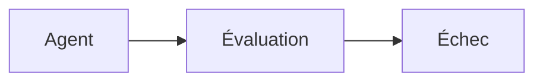
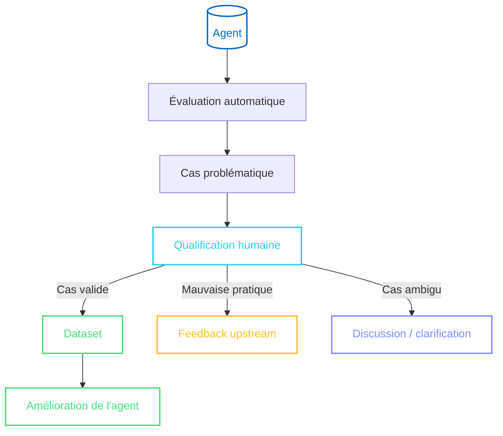

import SectionHeader from '@components/blog/SectionHeader.astro'
import Text from '@components/base/text.astro'
import TagList from '@components/base/TagList.astro'
import SectionTitle from '@components/blog/SectionTitle.astro'
import HighLight from '@components/base/Highlight.astro'
import Note from '@components/base/Note.astro'
import { Icon } from 'astro-icon/components'
import CodeBlock from '@components/base/CodeBlock.astro'
import DiffBlock from '@components/base/DiffBlock.astro'
import Table from '@components/base/Table.astro'
import Title from '@components/base/Title.astro'
import Link from '@components/base/Link.astro'

<SectionHeader sectionId="intro" label="intro" />

<Text>Avant de pouvoir déployer et améliorer un agent IA, il est important de pouvoir <HighLight accent="cyan" bold>mesurer ses performances</HighLight>. Cela permet de s'assurer que l'agent répond aux attentes et de détecter rapidement les problèmes qui pourraient survenir.</Text>

<Text>Cela peut sembler évident, car les acteurs logiciels sont habitués à mettre en place des tests unitaires, d'intégration, de régression, etc. pour vérifier le bon fonctionnement de leurs systèmes. Cependant, les systèmes basés sur des modèles de langage introduisent une difficulté supplémentaire : ils <HighLight accent="yellow" bold>produisent des réponses probabilistes et non déterministes</HighLight>. Par conséquent, une même question peut entraîner des réponses différentes, parfois toutes acceptables, parfois complètement incorrectes.</Text>

<Text>Par exemple, si nous demandons à un agent de faire un résumé d'un texte. Contrairement à une application classique qui retournerait toujours le même résultat pour une même entrée, un agent IA pourrait produire des résumés différents à chaque exécution, de plus il n'existe pas nécessairement une « bonne » réponse unique. Deux résumés différents peuvent être tout à fait valides et pertinents, même s'ils ne sont pas identiques. Cela démontre que dans certains cas, le défi n'est pas de savoir si la réponse est « correcte » ou « incorrecte », mais plutôt de <HighLight accent="green" bold>juger de sa qualité relative</HighLight>, de sa pertinence et de sa cohérence avec les attentes.</Text>

<Text>Cette nature probabiliste rend donc l'évaluation des agents IA plus complexe qu'un simple test binaire de succès ou d'échec. De plus, il faut trouver des métriques adaptées pour juger de la qualité des réponses, qui parfois peuvent être subjectives et difficiles à quantifier, ce qui rend l'évaluation difficile.</Text>

<TagList tags={[
  { label: 'Agents IA' },
  { label: 'Benchmark', variant: 'green' },
  { label: 'DeepEval', variant: 'purple' },
  { label: 'LLM-as-a-judge', variant: 'red' },
  { label: 'Human-in-the-loop', variant: 'yellow' },
]} />

<Text>Pourtant, sans capacité d'évaluation, il devient difficile de savoir si :</Text>

<ul class="grid grid-cols-1 sm:grid-cols-2 gap-3 my-6">
  <li class="flex items-start gap-3 p-3 rounded-block transition-colors hover:bg-surface-hover">
    <Icon name="lucide:git-compare" class="mt-1 shrink-0 size-[18px] text-accent-cyan" />
    

      Une nouvelle version du modèle est-elle meilleure ?
      
Comparer deux versions successives d'un modèle

    

  </li>
  <li class="flex items-start gap-3 p-3 rounded-block transition-colors hover:bg-surface-hover">
    <Icon name="lucide:pen-tool" class="mt-1 shrink-0 size-[18px] text-accent-purple" />
    

      Un prompt a-t-il amélioré ou dégradé l'agent ?
      
Mesurer l'impact d'une modification du prompt

    

  </li>
  <li class="flex items-start gap-3 p-3 rounded-block transition-colors hover:bg-surface-hover">
    <Icon name="lucide:activity" class="mt-1 shrink-0 size-[18px] text-accent-yellow" />
    

      Le système fonctionne-t-il toujours correctement ?
      
Détecter les régressions au fil du temps

    

  </li>
  <li class="flex items-start gap-3 p-3 rounded-block transition-colors hover:bg-surface-hover">
    <Icon name="lucide:alert-triangle" class="mt-1 shrink-0 size-[18px] text-accent-red" />
    

      Existe-t-il des cas problématiques ?
      
Identifier les cas où l'agent a du mal à répondre

    

  </li>
</ul>

<Text>L'objectif de l'évaluation n'est donc pas uniquement de mesurer les performances actuelles de l'agent, mais aussi de <HighLight accent="green" bold>fournir des données pour guider les améliorations futures</HighLight>, vérifier les régressions potentielles et suivre l'évolution des performances au fil du temps.</Text>

<SectionHeader sectionId="benchmarks" label="01" />

<SectionTitle>Benchmarks publics : <HighLight accent="cyan">utiles mais souvent insuffisants</HighLight></SectionTitle>

<Text>Pour mesurer les performances d'un agent IA, la communauté a développé de nombreux benchmarks publics. Ces jeux de données standardisés permettent de comparer les performances des modèles sur différents types de tâches comme le raisonnement, la compréhension de texte, la programmation, etc. Parmi les plus connus, on peut citer :</Text>

<ul class="grid grid-cols-1 sm:grid-cols-2 gap-3 my-6">
  <li class="flex items-start gap-3 p-3 rounded-block bg-surface-card border border-border transition-colors hover:bg-surface-hover">
    <Icon name="lucide:graduation-cap" class="mt-1 shrink-0 size-[18px] text-accent-green" />
    

      MMLU
      
Évalue les connaissances académiques sur plusieurs domaines

    

  </li>
  <li class="flex items-start gap-3 p-3 rounded-block bg-surface-card border border-border transition-colors hover:bg-surface-hover">
    <Icon name="lucide:code-2" class="mt-1 shrink-0 size-[18px] text-accent-cyan" />
    

      HumanEval
      
Mesure la génération de code à partir de descriptions naturelles

    

  </li>
  <li class="flex items-start gap-3 p-3 rounded-block bg-surface-card border border-border transition-colors hover:bg-surface-hover">
    <Icon name="lucide:sigma" class="mt-1 shrink-0 size-[18px] text-accent-purple" />
    

      GSM8K
      
Résolution de problèmes de mathématiques et de logique

    

  </li>
</ul>

<Text>Ces benchmarks sont utiles pour avoir une idée générale des performances d'un modèle sur des tâches standardisées. Cependant, ils ne reflètent pas toujours les cas d'utilisation spécifiques que l'on peut rencontrer dans un contexte réel. Lorsque l'on doit évaluer un agent destiné à être utilisé dans un contexte particulier, ces benchmarks indiquent seulement une <HighLight accent="yellow" bold>tendance générale</HighLight> et ne permettent pas nécessairement de savoir si l'agent sera performant dans le contexte spécifique pour lequel il est destiné.</Text>

<Text>Nous pouvons par exemple constater ce phénomène avec <Link href="https://www.swebench.com/">SWE-Bench</Link>, un benchmark populaire pour évaluer les agents de développement logiciel. Contrairement à HumanEval, qui se concentre sur la génération de code à partir de descriptions en langage naturel, SWE-Bench évalue les agents sur des tâches plus complexes et réalistes, comme la compréhension de code existant, la correction de bugs ou l'optimisation de performances. Un agent peut très bien obtenir un score élevé sur HumanEval mais échouer sur SWE-Bench, car ce dernier teste des compétences <HighLight accent="cyan" bold>plus avancées et spécifiques</HighLight> au développement logiciel.</Text>

<Text>À première vue, il pourrait sembler naturel de considérer qu'un agent obtenant un meilleur score sur SWE-Bench sera également meilleur dans tous les contextes de développement logiciel. Cependant, cette conclusion serait trompeuse.</Text>

<Text>En effet, comme tout benchmark, SWE-Bench repose sur un ensemble de choix qui influencent les résultats. Historiquement, une grande partie des dépôts utilisés dans le benchmark proviennent de projets <HighLight accent="green" bold>Python open source</HighLight>. Un agent obtenant un score élevé sur SWE-Bench démontre donc avant tout sa capacité à résoudre des problèmes au sein de projets Python.</Text>

<Text>Or dans de nombreuses entreprises, les applications sont développées dans d'autres langages, comme Java, C++, C#, etc. Un agent qui excelle sur SWE-Bench pourrait donc ne pas être performant dans un contexte de développement logiciel plus généraliste, car il n'a pas été évalué sur des tâches représentatives de ces autres langages.</Text>

<Text>On peut constater cela en regardant le leaderboard de SWE-Bench en verified (benchmark Python only) et dans le benchmark multilingual.</Text>

<Title size={3}>Top 5 SWE-Bench Verified (Python only) — 18-06-2026</Title>

<Table
  headers={[{ label: 'Rang', align: 'center' }, { label: 'Modèle' }, { label: '% Resolved', align: 'right' }, { label: 'Avg. $', align: 'right' }, { label: 'Date' }, { label: 'Agent' }]}
  highlightRows={[0]}
  highlightColor="green"
  rows={[
    ['1', 'Claude 4.5 Opus (high reasoning)', '76.80%', '$0.75', '2026-02-17', '2.0.0'],
    ['2', 'Gemini 3 Flash (high reasoning)', '75.80%', '$0.36', '2026-02-17', '2.0.0'],
    ['3', 'MiniMax M2.5 (high reasoning)', '75.80%', '$0.07', '2026-02-17', '2.0.0'],
    ['4', 'Claude Opus 4.6', '75.60%', '$0.55', '2026-02-17', '2.0.0'],
    ['5', 'GPT-5-2 Codex', '72.80%', '$0.45', '2026-02-19', '2.0.0'],
  ]}
/>

<Title size={3}>Top 5 SWE-Bench Multilingual — 18-06-2026</Title>

<Table
  headers={[{ label: 'Rang', align: 'center' }, { label: 'Modèle' }, { label: '% Resolved', align: 'right' }, { label: 'Avg. $', align: 'right' }, { label: 'Date' }, { label: 'Agent' }]}
  highlightRows={[0]}
  highlightColor="purple"
  rows={[
    ['1', 'Gemini 3 Flash', '72.70%', '$0.35', '2026-02-13', '2.0.0a0'],
    ['2', 'Claude 4.6 Opus', '72.00%', '$0.66', '2026-02-13', '2.0.0a0'],
    ['3', 'Claude 4.5 Opus', '70.70%', '$0.83', '2026-02-13', '2.0.0a0'],
    ['4', 'GLM-5', '69.70%', '$0.64', '2026-02-13', '2.0.0a0'],
    ['5', 'Gemini 3 Pro', '68.70%', '$1.02', '2026-02-13', '2.0.0a0'],
  ]}
/>

<Text>On peut constater que le classement évolue significativement entre les deux benchmarks. Certains modèles gagnent plusieurs places tandis que d'autres <HighLight accent="red" bold>disparaissent complètement du top 5</HighLight>. Pourtant les modèles eux-mêmes n'ont pas changé. La seule différence est le benchmark utilisé pour les évaluer.</Text>

<Text>Il est important de noter que le langage utilisé n'est pas le seul facteur qui peut influencer les performances d'un agent sur un benchmark. D'autres facteurs :</Text>

<ul class="space-y-2 my-4 ml-6">
  <li class="flex items-start gap-3 text-text-muted text-[15px] leading-[1.8]">
    
    Les domaines métier représentés dans les données
  </li>
  <li class="flex items-start gap-3 text-text-muted text-[15px] leading-[1.8]">
    
    Les types de tâches évaluées
  </li>
  <li class="flex items-start gap-3 text-text-muted text-[15px] leading-[1.8]">
    
    Les outils mis à disposition de l'agent
  </li>
  <li class="flex items-start gap-3 text-text-muted text-[15px] leading-[1.8]">
    
    Les critères de réussite définis pour chaque tâche
  </li>
  <li class="flex items-start gap-3 text-text-muted text-[15px] leading-[1.8]">
    
    La diversité des scénarios testés
  </li>
  <li class="flex items-start gap-3 text-text-muted text-[15px] leading-[1.8]">
    
    La difficulté et la nature des problèmes posés
  </li>
</ul>

<Text>Ainsi, quand un agent excelle sur un benchmark, il faut comprendre que cela indique uniquement ses performances sur l'ensemble de tâches défini par ce benchmark, et <HighLight accent="yellow" bold>non sur l'ensemble des situations qu'il pourrait rencontrer en production</HighLight>.</Text>

<Text>Les benchmarks publics sont donc utiles pour avoir une idée générale des performances d'un agent, mais ils ne suffisent pas à évaluer sa performance dans un contexte spécifique. Pour cela, il est nécessaire de mettre en place des <HighLight accent="green" bold>évaluations personnalisées</HighLight> qui reflètent les cas d'utilisation réels et les exigences spécifiques de l'environnement dans lequel l'agent sera déployé.</Text>

<SectionHeader sectionId="construire" label="02" />

<SectionTitle>Construire son benchmark : <HighLight accent="green">du générique au contextualisé</HighLight></SectionTitle>

<Text>Comme on l'a vu précédemment, les benchmarks publics permettent de comparer les modèles entre eux mais ne garantissent pas les performances d'un agent dans un contexte métier spécifique.</Text>

<Text>La solution consiste alors à <HighLight accent="green" bold>construire son propre benchmark</HighLight>, basé sur les cas d'utilisation réels que l'agent rencontrera en production. Cependant, ce n'est pas une tâche triviale : il est nécessaire de définir les objectifs de l'évaluation, de sélectionner les tâches représentatives, de créer des jeux de données pertinents et de définir des heuristiques d'évaluation adaptées. Cela peut nécessiter des ressources importantes, notamment en termes de temps et d'expertise.</Text>

<Text>De plus, dans le cas d'agents, il ne suffit généralement pas d'évaluer uniquement le résultat final produit. Un workflow agentique est composé de <HighLight accent="cyan" bold>plusieurs étapes</HighLight> et chacune d'entre elles peut être source d'erreurs. Il est donc nécessaire d'évaluer les différents composants qui interviennent dans l'exécution du workflow.</Text>

<Text>On peut par exemple chercher à évaluer :</Text>

<ul class="grid grid-cols-1 sm:grid-cols-2 gap-3 my-6">
  <li class="flex items-start gap-3 p-3 rounded-block transition-colors hover:bg-surface-hover">
    <Icon name="lucide:wrench" class="mt-1 shrink-0 size-[18px] text-accent-cyan" />
    

      Le Skill / Tool calling
      
Le bon outil, les bons paramètres, au bon moment du workflow

    

  </li>
  <li class="flex items-start gap-3 p-3 rounded-block transition-colors hover:bg-surface-hover">
    <Icon name="lucide:database" class="mt-1 shrink-0 size-[18px] text-accent-purple" />
    

      Le RAG
      
Document récupéré pertinent et suffisant pour répondre

    

  </li>
  <li class="flex items-start gap-3 p-3 rounded-block transition-colors hover:bg-surface-hover">
    <Icon name="lucide:bug" class="mt-1 shrink-0 size-[18px] text-accent-yellow" />
    

      La gestion d'erreurs
      
Comportement attendu lorsque un outil échoue ou un doc est introuvable

    

  </li>
  <li class="flex items-start gap-3 p-3 rounded-block transition-colors hover:bg-surface-hover">
    <Icon name="lucide:shield-check" class="mt-1 shrink-0 size-[18px] text-accent-green" />
    

      Le respect des règles métier
      
Contraintes et règles définies pour le contexte de déploiement

    

  </li>
  <li class="flex items-start gap-3 p-3 rounded-block transition-colors hover:bg-surface-hover">
    <Icon name="lucide:clock" class="mt-1 shrink-0 size-[18px] text-accent-red" />
    

      Le temps de traitement
      
Délai raisonnable et approprié pour la tâche

    

  </li>
  <li class="flex items-start gap-3 p-3 rounded-block transition-colors hover:bg-surface-hover">
    <Icon name="lucide:coins" class="mt-1 shrink-0 size-[18px] text-accent-pink" />
    

      Le coût de traitement
      
Coût acceptable par rapport à la valeur apportée

    

  </li>
  <li class="flex items-start gap-3 p-3 rounded-block transition-colors hover:bg-surface-hover">
    <Icon name="lucide:message-square-text" class="mt-1 shrink-0 size-[18px] text-accent-cyan" />
    

      La qualité de la réponse finale
      
Réponse correcte, complète et pertinente par rapport à la demande

    

  </li>
</ul>

<Text>La difficulté est alors de définir, pour chacun de ces éléments, <HighLight accent="yellow" bold>une manière fiable de déterminer si l'agent a réussi ou échoué</HighLight>.</Text>

<Text>Pour certaines propriétés, cette évaluation peut être <HighLight accent="green" bold>déterministe</HighLight>. On peut par exemple vérifier qu'un outil précis a été appelé avec les bons paramètres, ou que le temps de traitement est inférieur à un seuil défini. Pour d'autres propriétés, comme la pertinence d'un document récupéré ou la qualité d'une réponse générée, il n'existe pas nécessairement de réponse unique permettant une comparaison directe.</Text>

<Text>Il faut alors définir des <HighLight accent="cyan" bold>heuristiques de réussite</HighLight> capables d'évaluer ces comportements. Cette étape est particulièrement importante, car une mauvaise heuristique peut conduire à des conclusions erronées sur la performance de l'agent. Définir une bonne heuristique n'est cependant pas toujours trivial : elle doit être <HighLight accent="cyan" bold>suffisamment stricte pour détecter les erreurs</HighLight>, tout en restant <HighLight accent="cyan" bold>suffisamment flexible pour accepter différentes solutions valides</HighLight> à un même problème.</Text>

<Text>Cette étape présente néanmoins un avantage intéressant : elle force à <HighLight accent="green" bold>formaliser précisément ce que l'on attend de l'agent</HighLight>. Définir qu'une réponse est correcte oblige à expliciter les règles métier, les contraintes et les comportements attendus qui peuvent parfois rester implicites pour les utilisateurs.</Text>

<SectionHeader sectionId="deepeval" label="03" />

<SectionTitle>Mise en pratique avec <HighLight accent="purple">DeepEval</HighLight></SectionTitle>

<Text>Pour la suite de cet article, j'ai choisi d'utiliser <HighLight accent="purple" bold>DeepEval</HighLight> pour mettre en pratique les concepts présentés précédemment. Il s'agit cependant d'un choix personnel et il existe aujourd'hui plusieurs frameworks permettant d'évaluer et de benchmarker des agents IA.</Text>

<Text>Le choix du framework importe finalement moins que la <HighLight accent="green" bold>méthodologie d'évaluation</HighLight> mise en place. Même si la syntaxe et les abstractions proposées peuvent varier d'un framework à l'autre, on retrouve globalement les mêmes principes :</Text>

<ul class="space-y-2 my-4 ml-6">
  <li class="flex items-start gap-3 text-text-muted text-[15px] leading-[1.8]">
    
    définir des tests représentatifs
  </li>
  <li class="flex items-start gap-3 text-text-muted text-[15px] leading-[1.8]">
    
    exécuter l'agent
  </li>
  <li class="flex items-start gap-3 text-text-muted text-[15px] leading-[1.8]">
    
    récupérer les différentes étapes de son exécution
  </li>
  <li class="flex items-start gap-3 text-text-muted text-[15px] leading-[1.8]">
    
    appliquer des heuristiques pour évaluer les résultats obtenus
  </li>
</ul>

<Text>Autrement dit, passer de DeepEval à un autre framework modifierait principalement <HighLight accent="yellow" bold>la manière d'exprimer les tests et les métriques</HighLight>, mais pas fondamentalement le système d'évaluation lui-même.</Text>

<Text>L'objectif de cette section n'est donc pas de présenter DeepEval comme une solution unique ou indispensable, mais de montrer concrètement comment traduire les principes précédemment présentés en un système d'évaluation opérationnel.</Text>

<Text>Pour illustrer la mise en place d'un benchmark, nous allons prendre un cas volontairement simple : un agent chargé de <HighLight accent="cyan" bold>générer un message de commit à partir de différences de code</HighLight>.</Text>

<SectionHeader sectionId="dataset" label="03.1" />

<Title size={3}>Récupération / Création du dataset</Title>

<Text>La première étape consiste à constituer le dataset sur lequel notre agent sera évalué. Idéalement, nous disposons déjà de données historiques de <HighLight accent="green" bold>qualité</HighLight> correspondant au cas d'utilisation que nous souhaitons évaluer.</Text>

<Text>Dans notre exemple, il pourrait par exemple s'agir de commits existants accompagnés des différences de code correspondantes. Ces données ont l'avantage d'être directement issues de situations réelles et permettent donc de construire un dataset représentatif des entrées que l'agent rencontrera en production.</Text>

<Note title="Attention" variant="warning">
  L'utilisation de données réelles ne garantit pas leur pertinence pour autant. Une attention particulière doit être portée aux <HighLight accent="red" bold>biais d'apprentissage</HighLight> : un modèle peut associer sa prédiction à un facteur parasite plutôt qu'à une véritable logique. C'est le cas du célèbre exemple du modèle censé distinguer les loups des chiens (huskies), mais qui prédisait loup simplement en détectant la présence de neige en arrière-plan sur l'image. Transposé à notre cas d'usage sur du code, un biais similaire pourrait amener l'agent à valider ou rejeter un commit en fonction de variables arbitraires (nom de l'auteur, longueur des commentaires) plutôt que sur la qualité intrinsèque des modifications.
</Note>

<Text><strong class="text-text-primary">Combien de données sont nécessaires ?</strong></Text>

<Text>Il n'existe pas de nombre universel de données approprié pour une tâche de benchmarking. Le nombre de données nécessaires dépend de la diversité des tâches, du nombre de comportements que l'on souhaite évaluer, de la complexité de la tâche, etc.</Text>

<Text>Un dataset de <HighLight accent="cyan" bold>quelques dizaines de cas</HighLight> peut déjà être suffisant pour détecter des problèmes évidents. Cependant, il sera difficile d'en tirer des conclusions solides sur les performances globales d'un agent si les cas testés sont trop peu nombreux ou trop homogènes.</Text>

<Text>À l'inverse, augmenter simplement le nombre d'exemples n'améliore pas nécessairement la qualité du benchmark. Si 10 000 exemples correspondent quasiment tous au même type de tâche, ils n'apporteront pas beaucoup plus d'informations qu'un échantillon représentatif.</Text>

<Text>L'objectif est donc de construire un dataset suffisamment <HighLight accent="green" bold>large et diversifié pour représenter les situations importantes du système</HighLight>. Dans la pratique, il est préférable de commencer sur un dataset relativement simple et réduit, puis de l'enrichir progressivement à mesure que de nouveaux cas problématiques sont remontés.</Text>

<Text>Dans notre exemple, nous allons donc commencer avec un petit dataset de différences. L'objectif n'est pas d'obtenir immédiatement une couverture exhaustive, mais de disposer d'une base suffisamment variée pour construire nos premières métriques et identifier les limites de notre agent. Le dataset que nous allons utiliser est le suivant :</Text>

<DiffBlock code={`diff --git a/src/user_service.py b/src/user_service.py
index 7d9a123..c4f8b21 100644
--- a/src/user_service.py
+++ b/src/user_service.py
@@ -1,10 +1,24 @@
+import re
+
+
+EMAIL_REGEX = r"^[\\w\\.-]+@[\\w\\.-]+\\.\\w+$"
+
+
+def is_valid_email(email: str) -> bool:
+    return bool(re.match(EMAIL_REGEX, email))
+
+
 class UserService:
     def create_user(self, name: str, email: str):
+        if not is_valid_email(email):
+            raise ValueError("Invalid email address")
+
         user = {
             "name": name,
             "email": email,
         }
 
         return user`} title="Validation email" />

<DiffBlock code={`diff --git a/src/payment.py b/src/payment.py
index 1a2b3c4..5d6e7f8 100644
--- a/src/payment.py
+++ b/src/payment.py
@@ -10,6 +10,9 @@ class PaymentService:
     def process_payment(self, user, amount):
+        if user is None:
+            raise ValueError("User cannot be None")
+
         return {
             "user": user,
             "amount": amount
         }`} title="Check null" />

<DiffBlock code={`diff --git a/src/math_utils.py b/src/math_utils.py
index 111aaa..222bbb 100644
--- a/src/math_utils.py
+++ b/src/math_utils.py
@@ -1,6 +1,10 @@
 def divide(a, b):
+    if b == 0:
+        raise ValueError("Cannot divide by zero")
+
     return a / b`} title="Division par zéro" />

<DiffBlock code={`diff --git a/src/order_service.py b/src/order_service.py
index abc123..def456 100644
--- a/src/order_service.py
+++ b/src/order_service.py
@@ -1,8 +1,12 @@
+import logging
+
 class OrderService:
     def create_order(self, order):
+        logging.info("Creating order")
+
         return {"status": "created"}`} title="Ajout de logging" />

<DiffBlock code={`diff --git a/src/user.py b/src/user.py
index 123abc..456def 100644
--- a/src/user.py
+++ b/src/user.py
@@ -1,6 +1,6 @@
 class User:
     def __init__(self, name):
-        n = name
+        username = name`} title="Renommage de variable" />

<DiffBlock code={`diff --git a/src/user_service.py b/src/user_service.py
index aaa111..bbb222 100644
--- a/src/user_service.py
+++ b/src/user_service.py
@@ -5,6 +5,10 @@ class UserService:
     def register(self, name, age):
+        if age < 18:
+            raise ValueError("User must be adult")
+
         return {
             "name": name,
             "age": age
         }`} title="Validation d'âge" />

<Text>Ces six différences composent notre dataset initial : validation, vérification de nullité, division par zéro, ajout de logging, renommage de variable et validation d'âge.</Text>

<SectionHeader sectionId="heuristiques" label="03.2" />

<Title size={3}>Création des heuristiques</Title>

<Text>Une fois notre jeu de données défini, nous devons écrire les métriques qui évalueront la sortie de nos agents.</Text>

<Text>Dans notre cas la réponse de l'agent va devoir suivre la convention suivante : <Link href="https://www.conventionalcommits.org/en/v1.0.0/">conventional commit message</Link>. De cette convention, nous pouvons extraire plusieurs propriétés :</Text>

<ul class="grid grid-cols-1 sm:grid-cols-2 gap-3 my-6">
  <li class="flex items-start gap-3 p-3 rounded-block transition-colors hover:bg-surface-hover">
    <Icon name="lucide:ruler" class="mt-1 shrink-0 size-[18px] text-accent-cyan" />
    

      Longueur du commit
      
Entre 0 et 72 caractères

    

  </li>
  <li class="flex items-start gap-3 p-3 rounded-block transition-colors hover:bg-surface-hover">
    <Icon name="lucide:align-left" class="mt-1 shrink-0 size-[18px] text-accent-purple" />
    

      Formatage
      
&lt;type&gt;[optional scope]: &lt;description&gt;

    

  </li>
  <li class="flex items-start gap-3 p-3 rounded-block transition-colors hover:bg-surface-hover">
    <Icon name="lucide:check" class="mt-1 shrink-0 size-[18px] text-accent-green" />
    

      Cohérence
      
Le message doit être cohérent avec le code modifié

    

  </li>
</ul>

<Text>Pour cela, nous allons d'abord créer une classe CommitLengthMetric qui nous permettra de mesurer la longueur du commit message. Pour cela, DeepEval nous fournit une classe BaseMetric qui nous permettra de créer nos propres métriques en surchargeant la méthode measure.</Text>

<CodeBlock code={`from typing import override

from deepeval.metrics import BaseMetric
from deepeval.test_case.llm_test_case import LLMTestCase

class CommitLengthMetric(BaseMetric):
    score: float

    def __init__(
        self,
        min_length: int = 0,
        max_length: int = 72
    ) -> None:
        self.min_length = min_length
        self.max_length = max_length
        self.threshold = 1.0
        self.score = 0.0
        self.reason = ""

    @property
    def __name__(self) -> str:
        return "Commit message length"

    @override
    def measure(self, test_case: LLMTestCase, *args, **kwargs) -> float:
        if test_case.actual_output is None:
            self.score = 0.0
            self.reason = "No commit message generated"
            return self.score

        commit_message_length = len(test_case.actual_output)

        self.score = 1.0 if self.is_valid_commit_message_length(commit_message_length) else 0.0
        self.reason = (
            f"Commit message length = {commit_message_length}, "
            f"expected between {self.min_length} and {self.max_length}"
        )

        return self.score

    @override
    def is_successful(self) -> bool:
        return self.score >= self.threshold

    @override
    async def a_measure(self, test_case: LLMTestCase, *args, **kwargs) -> float:
        return self.measure(test_case)

    def is_valid_commit_message_length(self, commit_message: int) -> bool:
        return self.min_length <= commit_message <= self.max_length`} lang="py" title="CommitLengthMetric" />

<Text>Nous allons maintenant créer une classe ConventionalCommitFormatMetric qui nous permettra de mesurer la validité du format de commit.</Text>

<CodeBlock code={`import re

from typing import override

from deepeval.metrics import BaseMetric
from deepeval.test_case.llm_test_case import LLMTestCase

class ConventionalCommitFormatMetric(BaseMetric):
    score: float

    COMMIT_PATTERN = re.compile(
        r"^(feat|fix|docs|style|refactor|perf|test|build|ci|chore|revert)"
        r"(\\([a-zA-Z0-9_-]+\\))?"
        r"(!)?"
        r": .+$"
    )

    def __init__(self, threshold: float = 1.0):
        self.threshold = threshold
        self.score = 0.0
        self.reason = ""

    @property
    def __name__(self) -> str:
        return "Conventional commit format"

    @override
    def measure(self, test_case: LLMTestCase, *args, **kwargs) -> float:
        commit_message = test_case.actual_output or ""

        if not self.is_valid_commit_message(commit_message):
            self.reason = "Invalid conventional commit format"
            self.score = 0.0
            return self.score

        self.score = 1.0
        self.reason = "Valid conventional Commit"

        return self.score

    @override
    async def a_measure(
            self,
            test_case: LLMTestCase,
            *args,
            **kwargs,
    ) -> float:
        return self.measure(test_case)

    @override
    def is_successful(self) -> bool:
        return self.score >= self.threshold

    def is_valid_commit_message(self, commit_message: str) -> bool:
        return bool(self.COMMIT_PATTERN.match(commit_message))`} lang="py" title="ConventionalCommitFormatMetric" />

<Text>Pour la dernière propriété (le message du commit doit être cohérent avec le code modifié), nous allons utiliser une approche différente. Il est en effet complexe de mesurer la pertinence du message à partir du code uniquement avec des règles statiques. Pour cela, nous allons utiliser le pattern <HighLight accent="yellow" bold>LLM-as-a-judge</HighLight> : nous déléguons l'évaluation de cette propriété complexe à un autre modèle de langage, en lui fournissant des critères d'évaluation explicites.</Text>

<Text>DeepEval simplifie cette approche grâce à la classe GEval. Elle permet de définir une métrique basée sur des instructions en langage naturel et de calculer un score pondéré accompagné d'une explication.</Text>

<CodeBlock code={`GEval(
    name="Commit Relevance",
    criteria="""
    Determine whether the commit message accurately
    describes the changes contained in the git diff.
    """,
    evaluation_params=[
        SingleTurnParams.INPUT,
        SingleTurnParams.ACTUAL_OUTPUT,
    ],
    model=get_gemma_free_model()
)`} lang="py" title="GEval — LLM as judge" />

<Note title="Attention" variant="warning">
  Il est important de noter que le pattern LLM-as-a-judge n'est pas magique, et qu'il a lui aussi quelques limites :
</Note>

<Table
  headers={[{ label: 'Piège' }, { label: 'Problème' }]}
  rows={[
    ['Self-preference bias', 'Générateur = juge → préférence potentielle pour son propre style'],
    ['Position bias', 'A présenté avant B → préférence pour A'],
    ['Verbosity bias', 'Réponse longue perçue comme meilleure'],
    ['Style bias', 'Le juge confond style et qualité'],
    ['Poor rubric', 'Critères vagues → scores peu interprétables'],
    ['Judge ≠ ground truth', 'Le LLM judge reste un modèle avec ses propres erreurs'],
  ]}
/>

<SectionHeader sectionId="assemblage" label="03.3" />

<Title size={3}>Assemblage et exécution avec Pytest</Title>

<Text>Maintenant que nos métriques et notre jeu de données sont prêts, il ne reste plus qu'à assembler le tout dans une suite de tests.</Text>

<Text>L'un des avantages majeurs de DeepEval est son <HighLight accent="green" bold>intégration native avec PyTest</HighLight>. Cela permet d'exécuter l'évaluation de nos agents exactement comme n'importe quelle suite de tests unitaires dans un pipeline CI/CD.</Text>

<Text>Pour éviter la duplication de code, nous pouvons factoriser l'instanciation des métriques dans une fixture PyTest, puis paramétrer le test principal sur l'ensemble de notre dataset :</Text>

<CodeBlock code={`import pytest
from deepeval import assert_test
from deepeval.test_case import LLMTestCase
from deepeval.metrics import GEval
from deepeval.dataset import SingleTurnParams

@pytest.fixture
def commit_metrics():
    return [
        CommitLengthMetric(min_length=10, max_length=72),
        ConventionalCommitFormatMetric(),
        GEval(
            name="Commit Relevance",
            criteria="""
            Determine whether the commit message accurately
            describes the changes contained in the git diff.
            """,
            evaluation_params=[
                SingleTurnParams.INPUT,
                SingleTurnParams.ACTUAL_OUTPUT,
            ],
            model=get_gemma_free_model(),
        ),
    ]

@pytest.mark.parametrize("diff", COMMIT_CORRECTNESS_DATASET)
def test_commit_agent_correctness(diff, commit_metrics):
    agent = CommitMessageAgent()
    actual_output = agent.generate(diff)

    test_case = LLMTestCase(
        input=diff,
        actual_output=actual_output,
    )

    assert_test(test_case, commit_metrics)`} lang="py" title="test_commit_correctness" />

<Text>L'exécution de cette suite sur notre dataset de 6 différences donne le résultat suivant :</Text>

<Note title="Résultat" variant="success">
  6 passed, 4 warnings in 315.75s — Pass Rate: <HighLight accent="green" bold>100.0%</HighLight> | Passed: 6 | Failed: 0
</Note>

<Text>Chaque test est évalué sur les trois métriques (longueur, format, cohérence), avec un score détaillé et une justification. Prenons par exemple un test qui ne passe pas pour visualiser l'intérêt du score détaillé :</Text>

<CodeBlock code={`def test_commit_correctness_fail():
    metrics = [
        CommitLengthMetric(),
        ConventionalCommitFormatMetric(),
        GEval(
            name="Commit Relevance",
            criteria="""
            Determine whether the commit message accurately
            describes the changes contained in the git diff.
            """,
            evaluation_params=[
                SingleTurnParams.INPUT,
                SingleTurnParams.ACTUAL_OUTPUT,
            ],
            model=get_gemma_free_model()
        )
    ]

    generated = "fix: bug user"

    test_case = LLMTestCase(
        input=NULL_CHECK_DIFF,
        actual_output=generated
    )

    assert_test(test_case, metrics)`} lang="py" title="test_commit_correctness_fail" />

<Note title="Résultat" variant="danger">
  Commit Relevance [GEval] (score: 0.2, threshold: 0.5) 
  Le message 'fix: bug user' passe les métriques déterministes (longueur et format) mais échoue sur la pertinence : le juge estime qu'il ne décrit pas suffisamment la modification. Pass Rate: 0.0% | Failed: 1.
</Note>

<Text>Cet exemple illustre précisément pourquoi une seule métrique ne suffit pas : le message est formatellement valide mais sémantiquement insuffisant. C'est la <HighLight accent="yellow" bold>combinaison de règles déterministes et de jugement</HighLight> qui permet de capturer cette nuance.</Text>

<SectionHeader sectionId="apercu" label="03.4" />

<Title size={3}>Un simple aperçu du potentiel de DeepEval</Title>

<Text>Dans cet exemple, nous n'avons exploré qu'une toute petite partie des capacités de DeepEval. Le choix a été fait de rester sur un cas d'usage très ciblé pour garder une démonstration claire et concise.</Text>

<Text>En pratique, les frameworks d'évaluation modernes vont beaucoup plus loin et proposent des <HighLight accent="cyan" bold>briques prêtes à l'emploi</HighLight> pour mesurer des workflows agentiques complexes :</Text>

<Title size={3}>Tool / Skill Calling</Title>

<Text>Évaluer si l'agent sélectionne le bon outil au bon moment et s'il extrait les bons arguments.</Text>

<CodeBlock code={`from deepeval.test_case import LLMTestCase, ToolCall
from deepeval.metrics import ToolCorrectnessMetric

test_case = LLMTestCase(
    input="Quel temps fait-il à Paris ?",
    actual_output="Il fait 18°C et ensoleillé à Paris.",
    tools_called=[
        ToolCall(name="get_weather", args={"city": "Paris"})
    ],
    expected_tools=[
        ToolCall(name="get_weather", args={"city": "Paris"})
    ]
)

metric = ToolCorrectnessMetric(threshold=1.0)
metric.measure(test_case)

print(f"Score : {metric.score} | Raison : {metric.reason}")`} lang="py" title="Tool calling" />

<Title size={3}>RAG & Contexte</Title>

<Text>Mesurer la pertinence des documents récupérés (context relevance) et la fidélité de la réponse aux sources (faithfulness).</Text>

<CodeBlock code={`from deepeval.test_case import LLMTestCase
from deepeval.metrics import AnswerRelevancyMetric, FaithfulnessMetric

test_case = LLMTestCase(
    input="Quels sont les frais de résiliation ?",
    actual_output="Les frais de résiliation s'élèvent à 50 €.",
    retrieval_context=[
        "Article 4 : La résiliation du contrat entraîne des frais fixes de 50 €.",
        "Article 5 : Le paiement s'effectue uniquement par virement bancaire."
    ]
)

relevance_metric = AnswerRelevancyMetric(threshold=0.7)
faithfulness_metric = FaithfulnessMetric(threshold=0.8)

relevance_metric.measure(test_case)
faithfulness_metric.measure(test_case)`} lang="py" title="RAG metrics" />

<Title size={3}>Conversation multi-tours</Title>

<Text>Vérifier le maintien de l'état, le respect des consignes au fil de la discussion et la gestion des dérives (drift).</Text>

<CodeBlock code={`from deepeval.test_case import ConversationalTestCase, LLMTestCase
from deepeval.metrics import GEval, ConversationalParams

turns = [
    LLMTestCase(input="Je m'appelle Alice et je cherche un vol pour Lyon.", actual_output="Bonjour Alice, quelle est votre date de départ ?"),
    LLMTestCase(input="Mardi prochain. Au fait, rappelle-moi mon prénom ?", actual_output="Vous vous appelez Alice.")
]

conv_test_case = ConversationalTestCase(turns=turns)

drift_metric = GEval(
    name="Maintien de l'état et dérive",
    criteria="""
    Vérifier que l'agent conserve le contexte des échanges précédents (ex: prénom, destination)
    et ne dérive pas des consignes au fil de la discussion.
    """,
    evaluation_params=[ConversationalParams.TURNS]
)

drift_metric.measure(conv_test_case)`} lang="py" title="Multi-turns" />

<Text>Même si nous n'avons pas détaillé ces métriques spécifiques ici, la logique reste globalement la même : <HighLight accent="green" bold>définir une attente, capturer l'exécution et appliquer la bonne combinaison de règles et d'heuristiques</HighLight>. Pourtant, quelle que soit la puissance de ces outils automatisés, ils finissent par se confronter à une limite : la validation par le réel. C'est ici que l'humain va intervenir.</Text>

<SectionHeader sectionId="cas-reels" label="04" />

<SectionTitle>Confrontation avec <HighLight accent="red">les cas réels</HighLight></SectionTitle>

<Text>Nos tests passent avec succès sur notre dataset, mais en production, l'agent commence à générer des commit messages non satisfaisants pour des diffs complexes. Par exemple :</Text>

<DiffBlock code={`diff --git a/src/auth/jwt_handler.py b/src/auth/jwt_handler.py
index 5e2a1f4..8c3d9e2 100644
--- a/src/auth/jwt_handler.py
+++ b/src/auth/jwt_handler.py
@@ -1,50 +1,120 @@
 import jwt
+import logging
 from datetime import datetime, timedelta
+from functools import wraps
 from typing import Dict, Optional
+from enum import Enum
+
+logger = logging.getLogger(__name__)
+
+
+class TokenType(Enum):
+    ACCESS = "access"
+    REFRESH = "refresh"
+
 
 class JWTHandler:
     def __init__(self, secret_key: str, algorithm: str = "HS256"):
         self.secret_key = secret_key
         self.algorithm = algorithm
+        self.access_token_expiry = 3600  # 1 heure
+        self.refresh_token_expiry = 86400 * 30  # 30 jours
+        self.logger = logger
+
+    def _validate_secret_key(self) -> None:
+        if not self.secret_key or len(self.secret_key) < 32:
+            raise ValueError("Secret key must be at least 32 characters")
+
+    def generate_tokens(self, user_id: str) -> Dict[str, str]:
+        access_token = self.create_token(
+            {"user_id": user_id, "type": TokenType.ACCESS.value},
+            expires_in=self.access_token_expiry
+        )
+        refresh_token = self.create_token(
+            {"user_id": user_id, "type": TokenType.REFRESH.value},
+            expires_in=self.refresh_token_expiry
+        )
+        return {
+            "access_token": access_token,
+            "refresh_token": refresh_token,
+            "expires_in": self.access_token_expiry
+        }
 
     def create_token(self, data: Dict, expires_in: int = 3600) -> str:
+        self._validate_secret_key()
+
         payload = data.copy()
         payload["exp"] = datetime.utcnow() + timedelta(seconds=expires_in)
+        payload["iat"] = datetime.utcnow()
+
         try:
             token = jwt.encode(payload, self.secret_key, algorithm=self.algorithm)
+            self.logger.info(f"Token created for user {data.get('user_id')}")
             return token
         except Exception as error:
+            self.logger.error(f"Token creation failed: {error}")
             raise error
 
     def verify_token(self, token: str) -> Dict:
         try:
             payload = jwt.decode(token, self.secret_key, algorithms=[self.algorithm])
+            self.logger.info(f"Token verified for user {payload.get('user_id')}")
             return payload
         except jwt.ExpiredSignatureError:
+            self.logger.warning("Token expired")
             raise ValueError("Token expired")
         except jwt.InvalidTokenError:
+            self.logger.error("Invalid token")
             raise ValueError("Invalid token")
+
+
+def require_auth(function):
+    @wraps(function)
+    def wrapper(*args, **kwargs):
+        token = kwargs.get('token')
+        if not token:
+            raise ValueError("Token required")
+
+        jwt_handler = JWTHandler(secret_key="your-secret-key")
+        try:
+            jwt_handler.verify_token(token)
+        except ValueError:
+            raise ValueError("Unauthorized")
+
+        return function(*args, **kwargs)
+    return wrapper`} title="Diff complexe (JWT)" />

<Text>Ce diff va présenter un challenge pour notre agent :</Text>

<ol class="space-y-2 my-4 ml-6">
  <li class="flex items-start gap-3 text-text-muted text-[15px] leading-[1.8]">
    
    <strong class="text-text-secondary">Non atomique :</strong> le diff contient plusieurs responsabilités (ajout de logging, création d'une enum, refactoring de la gestion des tokens, ajout d'un décorateur).
  </li>
  <li class="flex items-start gap-3 text-text-muted text-[15px] leading-[1.8]">
    
    <strong class="text-text-secondary">Contexte trop large :</strong> l'agent doit résumer 120 lignes de changements en une seule phrase.
  </li>
  <li class="flex items-start gap-3 text-text-muted text-[15px] leading-[1.8]">
    
    <strong class="text-text-secondary">Ambiguïté sémantique :</strong> quel est le changement principal ? Le logging ? le nouveau système de tokens ? le décorateur ?
  </li>
</ol>

<Text>L'agent génère alors le message suivant :</Text>

<Note title="Message généré" variant="danger">
  feat(jwt): refactor token system
</Note>

<Text>Dans notre cas, un message plus acceptable aurait été par exemple :</Text>

<Note title="Message attendu" variant="success">
  refactor(auth): Restructure JWT handler with multi-token support, logging and decorators
</Note>

<Text>Cependant notre agent a échoué à produire un message suffisamment descriptif, car notre dataset ne contenait que des <HighLight accent="cyan" bold>petits changements atomiques</HighLight>.</Text>

<SectionHeader sectionId="limites" label="05" />

<Title size={3} id="limites">Les limites pratiques des tests et benchmarks d'agents</Title>

<Text>Les tests et benchmarks automatisés sont indispensables pour suivre la qualité d'un agent, mais ils ne doivent pas être interprétés comme des tests unitaires classiques. Dans un système traditionnel, un test est généralement rapide, déterministe et peu coûteux. Dans le cas d'un agent IA, ces propriétés ne sont pas toujours garanties.</Text>

<Text>Une première limite concerne le <HighLight accent="yellow" bold>temps d'exécution</HighLight>. Chaque cas de test peut nécessiter un appel au modèle qui génère la réponse, puis un ou plusieurs appels supplémentaires au modèle utilisé comme juge. Si le dataset contient plusieurs dizaines ou centaines de cas, l'exécution complète peut rapidement prendre plusieurs minutes, voire davantage. Cela influence directement la manière d'intégrer ces évaluations dans un workflow de développement.</Text>

<Text>Par exemple, il peut être raisonnable d'exécuter un <HighLight accent="cyan" bold>petit sous-ensemble de tests critiques à chaque pull request</HighLight>, puis de lancer une suite plus complète de manière planifiée, par exemple chaque nuit. L'objectif n'est pas nécessairement de tout bloquer à chaque changement, mais de disposer d'un signal régulier permettant de détecter les régressions.</Text>

<Text>La deuxième limite est le <HighLight accent="red" bold>coût en tokens</HighLight>. Une évaluation agentique manipule souvent des entrées volumineuses : diffs de code, documents récupérés par RAG, historique de conversation, traces d'exécution ou appels d'outils. Ces informations sont ensuite transmises au modèle d'évaluation. Plus les cas sont riches et réalistes, plus le coût augmente.</Text>

<Text>Ce coût peut encore augmenter à cause des <HighLight accent="yellow" bold>retries</HighLight>. Certains appels peuvent échouer temporairement, dépasser un timeout ou produire une réponse difficile à parser. Il est alors fréquent de relancer l'appel. Ces tentatives supplémentaires améliorent la robustesse du pipeline d'évaluation, mais elles augmentent aussi le temps d'exécution et le coût total.</Text>

<Text>Une autre difficulté vient du <HighLight accent="purple" bold>caractère probabiliste</HighLight> des modèles. Même avec un prompt identique, un modèle peut produire des variations. Le modèle juge peut lui aussi varier dans son appréciation, en particulier lorsque les critères sont subjectifs ou que le cas évalué est ambigu. Un test basé sur un LLM-as-a-judge peut donc parfois passer lors d'une exécution puis <HighLight accent="purple" bold>échouer lors d'une autre</HighLight>.</Text>

<Text>Pour limiter ce problème, il est important de rendre l'évaluation aussi reproductible que possible :</Text>

<ul class="grid grid-cols-1 sm:grid-cols-2 gap-3 my-6">
  <li class="flex items-start gap-3 p-3 rounded-block transition-colors hover:bg-surface-hover">
    <Icon name="lucide:crosshair" class="mt-1 shrink-0 size-[18px] text-accent-cyan" />
    

      Fixer les modèles
      
Modèle générateur ET modèle juge versionnés

    

  </li>
  <li class="flex items-start gap-3 p-3 rounded-block transition-colors hover:bg-surface-hover">
    <Icon name="lucide:thermometer" class="mt-1 shrink-0 size-[18px] text-accent-yellow" />
    

      Réduire la température
      
Lorsque cela est possible

    

  </li>
  <li class="flex items-start gap-3 p-3 rounded-block transition-colors hover:bg-surface-hover">
    <Icon name="lucide:git-branch" class="mt-1 shrink-0 size-[18px] text-accent-purple" />
    

      Versionner les prompts, métriques et dataset
      
Pouvoir identifier quelles modifications ont influencé un score

    

  </li>
  <li class="flex items-start gap-3 p-3 rounded-block transition-colors hover:bg-surface-hover">
    <Icon name="lucide:history" class="mt-1 shrink-0 size-[18px] text-accent-green" />
    

      Conserver l'historique des scores
      
Analyser les tendances plutôt qu'un résultat isolé

    

  </li>
</ul>

<Text>Il faut également éviter de donner trop de poids à un score unique. Un pass rate de 95 % peut sembler excellent, mais il ne dit pas forcément quels cas sont couverts, quels types d'erreurs subsistent, ni si les 5 % restants concernent des cas mineurs ou critiques. À l'inverse, une baisse ponctuelle du score peut venir d'un cas ambigu, d'un juge instable ou d'une vraie régression.</Text>

<Note title="À retenir" variant="info">
  Les benchmarks internes doivent être vus comme des <HighLight accent="cyan" bold>instruments de mesure</HighLight>, et non comme une vérité absolue. Comme tout instrument de mesure, ils ont une précision limitée, un coût d'utilisation et des conditions dans lesquelles leurs résultats sont plus ou moins fiables.
</Note>

<Text>C'est précisément pour cette raison que l'évaluation automatique ne suffit pas toujours. Lorsqu'un cas échoue, il ne faut pas seulement se demander si l'agent a donné une mauvaise réponse. Il faut aussi comprendre si <HighLight accent="yellow" bold>le test est bien défini</HighLight>, si le cas est représentatif, si la métrique mesure réellement ce que l'on souhaite mesurer, et si le comportement attendu est suffisamment clair.</Text>

<SectionHeader sectionId="human" label="06" />

<Title size={3}>Human in the loop</Title>

<Text>Ce type de cas met en évidence une limite de notre approche : un échec de l'agent ne signifie pas nécessairement que l'agent doit être amélioré.</Text>

<Text>Dans notre exemple, l'agent produit un message trop générique face à un diff particulièrement complexe. Une première réaction pourrait être de corriger manuellement le message, puis d'ajouter le diff et sa correction au dataset. Mais avant de faire cela, il faut se poser une question plus fondamentale : <HighLight accent="green" bold>ce diff constitue-t-il réellement un cas que notre agent doit apprendre à traiter ?</HighLight></Text>

<Text>Autrement dit, lorsqu'un nouveau cas problématique apparaît en production, nous devons d'abord déterminer s'il s'agit :</Text>

<ul class="space-y-2 my-4 ml-6">
  <li class="flex items-start gap-3 text-text-muted text-[15px] leading-[1.8]">
    
    d'une limite de l'agent, auquel cas le cas peut enrichir notre dataset ;
  </li>
  <li class="flex items-start gap-3 text-text-muted text-[15px] leading-[1.8]">
    
    ou d'une violation des pratiques attendues, auquel cas l'ajouter au dataset reviendrait à apprendre à l'agent à gérer un comportement qui ne devrait pas se produire.
  </li>
</ul>

<Text>Dans notre exemple, le diff regroupe plusieurs responsabilités : ajout du logging, introduction d'une enum, évolution de la gestion des tokens et ajout d'un décorateur. Si la codebase impose que les commits soient atomiques, le problème principal n'est alors pas la capacité de l'agent à résumer ce diff. Le problème est que <HighLight accent="red" bold>ce diff n'aurait probablement jamais dû constituer un seul commit</HighLight>.</Text>

<Text>C'est précisément dans ce type de situation que le human-in-the-loop devient utile. L'humain ne sert pas uniquement à fournir la « bonne réponse » lorsque l'agent échoue. Il intervient pour <HighLight accent="cyan" bold>qualifier le cas, comprendre la cause de l'échec et décider de la manière dont le système doit réagir</HighLight>.</Text>

<Title size={3} id="probleme-agent">1. Est-ce un problème de l'agent ou un problème du métier ?</Title>

<Text>La première étape consiste donc à distinguer une erreur de l'agent d'un problème provenant du processus ou des règles métier. Dans notre cas, deux décisions sont possibles :</Text>

<Table
  headers={[{ label: 'Approche' }, { label: 'Description' }, { label: 'Action' }]}
  rowColors={{ 0: 'green', 1: 'red' }}
  rows={[
    ['Cas à ajouter au dataset', 'Le diff est complexe mais légitime et l\'agent doit apprendre à mieux le traiter', 'Ajouter le cas avec un message de référence'],
    ['Cas à rejeter', 'Le diff viole les pratiques de la codebase et ne constitue pas un cas que l\'agent doit apprendre à gérer', 'Ne pas l\'ajouter au dataset et corriger le processus en amont'],
  ]}
/>

<Title size={3} id="humain-qualifie">2. L'humain, le garde-fou</Title>

<Text>Une fois cette première décision prise, l'humain peut qualifier plus précisément le cas. Il ne s'agit donc pas simplement d'approuver ou de rejeter la réponse de l'agent.</Text>

<Text>Pour chaque cas problématique, on peut par exemple conserver :</Text>

<ul class="grid grid-cols-1 sm:grid-cols-2 gap-3 my-6">
  <li class="flex items-start gap-3 p-3 rounded-block transition-colors hover:bg-surface-hover">
    <Icon name="lucide:file-diff" class="mt-1 shrink-0 size-[18px] text-accent-cyan" />
    
Le diff original

  </li>
  <li class="flex items-start gap-3 p-3 rounded-block transition-colors hover:bg-surface-hover">
    <Icon name="lucide:message-square" class="mt-1 shrink-0 size-[18px] text-accent-purple" />
    
Le commit message généré

  </li>
  <li class="flex items-start gap-3 p-3 rounded-block transition-colors hover:bg-surface-hover">
    <Icon name="lucide:pencil" class="mt-1 shrink-0 size-[18px] text-accent-yellow" />
    
Le message corrigé
Facultatif

  </li>
  <li class="flex items-start gap-3 p-3 rounded-block transition-colors hover:bg-surface-hover">
    <Icon name="lucide:tag" class="mt-1 shrink-0 size-[18px] text-accent-green" />
    
Le type de cas rencontré

  </li>
  <li class="flex items-start gap-3 p-3 rounded-block transition-colors hover:bg-surface-hover">
    <Icon name="lucide:list-checks" class="mt-1 shrink-0 size-[18px] text-accent-red" />
    
L'action à entreprendre

  </li>
  <li class="flex items-start gap-3 p-3 rounded-block transition-colors hover:bg-surface-hover">
    <Icon name="lucide:quote" class="mt-1 shrink-0 size-[18px] text-accent-pink" />
    
Une justification
Permettant de comprendre la décision

  </li>
</ul>

<Text>Un outil comme <HighLight accent="cyan" bold>Argilla</HighLight> permet justement de construire cette interface de revue et de conserver ces annotations. L'objectif n'est plus seulement de produire un pass ou un fail, mais de <HighLight accent="green" bold>transformer un échec observé en information exploitable</HighLight> pour la suite du processus.</Text>

<Note title="Qu'est-ce qu'Argilla ?" variant="info">
  <HighLight accent="cyan" bold>Argilla</HighLight> est un outil open source d'annotation et de revue de données, souvent utilisé pour construire, nettoyer et améliorer des datasets destinés aux systèmes IA. Il permet de présenter des exemples à des annotateurs humains, de leur poser des questions structurées, de collecter leurs décisions et de conserver les justifications associées.
</Note>

<Text>Dans notre cas, Argilla ne sert donc pas à évaluer automatiquement l'agent. Il sert plutôt à <HighLight accent="cyan" bold>organiser la revue humaine des cas problématiques</HighLight> : qualifier un diff, décider s'il doit rejoindre le dataset, documenter pourquoi il est accepté ou rejeté, et conserver cette décision pour les prochaines itérations. Par exemple, notre cas pourrait être annoté comme suit :</Text>

<CodeBlock code={`Type de cas : policy_violation
Action : reject
Justification :
  Le diff regroupe plusieurs responsabilités alors que les commits
  doivent rester atomiques. Ce cas ne doit donc pas être ajouté au
  dataset d'apprentissage.`} lang="text" title="Annotation" />

<Text>Exemple concret de code avec Argilla :</Text>

<CodeBlock code={`import argilla as rg

client = rg.Argilla(
    api_url="http://localhost:6900",
    api_key="<API_KEY>",
)

settings = rg.Settings(
    guidelines="""
    Qualifiez le cas et indiquez ce qu'il faut en faire.

    Un cas peut être valide même si le diff est complexe,
    à condition qu'il reste cohérent et légitime.
    """,

    fields=[
        rg.TextField(
            name="diff",
            title="Diff original",
            use_markdown=True,
        ),
        rg.TextField(
            name="generated_commit_message",
            title="Commit message généré",
        ),
    ],
    questions=[
        rg.LabelQuestion(
            name="case_type",
            title="Qualification du cas",
            labels=[
                "valid_atomic",
                "valid_complex",
                "policy_violation",
                "ambiguous",
            ],
        ),
        rg.LabelQuestion(
            name="dataset_action",
            title="Action sur le dataset",
            labels=[
                "add_to_dataset",
                "exclude",
                "escalate",
            ],
        ),
        rg.RatingQuestion(
            name="difficulty",
            title="Difficulté estimée pour l'agent",
            values=[1, 2, 3, 4, 5],
        ),
        rg.TextQuestion(
            name="reasoning",
            title="Justification",
        ),
        rg.TextQuestion(
            name="expected_commit_message",
            title="Commit message attendu",
            required=False,
        ),
    ],
)

# 3. Création du dataset
dataset = rg.Dataset(
    name="commit_message_review",
    workspace="admin",
    settings=settings,
    client=client,
)

dataset.create()

# 4. Ajout d'un cas à annoter
dataset.records.log(
    [
        {
            "diff": """
            diff --git a/auth.py b/auth.py
            ...
            """,
            "generated_commit_message": (
                "refactor(auth): update JWT handler"
            ),
        }
    ]
)`} lang="py" title="Argilla — interface de revue" />

<Text>À l'inverse, si l'équipe considère que ce type de diff complexe est parfaitement légitime, l'humain pourrait le qualifier comme valid_complex et fournir le message attendu :</Text>

<Note title="Message attendu" variant="success">
  refactor(auth): Restructure JWT handler with multi-token support, logging and decorators
</Note>

<Text>Le cas pourrait alors rejoindre le dataset et devenir un nouvel exemple permettant d'évaluer la capacité de l'agent à gérer des changements non atomiques mais légitimes.</Text>

<Text>L'intérêt de cette approche est justement de <HighLight accent="cyan" bold>conserver l'ensemble des cas rencontrés</HighLight>, y compris ceux qui ne rejoignent pas immédiatement le dataset d'apprentissage. Chaque cas constitue en effet une source d'information : un cas valide permet d'enrichir le dataset, un cas ambigu permet d'identifier les limites de la définition actuelle du problème, tandis qu'un cas problématique permet de documenter les erreurs et les comportements indésirables de l'agent.</Text>

<Text>Cette conservation représente une <HighLight accent="green" bold>forte valeur pour le système dans son ensemble</HighLight>. Elle permet notamment de revenir ultérieurement sur les décisions prises, de réévaluer certains cas lorsque les règles évoluent et de constituer progressivement un historique représentatif des difficultés rencontrées par l'agent.</Text>

<Text>Le dataset d'apprentissage n'est donc qu'une partie des données produites par le processus. À côté de celui-ci, il est pertinent de conserver un <HighLight accent="purple" bold>corpus de cas annotés</HighLight>, regroupant les exemples acceptés, rejetés et ambigus. Ce corpus devient progressivement une ressource permettant d'améliorer aussi bien l'évaluation que l'entraînement du système.</Text>

<Text>On obtient ainsi une boucle de feedback qui ne se limite plus à :</Text>

<Text>mais qui devient :</Text>

<Text>Le human-in-the-loop ne sert donc pas uniquement à produire de meilleures réponses : il sert à <HighLight accent="green" bold>déterminer ce qui mérite d'être appris</HighLight>.</Text>

<SectionHeader sectionId="conclusion" label="conclusion" />

<SectionTitle>Conclusion : l'évaluation, <HighLight accent="green">une boucle d'amélioration continue</HighLight></SectionTitle>

<Text>Évaluer un agent IA ne consiste pas seulement à lui faire passer quelques tests pour obtenir un score. C'est une démarche qui permet de <HighLight accent="cyan" bold>formaliser ce que l'on attend réellement du système</HighLight>, de mesurer ses progrès, de détecter ses régressions et de comprendre ses limites.</Text>

<Text>Les benchmarks publics restent utiles pour comparer les modèles sur des tâches standardisées, mais ils ne suffisent pas à garantir la performance d'un agent dans un contexte réel. Un agent doit être évalué sur les situations qu'il rencontrera effectivement : les données de l'entreprise, les règles métier, les outils disponibles, les contraintes de qualité, de coût et de temps d'exécution.</Text>

<Text>Construire son propre benchmark permet justement de passer d'une évaluation générique à une évaluation contextualisée. Cela demande de constituer un dataset représentatif, de définir des métriques adaptées et de combiner plusieurs approches : des <HighLight accent="green" bold>règles déterministes</HighLight> lorsque c'est possible, et des évaluations plus souples, comme le <HighLight accent="yellow" bold>LLM-as-a-judge</HighLight>, lorsque la qualité attendue est plus subjective.</Text>

<Text>Cette approche a cependant ses propres limites. Les évaluations peuvent être coûteuses, longues à exécuter et parfois instables. Un score ne doit donc <HighLight accent="red" bold>jamais être interprété isolément</HighLight>. Il doit être analysé dans le temps, confronté aux cas réels et replacé dans le contexte des objectifs du système.</Text>

<Text>C'est là que le human-in-the-loop prend toute sa valeur. L'humain ne vient pas seulement corriger les erreurs de l'agent : il aide à qualifier les cas, à distinguer les vraies régressions des cas ambigus, à décider ce qui doit être ajouté au dataset et à identifier les comportements qui ne devraient pas être appris.</Text>

<Note title="Message à emporter">
  Un bon système d'évaluation ne sert pas uniquement à dire si un agent réussit ou échoue. Il sert à créer une <HighLight accent="green" bold>boucle d'amélioration continue</HighLight>, dans laquelle chaque exécution, chaque erreur et chaque cas ambigu deviennent une opportunité de mieux comprendre, cadrer et améliorer l'agent.
</Note>